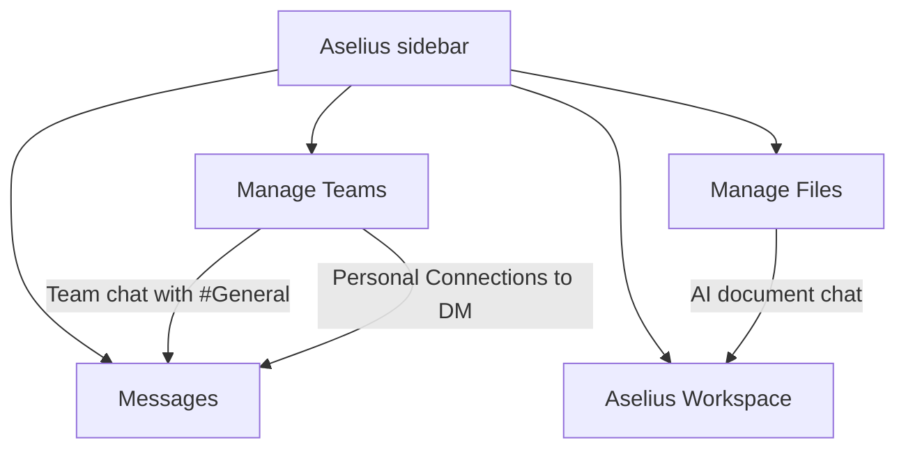
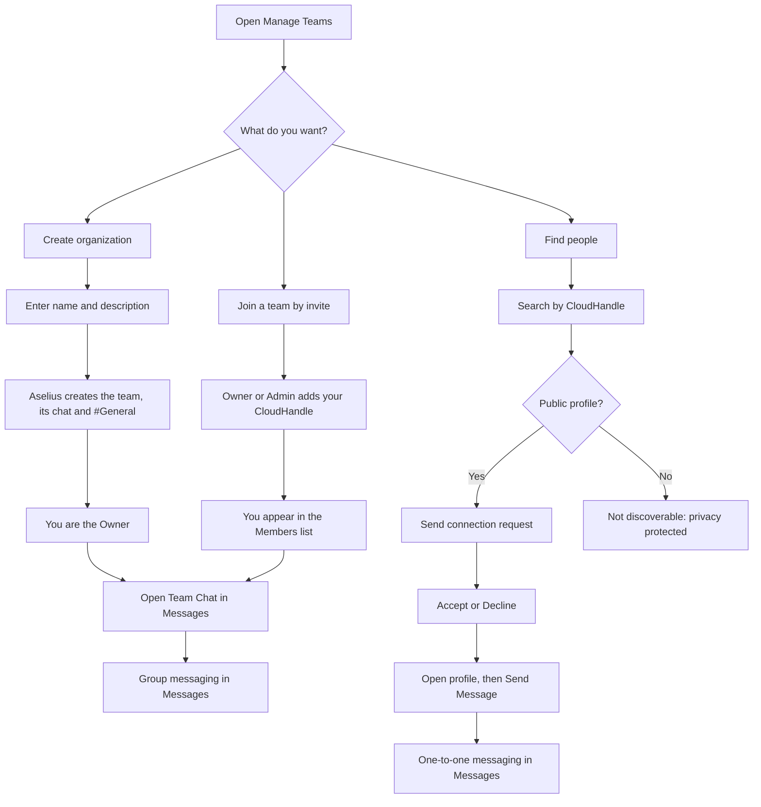

# Manage Teams and Personal Connections

Manage Teams is the people and organization layer of Aselius. Create teams with roles, get a team chat set up automatically, and build a personal network you can message one to one.

## At a glance
- **What it is:** Organizations (teams) with roles, plus Personal Connections outside any organization.
- **Best for:** Business users, team leads and owners, and IT and security reviewers.
- **You get:** Team membership and roles, a linked team chat with a #General channel, connection requests and direct messages.
- **Where:** Sidebar, then **Manage Teams**.
- **Cost:** Unlimited teams and connections on every plan.
- **AI:** None today. Manage Teams runs on standard application rules, not AI.

## What you can do

- **Create organizations (teams)** with defined roles and membership.
- **Message your team** in the Messages app. The team chat is linked automatically.
- **Build a personal network** outside any organization with Personal Connections.
- **Find colleagues** by CloudHandle and start one-to-one direct messages.

Aselius is not limited to people working with AI. Manage Teams supports structured communication between people and teams, under the same account and security model as your AI-assisted workspaces.

> **Note:** Manage Teams and Personal Connections are **not AI-powered** in the current release. They use membership rules, invitations, connection requests and real-time presence. AI on Aselius lives in other areas, such as **Aselius Workspace** and **Manage Files**. If AI comes to Teams, Beunec will say so in the release notes.

## Who it is for

| Audience | What you get |
|----------|----------------|
| **Business users** | Create teams, invite members, message colleagues, manage connections |
| **Team leads and owners** | Control membership, transfer ownership, delete organizations |
| **IT and security reviewers** | Industry-standard sign-in, role-based actions, flows that are easy to audit |

## Where it fits

| App | Handles |
|-----|---------|
| **Manage Teams** | People and organizations |
| **Messages** | Conversations: team chats and direct messages |
| **Manage Files** | Document storage and AI-assisted document work, with its own rules |

## Core concepts

### Organization (team)

An organization is a named group with:
- A **name** and **description**.
- **Members**, each with a role: **Owner**, **Admin** or **Member**.
- A linked **messaging group** with a default **#General** channel.

You never set up the chat space yourself. Aselius creates it when you create the team.

### Roles and permissions

| Role | What it can do |
|------|---------------------|
| **Owner** | Everything: edit team info, invite and remove members, change roles, **transfer ownership**, **delete organization** |
| **Admin** | Manage members and team settings. Cannot delete the organization or transfer ownership. |
| **Member** | Take part in team chat. Can invite others only if the team allows member invites. |

> **Note:** Only the **Owner** can delete an organization, and deletion is permanent. It removes the team, all memberships and the linked messaging group, including its channels and messages.

### Personal Connections

Personal Connections are on the same page as Manage Teams, but they are **separate from organizations**. With them you can:
- Find people by **CloudHandle**.
- Send and manage **connection requests**.
- View profiles and open **direct messages**.
- **Disconnect** when a working relationship ends.

Connections power one-to-one messaging. Team membership powers group messaging.

### CloudHandle

Your **CloudHandle** is your unique identity on Aselius (for example, `name@beunec.cloud`). You use it to:
- Invite someone to a team.
- Search for people to connect with.
- Send direct messages.

## How it works

### Teams and Messages stay in sync

1. Create an organization, for example "Acme".
2. Aselius creates the team, its messaging group and a **#General** channel.
3. Click **Message** on the team card, or **Open Team Chat** in team settings.
4. The team's group chat and channels open in Messages.

When an Owner or Admin adds someone to a team, Aselius also adds them to the team chat. No separate onboarding step is needed.

## Desktop and mobile

| Feature | Desktop (wide screens) | Mobile and tablet |
|---------|------------------------|-----------------|
| Team list | Full-width main area | Same, stacked layout |
| Team settings | **Right-side panel**, resizable, with the list still visible | **Full-page** team detail with back navigation |
| Connection profile | **Right-side panel** | **Modal dialog** |
| Going to Messages | Opens the group or DM in Messages | Same |

On desktop your team list stays in view while you work. Smaller screens get full-page views.

## Common tasks

| Task | Steps |
|------|--------|
| Create a team | Manage Teams, then **Create Team**, then name and description, then create |
| Invite a member | Open the team, then **Add member**, then CloudHandle and role, then Add |
| Message the team | Team card, then **Message**; or team settings, then **Open Team Chat** |
| Connect with someone | Personal Connections, then Discover, then CloudHandle, then **Send request** |
| Accept a request | Connection Requests, then **Accept** |
| Start a DM | Your Connections, then click the person, then **Send Message** |
| Delete a team (Owner only) | Trash icon on the team card, or team settings, then **Delete organization permanently** |
| Transfer ownership | Team settings, then Members, then the crown icon on the new owner, then confirm |

## Security and trust

| Control | What it means for you |
|---------|-------------|
| **Authentication** | Industry-standard sign-in through our identity provider. Every request must come from a signed-in account. |
| **Authorization** | Roles are checked on every sensitive action: invite, delete, transfer. |
| **Input hygiene** | Team names and descriptions are cleaned on our servers. |
| **Identity binding** | Every action is tied to your signed-in CloudHandle, never an anonymous session. |
| **Deletion scope** | When an Owner deletes an organization, its data and its linked team chat are removed. |

For message encryption and file storage, see the Messages documentation. For the full platform security model, see the [Security Disclosure](/aselius-platform/docs/security-disclosure).

## Limits

Manage Teams does not offer these in the current release. They are intentional product boundaries.
- AI-generated team recommendations, summaries or auto-invites.
- Automatic org chart inference.
- Built-in video calling. Use Messages for text and files, and an external tool for calls.
- A public people directory. To find someone you need their **CloudHandle**, and their profile must be **public**.
- Federation across organizations on other platforms, as some enterprise chat suites offer.

## How it fits Aselius

Tools such as Slack and Microsoft Teams are strong communication hubs. Aselius is **agentic infrastructure**: one place where people work with AI and with each other, under one account and security model. Manage Teams does **not** replace those tools. It is the organization and relationship layer inside Aselius, so that:
- Teams and connections are first-class.
- Messaging is built in.
- AI-assisted work in files and the workspace uses the same identity and storage.

**Product:** Aselius, by Beunec Technologies Inc. Manage Teams runs on standard application rules today. Future AI features will be announced in release notes.

## Related
- [Workspace](/aselius-platform/docs/workspace)
- [Messaging Channels](/aselius-platform/docs/messaging-channels)
- [Plans & Pricing](/aselius-platform/docs/plans-pricing)
- [Security Disclosure](/aselius-platform/docs/security-disclosure)
