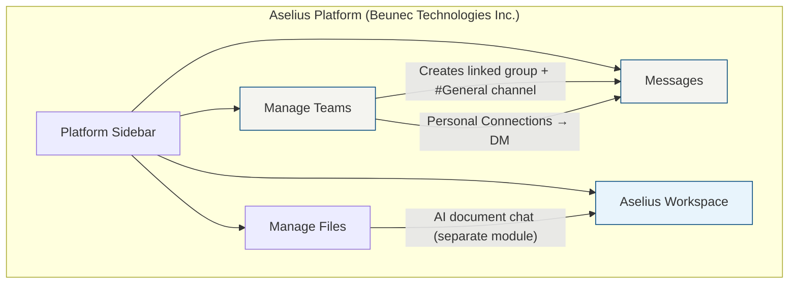
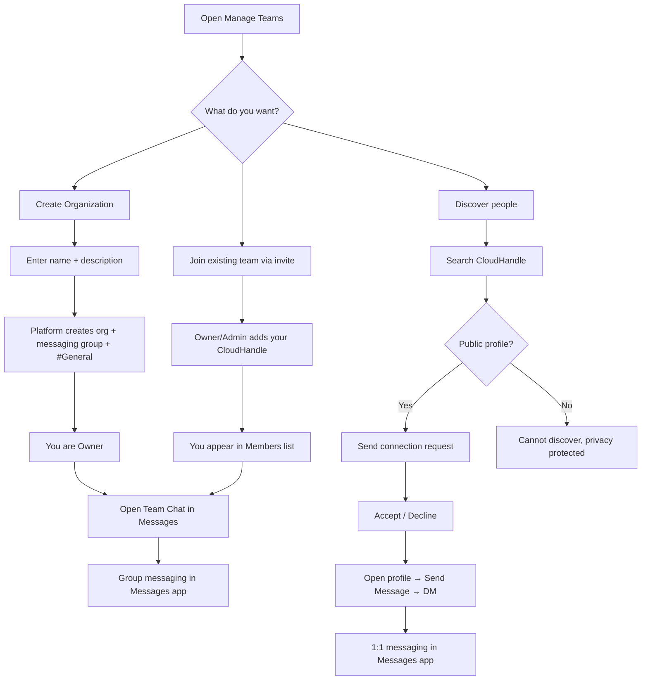
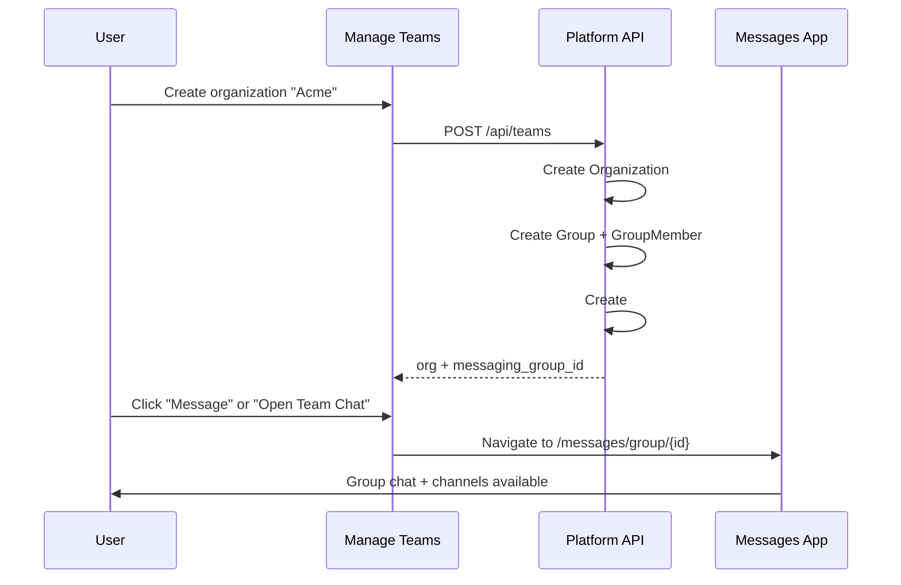

# Manage Teams & Personal Connections
  
**Version:** 1.0.0   
**Access:** Sidebar → **Manage Teams** (`/teams`)

---

## 1. Overview

**Manage Teams** is the organization and people layer of the Aselius Platform. It lets professionals and enterprises:

- Create **organizations (teams)** with defined roles and membership
- Open **team messaging** in the Messages app (linked automatically)
- Build a **personal network** outside any organization via **Personal Connections**
- Discover colleagues by **CloudHandle** and start **1:1 direct messages**

Manage Teams is designed for **human-to-human collaboration** inside a broader **agentic infrastructure platform**. Aselius is not limited to person-to-AI interaction; it also supports secure, structured communication between people, teams, and (separately) AI-assisted workspaces.

> **Transparency, AI today:**  
> Manage Teams and Personal Connections are **not AI-powered** in the current release. They use standard application logic: membership rules, invitations, connection requests, and real-time presence. AI capabilities on Aselius live in other areas (for example, **Aselius Workspace** and **Manage Files**). If AI is added to Teams in the future, Beunec will disclose it in product release notes.

---

## 2. Who this is for

| Audience | What you get |
|----------|----------------|
| **Business users** | Create teams, invite members, message colleagues, manage connections |
| **Team leads / owners** | Control membership, transfer ownership, delete organizations |
| **IT & security reviewers** | Auth0-backed access, role-based actions, audit-friendly flows |
| **Developers** | REST APIs under `/api/teams` and `/api/networks` with JWT authentication |

---

## 3. Platform context

**Manage Teams** focuses on **people and organizations**. **Messages** handles conversation. **Manage Files** handles document storage and AI-assisted document interaction, a different product surface with its own rules and parsing pipeline.

---

## 4. Core concepts

### 4.1 Organization (Team)

An **organization** is a named group with:

- **Name** and **description**
- **Members** with roles: **Owner**, **Admin**, or **Member**
- A linked **messaging group** with a default **#General** channel (created automatically)

When you create a team, you do not need to manually set up a chat space, the platform provisions one for you.

### 4.2 Roles and permissions

| Role | Typical capabilities |
|------|---------------------|
| **Owner** | Full control: edit team info, invite/remove members, change roles, **transfer ownership**, **delete organization** |
| **Admin** | Manage members and team settings; cannot delete the organization or transfer ownership |
| **Member** | Participate in team chat; may invite others only if the team allows member invites (server-side rule) |

Only the **owner** can permanently delete an organization. Deletion removes the team, all memberships, and the linked messaging group (including channels and messages).

### 4.3 Personal Connections

**Personal Connections** live on the same page as Manage Teams but are **separate from organizations**:

- Discover people by **CloudHandle**
- Send and manage **connection requests**
- View profiles and open **direct messages**
- **Disconnect** when a professional relationship ends

Connections are the social graph that powers 1:1 messaging; team membership is the organizational graph that powers group messaging.

### 4.4 CloudHandle

Your **CloudHandle** is your unique identity on the platform (for example, `name@beunec.cloud`). It is used to:

- Invite someone to a team
- Search for people to connect with
- Route direct messages

---

## 5. User journey (flowchart)

---

## 6. Desktop vs mobile experience

| Feature | Desktop (wide screens) | Mobile / tablet |
|---------|------------------------|-----------------|
| Team list | Full-width main area | Same, stacked layout |
| Team settings | **Right-side panel** (list stays visible); resizable | **Full-page** team detail with back navigation |
| Connection profile | **Right-side panel** | **Modal dialog** |
| Navigation to Messages | Opens group or DM in Messages | Same |

This pattern keeps context on desktop (you never lose sight of your team list) while remaining fully usable on smaller screens.

---

## 7. How Teams connects to Messages

**Member sync:** When an admin adds someone to a team, the platform also adds them to the linked messaging group so they can participate without a separate onboarding step.

---

## 8. Security and trust (high level)

Beunec does not publish internal key management or model architecture in public docs. What users and enterprises **can** rely on:

| Control | Description |
|---------|-------------|
| **Authentication** | Industry-standard identity via **Auth0**; API requests require a valid JWT |
| **Authorization** | Role checks on every sensitive action (invite, delete, transfer) |
| **Input hygiene** | Team names and descriptions are sanitized server-side |
| **Identity binding** | Actions are tied to your authenticated **CloudHandle**, not anonymous sessions |
| **Deletion scope** | Owner-initiated org delete removes org data and linked messaging artifacts |

For message content encryption and file storage details, see the **Messages** documentation. For the full platform security model, see the [Security Disclosure](/aselius-platform/docs/security-disclosure).

---

## 9. What Manage Teams does **not** do (today)

- No AI-generated team recommendations, summaries, or auto-invites  
- No automated org chart inference  
- No built-in video calling (use Messages for text/files; external tools for calls if needed)  
- No public people directory browse, discovery requires knowing a **CloudHandle** and the profile being **public**  
- No cross-tenant federation like some enterprise chat suites  

These are intentional product boundaries for the current release.

---

## 10. How this fits the Aselius philosophy

Traditional collaboration tools (Slack, Microsoft Teams, etc.) are excellent **communication hubs**. Aselius is built as **agentic infrastructure**: a place where humans work with AI *and* with each other, under one account and security model.

Manage Teams is **not positioned as a replacement** for those tools. It is the **organizational and relationship layer** inside Aselius so that:

- Teams and connections are first-class
- Messaging is native, not bolted on
- AI-assisted work (files, workspace) shares the same identity and storage context

---

## 11. Quick reference, common tasks

| Task | Steps |
|------|--------|
| Create a team | Manage Teams → **Create Team** → name + description → create |
| Invite a member | Open team → **Add member** → CloudHandle → role → Add |
| Message the team | Team card → **Message** or team settings → **Open Team Chat** |
| Connect with someone | Personal Connections → Discover → CloudHandle → **Send request** |
| Accept a request | Connection Requests → **Accept** |
| Start a DM | Your Connections → click person → **Send Message** |
| Delete a team (owner only) | Team card trash icon or team settings → **Delete organization permanently** |
| Transfer ownership | Team settings → Members → crown icon on target member → confirm |

---

## 12. Support and disclosure

- **Product:** Aselius Platform  
- **Company:** Beunec Technologies Inc.  
- **AI disclosure:** Manage Teams is rule-based software today. Future AI features will be announced in release notes.  
- **Proprietary systems:** Internal parsing engines, model providers, and infrastructure topology are not disclosed in public documentation.
