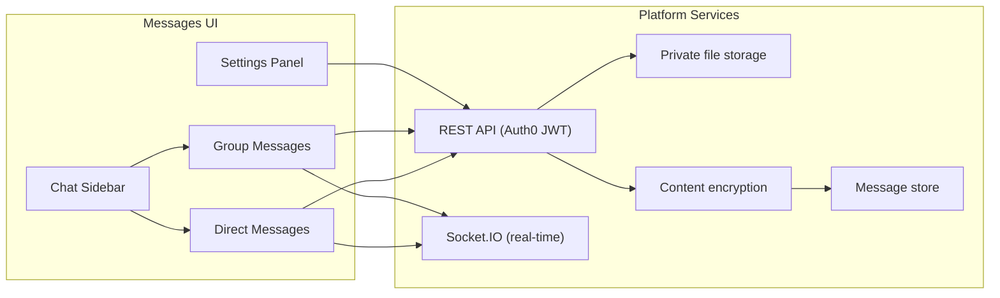
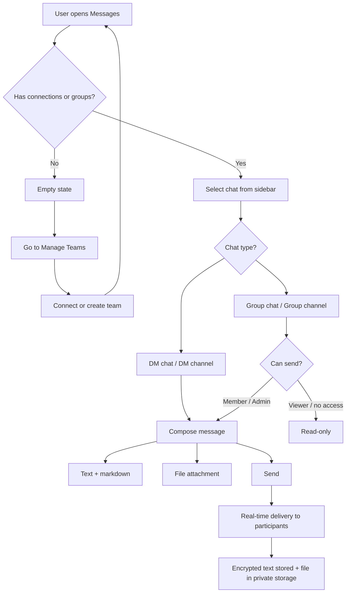
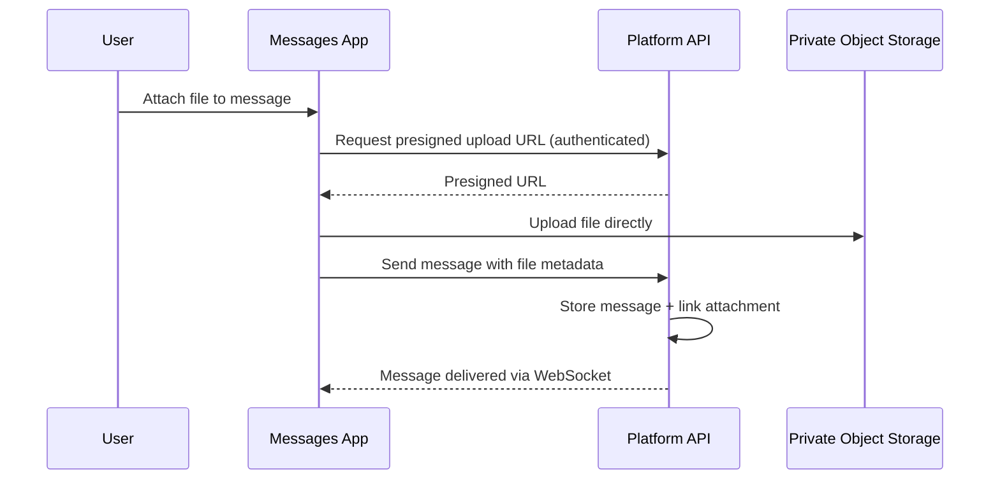
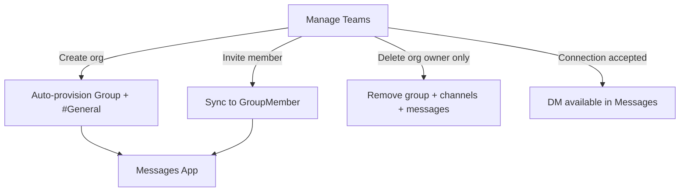

# Messages - Direct & Group Messaging
  
**Version:** 1.0.0
**Access:** Sidebar → **Messages** (`/messages`)

---

## 1. Overview

**Messages** is the secure communication hub of the Aselius Platform. It supports:

- **Direct messages (DMs)**: 1:1 conversations with connections  
- **Group messages**: team and project conversations with **channels**  
- **Rich text**: formatting, mentions, emoji, replies  
- **File sharing**: attachments stored in private object storage  
- **Real-time delivery**: live updates via WebSocket  

Messages is optimized for **professional collaboration**: structured chats, permission-aware groups, and integration with **Manage Teams** so organizations get messaging automatically.

> **Transparency, AI today:**  
> The **Messages** module is **not AI-powered** in the current release. Sending, receiving, searching, pinning, forwarding, and file attachment are deterministic application features. **AI-assisted document understanding** is available in **Manage Files** and **Aselius Workspace**, not inside the chat composer. Beunec will disclose if generative or summarization features are added to Messages in the future.

---

## 2. Who this is for

| Audience | What you get |
|----------|----------------|
| **Daily users** | DMs, team channels, files, mentions, pins |
| **Team admins** | Channels, member roles, permissions, moderation actions |
| **Security reviewers** | Encrypted message content, Auth0 JWT, private file URLs |
| **Developers** | REST + Socket.IO APIs documented at integration level |

---

## 3. Architecture at a glance

---

## 4. Conversation types

### 4.1 Direct messages (DM)

| Type | Description |
|------|-------------|
| **DM chat** | Main 1:1 thread with a connection |
| **DM channels** | Optional sub-channels within a DM pair (e.g. topics); creator can manage them |

**Requirement:** You must be **connected** with the other person (via Manage Teams → Personal Connections) before messaging.

**Route example:** `/messages/dm/{cloudhandle}`

### 4.2 Group messages

| Type | Description |
|------|-------------|
| **Group chat** | Main “General” stream for the group |
| **Group channels** | Named channels (e.g. #General, project-specific channels) |

**Sources of groups:**

1. **Auto-created** when you create an organization in Manage Teams  
2. **Manually created** from the Messages sidebar (standalone groups)

**Route examples:**

- `/messages/group/{groupId}` - group chat  
- `/messages/group/{groupId}/channel/{channelId}` - specific channel  

### 4.3 Threads (legacy)

Group **threads** have been **retired** in favor of **channels**. Some older UI labels may still reference threads; new work should use channels. Backend thread endpoints return “removed” responses.

---

## 5. End-to-end user flow

---

## 6. Messaging features (current release)

### 6.1 Composition and content

| Feature | Supported |
|---------|-----------|
| Rich text / markdown | Yes |
| @mentions | Yes (DM contact or group participants) |
| Emoji reactions | Yes |
| Reply to message | Yes |
| Edit message | Yes |
| Forward message | Yes (to connections via new DM) |
| Pin message | Yes |
| Pin conversation (sidebar) | Yes |
| In-chat search | Yes (minimum 2 characters) |
| Read receipts | Yes (DM) |
| Copy message | Yes |

### 6.2 Group administration

| Feature | Who |
|---------|-----|
| Create / rename / delete channels | Admins (policies may vary by channel) |
| Add / remove members | Group admins |
| Per-channel permissions | Admin / Member / Viewer / No access |
| Group settings | Dialog (mobile) or **right panel** (desktop) |
| Exit group | Members |
| Delete group | Admins |

### 6.3 Media & files gallery

From chat **Settings → Media**, you can browse shared **media** (images/videos) and **documents** shared in that conversation.

---

## 7. File sharing in Messages

### 7.1 How it works

Files are **not embedded in the message database as blobs**. They live in **private object storage** (AWS S3, AES-256 encrypted, bucket-key enabled); downloads use **time-limited presigned URLs** regenerated on each request. 

**Storage infrastructure note:** As of August 2026, message attachments are stored in the `aselius-platform-messaging-prod` bucket (region us-east-2), a dedicated secure bucket with bucket-versioning and lifecycle rules. Older attachments uploaded before this date to a legacy bucket are no longer accessible (that credential was not valid and cannot be recovered). New uploads go to the production bucket with full encryption and access controls.

### 7.2 Limits and types (Messages)

| Rule | Value |
|------|--------|
| Max file size (client guard) | **100 MB per file** |
| File type filter in chat | **Broad** most file types can be attached |
| Upload rate limit | Server-side throttling applies |
| Storage quota | Enforced per account plan (total / files / messages buckets) |

**Rendering in chat:**

- **Images / video**: inline preview where supported  
- **PDF, Office, text**: icon + download / preview  
- **Other types**: generic file card with download  

### 7.3 Messages vs Manage Files (important distinction)

| | **Messages attachments** | **Manage Files** |
|--|--------------------------|------------------|
| **Purpose** | Share files in conversation | Store, organize, preview, share libraries |
| **AI parsing / chat** | **No** (today) | **Yes** AI chat over documents |
| **Allowed types** | Permissive for collaboration | **Curated allow-list** + security blocks (no executables, etc.) |
| **Markdown pipeline** | Display only | Upload, conversion, compression metadata, AI Q&A |

If you need **AI to read, summarize, or answer questions about documents**, use **Manage Files**. Messages is for **timely exchange**; Manage Files is for **document intelligence**.

Beunec does not publish internal parsing algorithms, model names, or conversion pipelines in public documentation. We disclose **what** the feature does for users and **why** files are validated, not **how** proprietary engines are implemented.

---

## 8. Security and privacy (high level)

| Layer | Approach |
|-------|----------|
| **Authentication** | Auth0 JWT on all API calls |
| **WebSocket** | Token validated on connection; identity mapped to CloudHandle |
| **Message text** | Encrypted at rest (**AES-256-GCM**) before database storage |
| **File attachments** | Private storage; access via authenticated presigned URLs |
| **Membership** | Group file and message APIs require group membership |
| **Input validation** | Server-side sanitization of message text and metadata |
| **Rate limiting** | API and upload throttles to reduce abuse |

**Mute notifications** is currently a **client-side preference** (browser storage), not a server policy.

For the full platform security model, encryption posture, and vulnerability reporting, see the [Security Disclosure](/aselius-platform/docs/security-disclosure).

---

## 9. Real-time behavior

Messages uses **Socket.IO** for live updates:

- New messages appear without full page refresh  
- Edits, reactions, and pin changes propagate to open chats  
- DM read receipts sync when participants view messages  
- Connection presence (online / away / offline) updates connection cards in Manage Teams  

For scale, the platform can use a **Redis adapter** for multi-instance WebSocket coordination (operations detail not disclosed publicly).

---

## 10. Desktop vs mobile - Settings

| Surface | Desktop | Mobile |
|---------|---------|--------|
| DM settings | **Right panel** (chat stays visible) | **Full-screen dialog** |
| Group settings | **Right panel**, resizable | **Full-screen dialog** |
| Panel width | User-adjustable; preference saved locally | N/A |

Settings tabs include **About**, **Media**, **Members** (groups), **Permissions** (groups), and **Channels** (DMs).

---

## 11. Integration with Manage Teams

**Empty Messages state** directs users to **Manage Teams** to connect or create a team, reflecting that relationships and organizations are prerequisites for a full messaging experience.

---

## 12. Plans and fair use

Storage and history may vary by subscription tier. Examples from platform defaults:

| Plan | Total storage | Files bucket | Messages bucket |
|------|-----------------|--------------|-----------------|
| Free | 10 GB | 8 GB | 1 GB |
| Pro | 100 GB | 80 GB | 20 GB |
| Enterprise | 500 GB | 400 GB | 100 GB |

Non-Pro DM history may be limited (e.g. recent message window) for performance and plan enforcement. Check in-product notices for your account.

---

## 13. What Messages does **not** do (today)

- No AI reply suggestions, summarization, or translation in chat  
- No built-in voice/video calls  
- No email bridge or external federation (Slack Connect, etc.)  
- No E2E encryption where even the server cannot decrypt (server encrypts at rest with platform keys)  
- No AI parsing of attachments inside the chat thread  

---

## 14. Positioning: Aselius vs traditional chat apps

| Dimension | Typical chat apps (Slack, Teams, …) | Aselius Messages |
|-----------|-----------------------------------|------------------|
| Primary identity | Workspace / tenant | **CloudHandle** on unified platform |
| AI location | Increasingly in-chat | **Separated**: Workspace + Manage Files for AI; Messages for human dialogue |
| Org + chat | Often integrated | **Manage Teams** provisions messaging automatically |
| Agentic platform | Usually not core | Aselius treats **human ↔ human** and **human ↔ AI** as co-equal surfaces |

Aselius is **not claiming to be “better Slack.”** It is an **infrastructure platform** where secure messaging is a native pillar, not an afterthought, and where AI is applied deliberately where document and research workflows need it.

---

## 15. Quick reference, common tasks

| Task | How |
|------|-----|
| Start a DM | Manage Teams → connect → Messages → select person |
| Open team chat | Manage Teams → **Message** on team card |
| Create a channel | Group → sidebar → add channel |
| Attach a file | Composer → attach → send |
| Pin a message | Message menu → Pin |
| Forward | Message menu → Forward → pick connection |
| Mute notifications | DM settings → toggle (local preference) |
| Browse shared files | Chat settings → **Media** tab |
| AI questions on a PDF | Upload to **Manage Files** → use AI chat panel there |

---

## 16. Support and disclosure

- **Product:** Aselius Platform, Messages module  
- **Company:** Beunec Technologies Inc.  
- **Encryption:** Message body encrypted at rest; attachment security via private storage and authenticated access  
- **AI:** Not used in Messages today; see Manage Files / Aselius Workspace for AI features  
- **Proprietary:** Model selection, parsing engines, and internal routing are confidential   
