# Aselius Workspace

**Part of the Aselius Platform · Created by Beunec Technologies Inc.**

**Version:** 1.0.0   

Aselius Workspace is where researchers, engineers, founders, and startup teams run real-world tasks: research, drafting, coding prototypes, creative assets, and governed collaboration, with outputs you can preview, edit, download, and share. It is built for software engineering teams, research organizations, consulting firms, startup teams, university post-graduates who need production-grade deliverables, not just chat agent replies.

Access it from the **Aselius Platform sidebar** under **Workspace**.

## What Workspace Is

Workspace is not a single chat box. It is an **agentic task environment** built around:

| Area               | What it does                                                            |
| ------------------ | ----------------------------------------------------------------------- |
| **Taskspace**      | Your primary work surface, conversation, attachments, engines, previews |
| **Governance**     | Workspace-level AI behavior and content rules                           |
| **Connector**      | Secure OAuth connections to external apps                               |
| **Credits**        | Prepaid balance for agentic engine usage                                |
| **Shared with me** | Accept invitations and open workspaces shared with you                  |

At the center is **Taskspace** (internally `ChatSpace`): one conversation thread per task, combining a **conversation area** on the left, your prompts, agent responses, and clickable snapshots of completed work, with a **right-side Preview Panel** for assets, attachments, sandbox iframe, documents, and HTML.

## High-Level Architecture

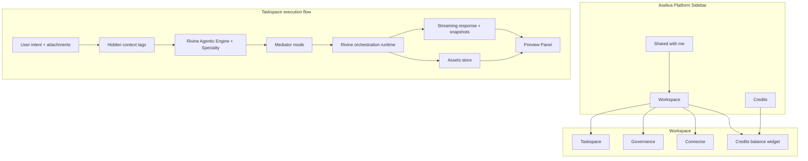

**How to read this:** You work in Taskspace. Your message is enriched with hidden context (date, engine choice, agent notes, attachments). The **Rivine** orchestration runtime routes and executes the task. Deliverables land in **Assets** and as **snapshots** in the conversation. The **Preview Panel** lets you inspect and edit without leaving the browser.

### Quick summary: how a turn works

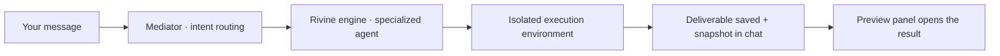

You can **pin an engine** from the Space UI (skip automatic routing) or let the Mediator choose. You can also set a **specialty** (e.g. PDF vs spreadsheet for Research, or a legal domain for Cicero) to steer output without re-explaining context every turn.

## 1. Taskspace

Taskspace is where tasks are **executed, previewed, and continued** over time.

### What you can do

- Send natural-language requests to Rivine agentic engines
- Attach files, paste text, parse URLs, capture screenshots
- Pick an engine and **specialty** (sub-mode) for the kind of work you need
- Use **Agent Notes** to jump directly to a pre-configured engine + specialty
- Stream AI responses in real time, including tool progress whenever the engine uses external data or sandbox actions
- Open deliverables from **snapshot cards** in the conversation
- Approve or reject high-risk actions via **Human-in-the-Loop (HITL)** when the engine pauses for your decision
- Search across messages, taskspaces, assets, and workspaces from the workspace header

### Conversation layout (accessibility)

Older messages use **flip cards** to reduce visual clutter:

- **Your previous requests** collapse to *"Click to view your request"*
- **Older AI responses** (beyond the latest two) collapse similarly until you expand them
- Attachment and file snapshots stay visible as tappable cards on expanded messages

This flip-card behavior applies to both sides of the exchange, your original prompt and the AI response, so you can review long agent output without losing your original ask.

### Snapshots

When an engine finishes meaningful work, a **snapshot card** appears in the conversation. Click it to open the deliverable in the Preview Panel.

| Output type                           | Snapshot behavior                                    |
| ------------------------------------- | ---------------------------------------------------- |
| Markdown document                     | Opens in the built-in editor (rendered + editable)   |
| HTML report / deck                    | Renders in the HTML preview; export when available   |
| Image / video (Creative, coming soon) | Opens media preview from stored asset URL            |
| Code (Rivine Code)                    | Opens sandbox preview, see Rivine Code section below |

### Roles and permissions

| Role         | Typical access                                 |
| ------------ | ---------------------------------------------- |
| **Owner**    | Full control, share, transfer ownership        |
| **Operator** | Edit governance, share, manage taskspaces      |
| **Member**   | Create and use taskspaces                      |
| **Guest**    | View-only, cannot edit documents or governance |

## 2. Rivine Agentic Engines

Rivine is Beunec's **proprietary agentic orchestration runtime**. Each Rivine engine is a **runtime construct**, orchestrator, tools, verification, and sandbox policy, not a single generic model call. The runtime handles planning, routing, tool use, verification, and delivery; language models operate inside that harness.

We do **not** disclose specific third-party model IDs, routing tables, or internal parsing strategies. What matters for users: engines are **specialized**, **governed**, and produce **inspectable outputs**.

### Available engines (today)

| Engine               | Best for                                                                                            | Deliverable                                                     | Minimum credits to select |
| -------------------- | --------------------------------------------------------------------------------------------------- | --------------------------------------------------------------- | ------------------------- |
| **Auto**             | Platform routes to the best engine                                                                  | -                                                               | None                      |
| **Rivine TaskForce** | Action-oriented professional work: connected apps, diagrams, interactive docs, verified computation | Markdown, inline HTML, diagrams, spreadsheets, computed results | $2.00                     |
| **Rivine Research**  | Source-grounded, high-reliability research across domains                                           | Markdown → PDF or spreadsheet HTML                              | $10.00                    |
| **Rivine Code**      | Software engineering, debugging, security review, working delivered projects                        | Sandbox code + live preview                                     | $20.00                    |
| **Rivine Cicero**    | Legal drafting, review, and policy work                                                             | Markdown legal memo                                             | $5.00                     |
| **Rivine Creative**  | Interactive image, video, and audio creation/editing                                                | PNG / video / audio media                                       | **Coming soon**           |
| **Rivine FIDA**      | Financial research and quantitative analysis                                                        | Not available yet                                               | **Coming soon**           |

> **Not available yet:** Rivine Creative, Rivine FIDA, Rivine Agentic Engines as an API, and several connector/import integrations (see below).

### What each engine actually does

**Rivine TaskForce** is Aselius's action-oriented workspace engine, not generative chat. It turns your intent into professional work: grounded answers plus real outputs you can open in Preview. It uses connected apps (email, calendars, databases, MCP tools) and native specialties (Excalidraw, Mermaid, HTML STEM, HTML 3D, YouTube learning packs, sandboxed Code Execution) to produce diagrams, interactive documents, videos, and verified computations, then saves them as workspace assets. In short: "do the work in the workspace": advise critically, act through connected tools, and deliver production-ready artifacts.

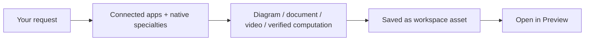

**Rivine Research** is Aselius's source-grounded research engine for high-reliability, multi-domain work. It doesn't free-summarize; it ingests uploaded documents and grounded sources first, then runs a sequenced pipeline (extract → validate → cross-check → synthesize → audit) so claims stay tied to evidence, conflicts stay visible, and gaps escalate instead of being invented. Specialties like PDF and Spreadsheet turn that into durable research Markdown or verified workbooks via a bounded sandbox, industry-adaptable research you can trust and hand off.

**Rivine Cicero** is the legal and policy workbench for real-world drafting and review with use-case expertise (contract review, legal drafting, immigration, corporate, employment, international relations, policy drafting). It runs jurisdiction-first, evidence-linked workflows with conservative language: confirm governing law and facts, spot issues, draft or memo, then escalate high-risk or unclear matters to human/licensed review. It's research-and-draft support under guardrails, not a substitute for a licensed attorney or international relations diplomat.

**Rivine Code** is the build-first software engineering engine: programming, debugging, security guardrails, and delivery of working projects, not plans or command lists. Through Rivine Notes (Next.js, Python, hybrid stacks, HTML/CSS/JS, Vue, mobile, backends, databases, and more) it implements in real files, installs/runs when possible, verifies the result, and keeps changes surgical and reversible, with live preview/sandbox where available and downloadable projects otherwise.

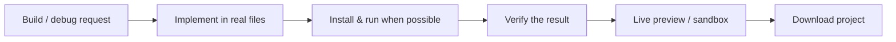

**Rivine Creative** *(coming soon)* will be Aselius's engine for interactive image, video, and audio creation and editing, generating and refining visual and media deliverables directly in the workspace. It is not yet available; select **Auto** or another engine in the meantime.

> Rivine, Rivine TaskForce, Rivine Research, Rivine Cicero, Rivine Code, and Rivine Creative are **closed-source, proprietary Beunec technology**. What we disclose here is *what each engine does and produces*, not how it works internally. Workspace is where you use them, not where their internals are exposed.

### Which engine should I pick?

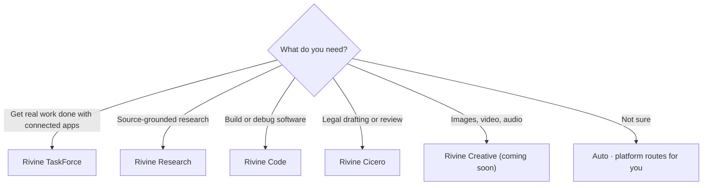

### Specialty selections

Most engines require a **specialty** before you send a message. Specialties activate a focused sub-agent mode with its own operating instructions.

| Engine                          | Specialties                                                                                                                       |
| ------------------------------- | --------------------------------------------------------------------------------------------------------------------------------- |
| Rivine TaskForce                | Chat, Excalidraw, Mermaid, HTML STEM, HTML 3D, YouTube learning packs, Code Execution                                             |
| Rivine Research                 | PDF, Spreadsheet                                                                                                                  |
| Rivine Code                     | Next.js, Python, Next.js + Python (hybrid), HTML/CSS/JS, Vue, Svelte, Flutter, Swift, Kotlin, Node.js, Go, Java, Rust, C#/.NET, PHP, Ruby, SQL Database, MongoDB, Redis, GraphQL, Next.js + FastAPI + PostgreSQL, React + Node.js + MongoDB, Vue + Django + PostgreSQL, Next.js + Supabase, React + Firebase, and any other language or stack |
| Rivine Cicero                   | Contract Review, Legal Drafting, Immigration Law, International Relations, Corporate Law, Employment Law, Policy and Law Drafting |
| Rivine Creative *(coming soon)* | Image Generation, Image Editing, Video Generation, Video Editing, Audio Generation                                                |

If a specialty is required and not selected, send is blocked until you choose one. Set specialty in the Space UI or describe it in your prompt, the Mediator can also infer it from context.

### Grounded data (when enabled)

For TaskForce, Research, and Cicero (and Creative once available), you can enable **grounded sources**, finance, health literature, SEC filings, maps, web search, and more. Agents are instructed to **cite sources** rather than rely on memory alone. Source toggles are per-workspace; disabled sources are never called.

### Agent Notes

**Agent Notes** are pre-written harness instructions for each specialty, they tell the runtime *how* to execute (evidence rules, escalation triggers, output shape), not just *what* to answer.

- In **Auto** mode, Agent Notes list every specialty across engines; picking one auto-selects the matching engine + specialty.
- On send, the selected note is injected invisibly into your message (you do not see it in the chat bubble).
- Notes enforce behaviors like: cite sources, never invent spreadsheet cells, escalate legal risk to HITL, block unsafe creative requests, etc.

Separately, **Agent Notes** can also surface *after* a run as transparency metadata in the conversation: the routing decision, which engine handled the task, verification or escalation flags, and citation summaries. This is not a separate agent, it exists to help you audit *what happened*, not to replace the deliverable.

### How engine execution works (simplified)

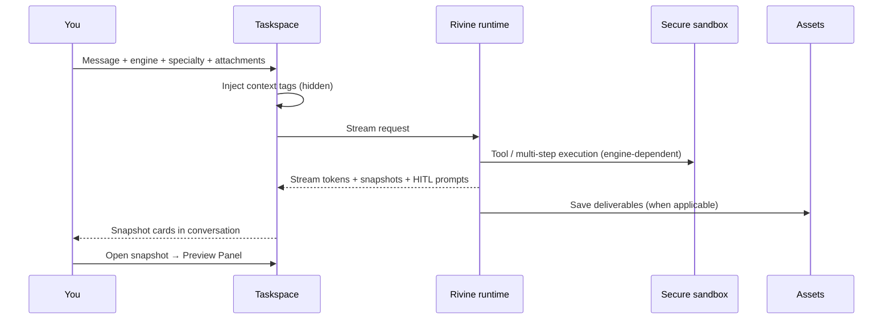

**Rivine Code** is designed as an **autonomous coding runtime** build, debug, audit, and preview software without opening a local IDE. For non-technical users, that means seeing a working preview in the browser. For engineers, it means a quick prototype you can download and carry into production tooling.

**Current behavior in Workspace (transparent):**

- Engine outputs appear as **snapshots** in the conversation (markdown, HTML blocks, generated images).
- **Markdown and HTML** open in the Preview Panel (editable document editor or HTML live preview).
- **All deliverables** are saved to **Assets**.
- **Rivine Code project file trees** run in an isolated sandbox with preview capability; the working project tree is **persisted to Assets** as a code project asset on completed turns (dependency/build folders and binaries excluded), so it survives past the live sandbox session, not only as a snapshot in the conversation.
- The **HTML tab** provides a sandboxed iframe preview for HTML content (code editor + live render).

### Human-in-the-Loop (HITL)

When the runtime hits verification limits, low confidence, or high-risk actions, it can pause and show an **approval request** in Taskspace. You can approve or reject before execution continues. This is especially relevant for legal, security, and data-sensitive workflows.

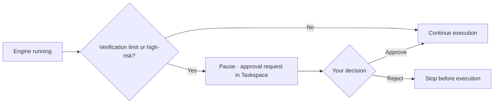

## 3. Mediator Modes

Mediators shape **how your intent is interpreted** before routing.

| Mode        | Purpose                                             | When to use                                                                  | Plan availability |
| ----------- | --------------------------------------------------- | ---------------------------------------------------------------------------- | ----------------- |
| **Alpha**   | Optimizes intent for global regulatory compliance   | Fast routing; good for clear, single-intent requests                         | All plans         |
| **Bravo**   | Applies the Agentic Annotation Protocol             | Default; more careful intent analysis before routing                         | Pro, Essential    |
| **Charlie** | Optimizes intent and awaits approval before routing | Revision pass, useful when routing confidence is low or context is ambiguous | Essential         |

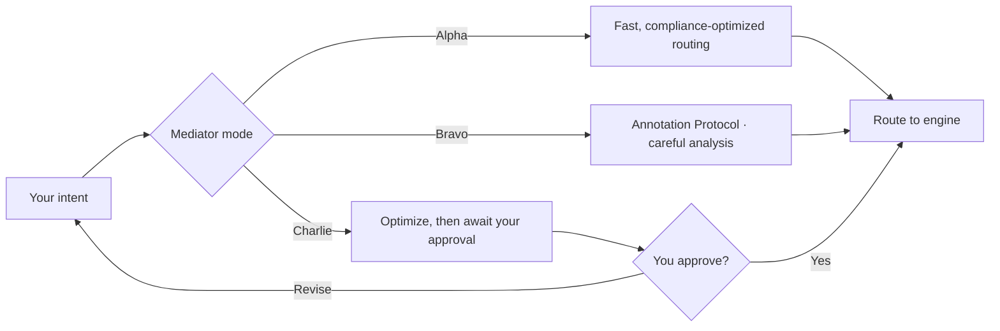

> **Transparency note:** Mediator selection is available in the Taskspace UI and gated by subscription plan. Full end-to-end wiring from UI selection into every stream request should be verified against your deployment; the frontend currently stores mediator choice in the interface while the primary stream payload focuses on message, attachments, sources, and file context.

If you **select an engine explicitly** in the Space, routing can skip the Mediator entirely and go straight to that engine.

## 4. Preview Panel (right side)

The Preview Panel is your **inspect-and-edit surface** without leaving Workspace.

### Tabs

| Tab             | Purpose                                                                 |
| --------------- | ----------------------------------------------------------------------- |
| **Assets**      | All taskspace files, filter by user vs AI, type, download, delete, open |
| **Attachments** | Pending items before you send a message                                 |
| **Preview**     | Markdown documents, images, plain text                                  |
| **HTML**        | HTML code editor + sandboxed live preview                               |
| **Share**       | Share workflow (when opened from share actions)                         |

### Markdown documents

- Rendered and **editable** in the built-in document editor
- Table of contents in fullscreen
- Word count
- **Export:** Markdown, PDF (print), DOCX
- **Save** updates the asset (guests: read-only)
- Follow-up prompts can request **surgical revisions** (targeted patches) instead of full regeneration, you don't need to ask the engine to redo the whole document to fix one section

### HTML

- Split view: code editor + **sandboxed iframe preview**
- **Export:** HTML file, PDF (print)
- AI responses that include HTML code blocks appear as **HTML snapshots** in the conversation, click to open the HTML tab
- Research PDF-style reports and spreadsheet layouts preview as **self-contained HTML**, suitable for review, print, or export workflows supported by your plan

### Panel behavior

- Resizable on desktop (width remembered)
- Full-screen sheet on mobile
- Optional fullscreen mode for focused editing

## 5. Assets

Assets are the **durable output library** for each Taskspace.

| Property          | Details                                                                                                        |
| ----------------- | -------------------------------------------------------------------------------------------------------------- |
| **Types**         | Document, code, image, data, other                                                                             |
| **Creator**       | User or AI                                                                                                     |
| **Typical flow**  | Upload/parse → markdown asset, or AI generates → saved asset                                                   |
| **In AI context** | Taskspace assets are included as `current_file_context` on each message so engines stay grounded in your files |

**By source**

| Source  | Examples                                                                                   |
| ------- | ------------------------------------------------------------------------------------------ |
| **You** | Uploads (documents, images, references)                                                    |
| **AI**  | Generated markdown, HTML, media from TaskForce, Research, Cicero (Creative once available) |

Assets are **versioned**. AI-created assets are tagged with engine metadata and citations where applicable.

**Snapshots vs Assets**

- **Snapshots** in chat are quick-open cards tied to message content (pasted text, file references, HTML blocks, images).
- **Assets** are persisted files you manage in the Assets tab.

Rivine Code's sandbox project tree is persisted to Assets as a **code project asset** on completed turns, in addition to its snapshot/preview in the conversation.

## 6. Attachments & file parsing

### Supported upload types

Uploaded files are converted to a **markdown-first** representation for AI grounding (exact parser engines are proprietary).

| Category      | Extensions                                                                                                                                     |
| ------------- | ---------------------------------------------------------------------------------------------------------------------------------------------- |
| **Images**    | jpg, jpeg, png, gif, bmp, svg, webp                                                                                                            |
| **Documents** | pdf, docx, xlsx, pptx, csv, txt, rtf, md                                                                                                       |
| **Audio**     | mp3, wav, m4a, flac, ogg, mpeg                                                                                                                 |
| **Video**     | mp4, mov, avi, mkv, webm, mpeg                                                                                                                 |
| **Code**      | py, js, jsx, ts, tsx, html, css, json, xml, sql, java, tex, vue, svelte, go, rs, rb, php, c, cpp, h, cs, swift, kt, yaml, yml, scss, less, mdx |

### Limits

| Limit                      | Value                                |
| -------------------------- | ------------------------------------ |
| Max file size              | 200 MB                               |
| Max files per message      | 10                                   |
| Max files per batch upload | 10                                   |
| Daily uploads              | 3 (Base) / 10 (Pro) / 20 (Essential) |

### Not supported

- Archives (.zip, .rar, etc.)
- Executables and other blocked extensions for security

### Import methods

| Method                                   | Status                      |
| ---------------------------------------- | --------------------------- |
| File upload                              | Available                   |
| Paste text                               | Available (no server parse) |
| Paste / clipboard image                  | Available                   |
| Web page or YouTube URL parse            | Available                   |
| Screenshot capture                       | Available                   |
| Import from Manage Files                 | Available                   |
| Google Drive / OneDrive / Dropbox attach | **Coming soon**             |

### What is AI-powered here

- **Parsing** runs on Beunec's server-side pipeline (not a chat completion you type into).
- Parsed content becomes markdown assets the engines can reason over.

## 7. Hidden context injection (agentic awareness)

To activate the full Rivine harness without cluttering your chat, Workspace injects structured tags into outbound messages. These are **hidden from the visible conversation** but used by the runtime for classification, routing, and output quality.

| Tag                  | Purpose                                                                       |
| -------------------- | ----------------------------------------------------------------------------- |
| `<context_identity>` | Your local date, time, timezone, and location (if browser permission granted) |
| `<agentic_engine>`   | Explicit engine override when not using Auto                                  |
| `<user_propritize>`  | Specialty / sub-agent mode selection                                          |
| `<agent_note>`       | Full specialty harness instructions                                           |
| `<pasted_text>`      | Pasted content attachments                                                    |
| `<file_attachment>`  | References to parsed asset files                                              |
| Language hint        | Response language preference (non-English)                                    |

This is how Workspace gives agents **situational awareness** (when/where you are working) and **execution discipline** (which engine, which specialty, which rules) without you managing prompts manually.

## 8. Governance

**Route:** Workspace → **Governance** tab  
**AI-powered?** The page itself is configuration UI. Saved rules **inform** AI behavior on the backend, it is not a chat feature.

### What you configure

**System instructions**

- Primary role
- Specified industry
- Behavioral guidelines
- Response format

**Content restrictions**

- Prohibited topics
- Content filters

**Who can edit:** Owners and Operators. Guests see read-only fields.

## 9. Connector

**Route:** Workspace → **Connector** (dedicated page)  
**AI-powered?** No, this is **credential and permission management** so engines can access external systems when authorized.

Connections come in two kinds: native **RCP** (Rivine Context Protocol) apps managed directly on the Connector page, and **MCP** (Model Context Protocol) apps available to Rivine TaskForce for broader professional/enterprise workflows.

### RCP: native app connections (Connectable today)

| App                     | Access                     |
| ----------------------- | -------------------------- |
| Google (Gmail/Calendar) | Mail/calendar read & send  |
| Microsoft 365           | Mail/calendar              |
| Supabase                | Read/edit                  |
| Firebase                | Read/edit                  |
| MongoDB                 | Read/edit                  |
| Stripe                  | Read balances/transactions |
| GitHub                  | Read repositories          |

### MCP: app connections available to Rivine TaskForce

Rivine TaskForce can reach a much larger catalog of professional and enterprise apps through MCP: Slack, Excalidraw, Google Drive, v0, Notion, Asana, Docusign, Supermetrics, Zoom, Linear, monday.com, Intercom, Miro, Box, Airtable, Zapier, Trello, Sentry, ZoomInfo, Gamma, Calendly, ClickUp, Global Database, Shopify, Adobe, Cloudflare, Tableau Cloud, Spotify, Dropbox, Mixpanel, Ramp, PostHog, PlanetScale, ClickHouse, Amplitude, CoCounsel Legal, Midpage Legal Research, Legal Data Hunter, Definely, Harvey, Salesloft, Lucid, Figma, and Vercel.

### Not yet implemented (RCP Connector page)

- Dropbox
- Box

**Connect Apps toggles** in the Taskspace input area list additional sources (web, maps, health, etc.) but are currently **disabled** in the UI, connecting apps is done through the Connector page first.

## 10. Credits

**Route:** `/credits` (linked from the balance widget in Workspace header)  
**AI-powered?** No, this is **prepaid usage billing**.

- Credits are consumed when you run agentic engines (usage-based after free monthly allocation).
- Each Rivine engine has a **minimum balance** required to select it (see engine table above).
- Low balance is highlighted when under $5.00.
- Credits can be shared via CloudHandle (per plan features).
- Pay-per-token usage is metered per call at the runtime level (see "Under the hood" below).
- A **Rivine Infrastructure fee of 20%** is applied on top of underlying usage cost before it is debited from your credits, this covers orchestration, sandboxing, verification, and delivery infrastructure, not just raw model tokens.

## 11. Shared with me

**Route:** Platform sidebar → **Shared with me**  
**AI-powered?** No, this is **collaboration and access control**.

- View pending invitations and active shared workspaces
- Accept or decline invitations
- Open a shared workspace (lands in its first Taskspace)
- Roles: Owner, Operator, Member, Guest

Workspace owners/operators can share from the Preview Panel **Share** tab (when enabled).

## Under the hood (what we share publicly)

We do not publish exact model names, routing tables, or parsing strategies, that is proprietary Beunec infrastructure. Here is what matters for trust and quality.

### 1. Orchestration runtime (RE-AI graph)

A **graph-based runtime** coordinates each turn:

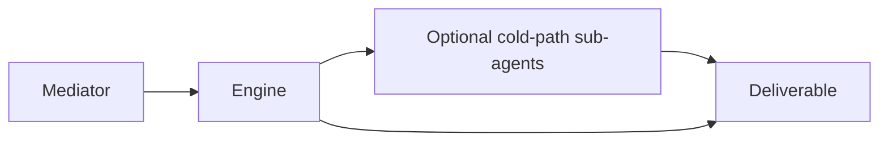

- State persists across steps and supports **human-in-the-loop pauses** (approval, clarification, escalation)
- Long tasks can resume without losing thread context
- Pay-per-token usage is metered per call

### 2. Reasoning framework (REA / REI / REAI)

Engines use one of three **tool-calling reasoning patterns**, chosen by task type:

| Pattern  | Orientation               | Typical engines  |
| -------- | ------------------------- | ---------------- |
| **REA**  | Analysis-first            | Research, Cicero |
| **REI**  | Implementation-first      | Code             |
| **REAI** | Analysis + implementation | TaskForce        |

Each loop: plan → call tools → verify → terminate with a structured answer. Models are nudged to finish via a `final_answer` contract rather than trailing prose.

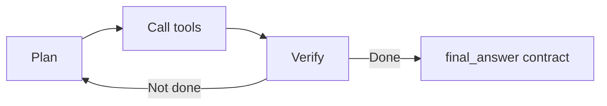

### 3. Harness engineering ("brain and hands")

Beunec separates **decision-making** from **execution**:

- The **orchestrator** plans and delegates
- **Sandboxes and tools** run in isolated, ephemeral execution environments (dedicated per code session; scoped tool access for research/legal)
- If execution fails, the harness can **retry or adapt** without wiping conversation memory, similar in spirit to resilient agent harnesses in the industry, tuned for Rivine's multi-engine layout

For Research and legal work, downstream formatters (PDF/Sheets) **do not** re-run open web research, they work from the lead agent's grounded output, controlling cost and drift.

### 4. Verification

- **Deterministic checks** where possible (schemas, tests, linters on the Code cold path)
- **Inferential self-checks** via agent instructions and escalation tags
- **Grounded citations** for factual engines
- Repeated failure or high-risk actions can escalate to **you** (HITL)

### 5. Agentic Annotation Protocol

Every agent, sub-agent, and tool-facing model receives a **standardized instruction layer**: capability boundaries, when to call tools, when to escalate, and positive/negative behavioral examples. This is the same family of ideas as the GCAP/ASPS annotation approach, consistent behavior across the stack, not ad-hoc prompts per feature.

### 6. Security & data handling (summary)

**Authentication & access control:**
- Auth0 JWT-based authentication for all API calls; workspace access is role-gated (Owner, Operator, Member, Guest)
- OAuth 2.0 with PKCE for third-party app connections (credentials scoped per connector, not exposed to agents)

**Data in transit:**
- HTTPS (TLS 1.2+) for all client-server communication
- WSS (encrypted WebSocket) for real-time messaging and streaming

**Data at rest:**
- Workspace assets and taskspace chat stored in encrypted databases
- File attachments in private S3 buckets with AES-256 encryption (bucket-key enabled)
- Message content encrypted before storage in DynamoDB
- Credentials for external connectors encrypted with Fernet key derivation (never plain-text)

**Sandbox isolation:**
- Each Rivine Code session runs in an isolated, ephemeral sandbox with no network access to other user sessions
- Sandbox file system is cleaned up on session end; no data persists except what you explicitly persist to Assets

**API guardrails:**
- Rate limiting and quota enforcement per user and per engine
- Agent output sanitizers remove internal system metadata, trace markers, and infrastructure details before they reach your browser
- Personally identifiable information (PII) flagging on sensitive output paths

**What we don't store:**
- Raw third-party API credentials (we encrypt them or use refresh tokens instead)
- Voice inputs or raw media beyond the file metadata you explicitly upload
- Browsing history or IP logs for profiling purposes
- Long-term audit logs of agent decision-making; session logs are purged per your retention plan

**Compliance & transparency:**
- Detailed security practices and data handling policies are available in our [Security Disclosure](/aselius-platform/docs/security-disclosure) for enterprises and security reviewers
- Vulnerability reporting is supported via responsible disclosure (contact security@beunec.com)

## What is AI-powered vs not (summary)

| Feature                      | AI-powered?                                             |
| ---------------------------- | ------------------------------------------------------- |
| Taskspace chat & streaming   | **Yes**                                                 |
| Rivine engines + specialties | **Yes**                                                 |
| File/URL parsing to markdown | Server pipeline (proprietary; not user-facing LLM chat) |
| Preview Panel editors        | **No** client-side edit/export                          |
| Assets library CRUD          | **No** standard API                                     |
| Governance                   | **Config only** shapes AI via backend                   |
| Connector OAuth              | **No**                                                  |
| Credits & billing            | **No**                                                  |
| Shared with me               | **No**                                                  |
| Workspace search             | Depends on implementation; not generative chat          |
| Voice input                  | Browser speech-to-text → your message text              |
| Mediator UI                  | Intent shaping layer; plan-gated                        |

### Detailed breakdown

**AI-powered today**

- Mediator routing
- All Rivine agentic engines and their sub-agents
- Grounded research and citation assembly
- Surgical document/code revisions via follow-up prompts
- Rivine Code sandbox execution and cold-path delivery (APST, coder, CI/CD steps where enabled)
- Creative media generation pipelines (coming soon)

**Not AI-powered today (may evolve)**

1. **Built-in document editor**: Manual edits in the preview panel are **your** changes. The editor does not silently rewrite content unless you ask an engine to revise it.
2. **Workspace administration**: Members, roles, permissions, billing, and connector OAuth setup are **standard platform controls**, not agent-driven decisions.

We will disclose when additional surfaces become AI-assisted.

## How Aselius Workspace compares

We will not claim features we have not shipped. Here is an honest positioning lens for researchers, engineers, and founders evaluating agentic tools:

| Dimension              | Typical copilot / workspace products | Aselius Workspace                                                                      |
| ---------------------- | ------------------------------------ | -------------------------------------------------------------------------------------- |
| **Architecture**       | Often a chat layer over one model    | **Rivine runtime** with specialized engines, specialties, verification, and HITL       |
| **Output handling**    | Copy-paste from chat                 | **Assets + Preview Panel** edit markdown/HTML, export, reopen from snapshots           |
| **Task continuity**    | Session-based chat                   | **Taskspaces** with persistent assets and governed configuration                       |
| **Enterprise control** | Tenant policies vary                 | **Governance** per workspace + role-based sharing                                      |
| **Coding**             | IDE assistant or codegen             | **Rivine Code** as runtime construct with in-browser preview (not "just autocomplete") |
| **Transparency**       | Opaque routing                       | Visible engine/specialty choice, agent notes, HITL checkpoints                         |

We are **not** claiming to replace your entire IDE, legal counsel, or brokerage stack. We **are** offering a unified place to **run governed agentic work** and **leave with deliverables**, documents, code previews, research outputs, and creative assets, without stitching together five separate tools.

## Usage tips

1. **Pick the right Space engine**: or let Bravo Mediator route, then lock the engine if it chose correctly.
2. **Enable only the grounded sources you need**: fewer sources, faster turns, lower cost.
3. **Use follow-ups for surgical edits**: "patch section 3", "fix the chart labels", instead of regenerating entire documents.
4. **Rivine Code:** describe stack (Next.js, dashboard, landing page); use preview to validate before download.
5. **Rivine Research:** say PDF or spreadsheet upfront, or set the specialty toggle.
6. **Cicero:** treat output as **legal information, not legal advice**: escalation paths exist for high-stakes matters.

## Recommended workflows

### Researcher

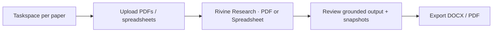

### Engineer / founder

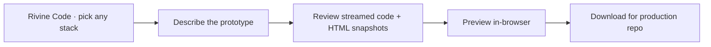

### Legal / policy operator

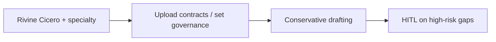

### Team lead

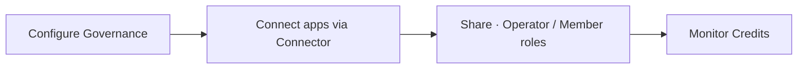

## Roadmap (disclosed only)

**Available now:** Rivine TaskForce, Research, Code, Cicero; Mediator modes; grounded sources; asset previews; Code sandbox preview; pay-per-token metering.

**In progress / not yet production:**

| Item                                                  | Status              |
| ----------------------------------------------------- | ------------------- |
| Rivine Creative (interactive image, video, audio)     | Coming soon         |
| Rivine FIDA (financial intelligence & backtesting)    | Coming soon         |
| Rivine Agentic Engines as an API                      | Coming soon         |
| Google Drive / OneDrive / Dropbox attach in Taskspace | Coming soon         |
| Dropbox / Box Connector                               | Not yet implemented |

Beunec will disclose additional capabilities when they are ready for production use.

## Legal & product notes

© 2026 Beunec Technologies, Inc. All rights reserved.

- **Aselius Platform** is created by **Beunec Technologies Inc.**
- Workspace is one application within the platform, selectable from the sidebar.
- Rivine, Reverse Engineering of Analysis & Implementation, and related orchestrations are **proprietary**, not open source. Documentation describes *capabilities and outcomes*, not internal implementation recipes.
- Rivine Cicero and similar engines are **not substitutes** for licensed attorneys, physicians, or financial advisors.
- Agentic Annotation Protocol principles (capability transparency, refusal of harmful requests, no fabricated real-time data) are embedded in engine harness design.
- AI outputs require human review for high-stakes decisions (legal, medical, financial, security). Cicero and Research outputs are assistive, not substitutes for licensed professionals.

## Quick reference diagram: one task end-to-end

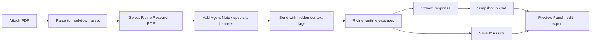

