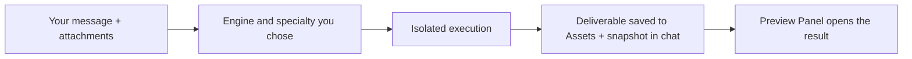
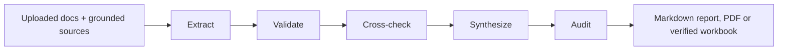
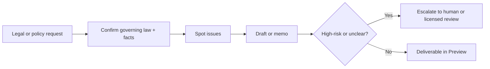
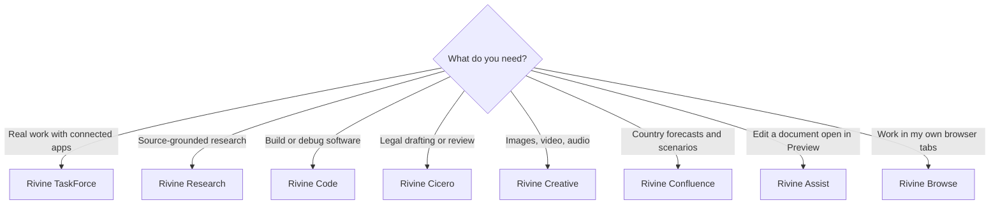
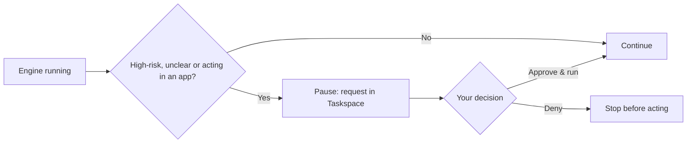
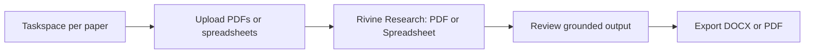
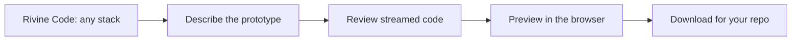
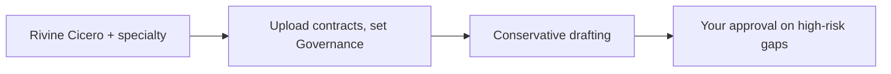
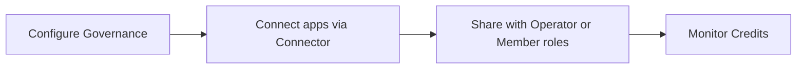

# Aselius Workspace

Aselius Workspace is the part of Aselius where you run real work with Rivine engines: research, drafting, coding prototypes, legal work, forecasts and media. You leave with deliverables you can preview, edit, download and share, not just chat replies.

## At a glance

- **What it is:** An agentic task environment: Taskspace, Governance, Connector, Credits and Shared with me.
- **Best for:** Software teams, research organizations, consulting firms, startups and post-graduate researchers who need production-grade output.
- **You get:** Documents, HTML reports, spreadsheets, code projects with live preview, and media, all saved to Assets.
- **Where:** Aselius Platform sidebar, **Workspace**, at https://aselius.beunec.com.
- **Cost:** Prepaid credits; each engine has a minimum balance to start a turn ($1 to $10).
- **Control:** You pick the engine and specialty. Risky actions wait for your approval.

## How a turn works

| Area | What it does |
| --- | --- |
| **Taskspace** | Your work surface: conversation, attachments, engines and previews |
| **Governance** | Workspace-level AI behavior and content rules |
| **Connector** | Secure OAuth connections to external apps |
| **Credits** | Prepaid balance for engine usage |
| **Shared with me** | Invitations and workspaces others have shared with you |

## Taskspace

Each Taskspace is one conversation thread per task. The conversation sits on the left; the **Preview Panel** sits on the right.

### What you can do

- Send natural-language requests to a Rivine engine and its **Specialty**.
- Attach files, paste text, parse web page or YouTube URLs, and capture screenshots.
- Use **Agent Notes** to jump straight to a pre-configured engine and specialty.
- Watch responses stream in real time, including tool progress when an engine uses external data or a sandbox.
- Open deliverables from **snapshot cards** in the conversation.
- Approve or deny actions when an engine pauses for you (see [Human in the loop](#human-in-the-loop)).
- Search messages, taskspaces, assets and workspaces from the workspace header.

### Conversation layout

To reduce clutter, older messages collapse into **flip cards**. Your earlier requests show *"Click to view your request"*, and AI responses older than the latest two collapse the same way until you expand them. Attachment and file snapshots stay visible as tappable cards on expanded messages.

### Snapshots

When an engine finishes meaningful work, a snapshot card appears in the conversation. Click it to open the deliverable in the Preview Panel.

| Output | Opens as |
| --- | --- |
| Markdown document | Built-in editor (rendered and editable) |
| HTML report or deck | HTML preview; export when available |
| Image, video or audio (Creative) | Media preview |
| Code project (Rivine Code) | Sandbox live preview |

### Roles

| Role | Access |
| --- | --- |
| **Owner** | Full control, share, transfer ownership |
| **Operator** | Edit Governance, share, manage taskspaces |
| **Member** | Create and use taskspaces |
| **Guest** | View only; cannot edit documents or Governance |

## Rivine engines

Rivine is Beunec's proprietary agentic orchestration runtime. Each engine is a specialized, governed worker with its own tools, verification and sandbox rules, and it produces outputs you can inspect. Beunec does not disclose which models engines use.

| Engine | Best for | Deliverable | Start floor (every plan) |
| --- | --- | --- | --- |
| **Rivine TaskForce** | Action-oriented professional work: connected apps, diagrams, interactive docs, verified computation | Markdown, inline HTML, diagrams, spreadsheets, computed results | $2.00 |
| **Rivine Research** | Source-grounded, high-reliability research across domains | Markdown, PDF or spreadsheet HTML | $5.00 |
| **Rivine Code** | Software engineering, debugging, security review, working projects | Sandbox code with live preview (also a CLI) | $10.00 |
| **Rivine Cicero** | Legal drafting, review and policy work | Markdown legal memo | $3.00 |
| **Rivine Confluence** | Country forecasting and scenarios; models choose evidence, code computes the numbers | Markdown and an interactive dashboard | $5.00 |
| **Rivine Assist** | Surgical follow-up edits on a document already open in Preview | In-place Markdown, HTML or code edits | $1.00 |
| **Rivine Browse** | Tasks in your real browser tabs and signed-in sessions | Side panel, with optional engine handoff | $2.00 |
| **Rivine Creative** | Image, video and audio generation and surgical editing, in seven modes | Image, video or audio files | $3.00 |

> **Note:** Rivine engines are not yet available as a public API. Rivine FIDA is deprecated and no longer in the product.

### What each engine does

**Rivine TaskForce** does the work inside the workspace rather than chatting about it. It advises critically, acts through connected apps (email, calendars, databases, MCP tools), and uses native specialties to produce diagrams, interactive documents, learning packs and verified computations saved as assets.

**Rivine Research** grounds every claim in your uploaded documents and cited sources instead of free-summarizing. Conflicts stay visible and gaps are flagged, not invented. The PDF and Spreadsheet specialties turn findings into a durable report or a verified workbook.

**Rivine Cicero** is a legal and policy workbench. It confirms governing law and facts first, spots issues, drafts in conservative language, and escalates high-risk or unclear matters to human or licensed review. It is research-and-draft support, not a substitute for a licensed attorney or diplomat.

**Rivine Code** builds working projects, not plans or command lists. It writes real files, installs and runs them when possible, verifies the result, and keeps changes surgical and reversible. You get a live preview in the browser and a project you can download into your own tooling, with no local IDE required.

**Rivine Confluence** produces country forecasts and scenarios. Models choose the evidence; code computes every figure.

**Rivine Assist** makes targeted edits to the document open in Preview, so you do not regenerate the whole thing.

**Rivine Browse** works in your own browser tabs and signed-in sessions, and can hand a task to another engine.

**Rivine Creative** makes and edits images, short animations, video and audio. Each of its seven modes hands you a finished file you can preview, download or publish. See [Rivine Creative](/aselius-platform/docs/rivine-creative).

> **Note:** Rivine and all Rivine engines are closed-source, proprietary Beunec technology. These docs describe what each engine does and produces, not how it works internally.

### Specialties

Most engines require a **Specialty** before you can send. If one is required and not selected, sending is blocked until you choose one.

| Engine | Specialties |
| --- | --- |
| Rivine TaskForce | Chat, Excalidraw, Mermaid, HTML STEM, HTML 3D, YouTube learning packs, Code Execution |
| Rivine Research | PDF, Spreadsheet |
| Rivine Code | Mode: Frontend Only, Backend Only, Full Stack, Plan/Ask Only, Security Scan/Fix. Rate: Manual (review changes as they land) or Bypass (apply as it works) |
| Rivine Cicero | Contract Review, Legal Drafting, Corporate Law, Employment Law, Immigration Law, International Relations, Patent Compliance, M&A Due Diligence, Policy and Law Drafting, General |
| Rivine Creative | Generate Image, Surgical Edit Image, Animate / GIF / Motion, Generate Video, Surgical Edit Video, Generate Audio, Generate Music / SFX |

### Grounded sources

For TaskForce, Research and Cicero you can enable **grounded sources** such as finance, health literature, SEC filings, maps and web search. Engines cite these sources rather than relying on memory. Toggles are per workspace, and a disabled source is never called.

### Agent Notes

**Agent Notes** are pre-written instructions for each specialty: evidence rules, escalation triggers and output shape. They enforce behavior such as citing sources, never inventing spreadsheet cells, escalating legal risk to you, and blocking unsafe creative requests.

- The Agent Notes list shows every specialty across engines. Picking one selects its engine and specialty for you.
- The selected note is sent with your message but not shown in your chat bubble.
- After a run, Agent Notes can also show which engine handled the task, verification or escalation flags, and a citation summary, so you can audit what happened.

## Choosing an engine

There is no automatic router or mediator. You choose the engine and its specialty in the Taskspace input bar, and the engine you pick is the engine that runs, with its specialty exactly as you set it.

## Human in the loop

Engines stop and wait for you instead of guessing or acting on their own:

- **Before acting in a connected app**, the engine shows the exact action with **Deny** and **Approve & run**.
- **When it needs input**, it asks one question and waits for your answer.
- **On low confidence, verification limits or high-risk steps**, it pauses with an approval request. This matters most for legal, security and data-sensitive work.

## Preview Panel

The Preview Panel lets you inspect and edit results without leaving Workspace. It is resizable on desktop (width is remembered), a full-screen sheet on mobile, and has an optional fullscreen mode.

| Tab | Purpose |
| --- | --- |
| **Assets** | All taskspace files: filter by user or AI and by type; open, download, delete |
| **Attachments** | Items waiting to be sent with your next message |
| **Preview** | Markdown documents, images and plain text |
| **HTML** | HTML code editor with sandboxed live preview |
| **Share** | Sharing workflow (when opened from a share action) |

**Markdown documents**

- Rendered and editable, with a table of contents in fullscreen and a word count.
- Export as Markdown, PDF (print) or DOCX. **Save** updates the asset; guests are read-only.
- Ask a follow-up for a surgical revision of one section instead of regenerating the document.

**HTML**

- Split view: code editor and sandboxed live preview. Export as HTML or PDF (print).
- HTML code blocks in AI responses appear as HTML snapshots that open this tab.
- Research PDF-style reports and spreadsheet layouts preview as self-contained HTML for review, print or export.

## Assets

Assets is the durable output library for each Taskspace. Every deliverable is saved here, versioned, and AI-created assets carry the engine that made them and citations where applicable.

| Property | Details |
| --- | --- |
| **Types** | Document, code, image, data, other |
| **Created by** | You (uploads, references) or AI (generated documents, HTML, code and media) |
| **Grounding** | Your taskspace assets are available to engines on every message, so answers stay grounded in your files |

> **Note:** Snapshots are quick-open cards in the chat. Assets are the persisted files you manage. A Rivine Code project tree is also saved to Assets as a code project on each completed turn (dependency and build folders and binaries excluded), so it outlives the live sandbox.

## Attachments and uploads

Uploaded files are converted to Markdown so engines can reason over them. Parsing runs on Beunec's servers, not as a chat you type into.

### Supported upload types

| Category | Extensions |
| --- | --- |
| **Images** | jpg, jpeg, png, gif, bmp, svg, webp |
| **Documents** | pdf, docx, xlsx, pptx, csv, txt, rtf, md |
| **Audio** | mp3, wav, m4a, flac, ogg, mpeg |
| **Video** | mp4, mov, avi, mkv, webm, mpeg |
| **Code** | py, js, jsx, ts, tsx, html, css, json, xml, sql, java, tex, vue, svelte, go, rs, rb, php, c, cpp, h, cs, swift, kt, yaml, yml, scss, less, mdx |

Archives (zip, rar and similar), executables and other blocked types are not accepted, for security.

### Limits

| Limit | Value |
| --- | --- |
| Max file size | 200 MB |
| Max files per message | 10 |
| Max files per batch upload | 10 |
| Daily uploads | 15 (Base) / 30 (Pro) / 40 (Essential) |

### Ways to add content

| Method | Status |
| --- | --- |
| File upload | Available |
| Paste text | Available (sent as-is, not parsed) |
| Paste or clipboard image | Available |
| Web page or YouTube URL | Available |
| Screenshot capture | Available |
| Import from Manage Files | Available |
| Google Drive, OneDrive, Dropbox | Coming soon |

### What is sent with your message

To give engines situational awareness without cluttering your chat, Workspace adds context to each message that you do not see in the bubble: your local date, time and timezone, your location (only if you grant browser permission), your engine and specialty, the selected Agent Note, your pasted text and file attachments, and your response language if it is not English.

## Governance

**Where:** Workspace, **Governance** tab. This is configuration, not a chat feature; saved rules shape how engines behave in the workspace.

- **System instructions:** primary role, specified industry, behavioral guidelines, response format.
- **Content restrictions:** prohibited topics, content filters.
- **Who can edit:** Owners and Operators. Guests see read-only fields.

## Connector

**Where:** Workspace, **Connector** page. This manages credentials and permissions so engines can reach external systems only when you authorize them.

There are two kinds of connection: native **RCP** (Rivine Context Protocol) apps managed on the Connector page, and **MCP** (Model Context Protocol) apps available to Rivine TaskForce.

### Native apps you can connect today

| App | Access |
| --- | --- |
| Google (Gmail, Calendar) | Read and send mail; calendar |
| Microsoft 365 | Mail and calendar |
| Supabase | Read and edit |
| Firebase | Read and edit |
| MongoDB | Read and edit |
| Stripe | Read balances and transactions |
| GitHub | Read repositories |

Dropbox and Box are not yet available on the Connector page.

### MCP apps available to Rivine TaskForce

Slack, Excalidraw, Google Drive, v0, Notion, Asana, Docusign, Supermetrics, Zoom, Linear, monday.com, Intercom, Miro, Box, Airtable, Zapier, Trello, Sentry, ZoomInfo, Gamma, Calendly, ClickUp, Global Database, Shopify, Adobe, Cloudflare, Tableau Cloud, Spotify, Dropbox, Mixpanel, Ramp, PostHog, PlanetScale, ClickHouse, Amplitude, CoCounsel Legal, Midpage Legal Research, Legal Data Hunter, Definely, Harvey, Salesloft, Lucid, Figma and Vercel.

> **Note:** The **Connect Apps** toggles in the Taskspace input bar (web, maps, health and others) are currently disabled. Connect apps on the Connector page first.

## Credits

**Where:** the **Credits** page, linked from the balance widget in the Workspace header. Credits are prepaid usage billing, not an AI feature.

- $1 = 1 credit, and credits never expire. Plans include free monthly credits: 5 (Base), 10 (Pro, $20/month), 20 (Essential, $40/month).
- Usage is metered per call. A **20% Rivine Infrastructure fee** is added to the underlying model provider cost; it covers orchestration, sandboxing, verification and delivery.
- Each engine needs a minimum prepaid balance to start a turn (see the engine table). The floors are the same on every plan, from one wallet.
- Your balance is highlighted when it drops below $5.00.
- Credits can be shared via CloudHandle, depending on plan features.

See [Plans and pricing](/aselius-platform/docs/plans-pricing).

## Shared with me

**Where:** Platform sidebar, **Shared with me**. This is collaboration and access control.

- See pending invitations and active shared workspaces; accept or decline invitations.
- Open a shared workspace (it lands in its first Taskspace).
- Your role (Owner, Operator, Member or Guest) sets what you can do.

Owners and Operators share from the Preview Panel **Share** tab, when enabled.

## Trust, isolation and security

- **Isolation:** Every engine's tool calls, code execution, research and connector calls run in isolated, temporary environments that never share state with another user's task. Each Rivine Code session gets its own sandbox, cleaned up when the session ends; only what is saved to Assets persists.
- **Recovery:** Long tasks keep their context. If a step fails, the engine can retry or adapt without losing what already happened.
- **Verification:** Automated checks (such as tests and linters in Rivine Code), engine self-checks, and citations for factual engines. Repeated failures or high-risk actions come to you.
- **Cost control:** Research PDF and spreadsheet formatting works from the grounded research already done; it does not run fresh web research.
- **Consistent rules:** Every engine is held to the same principles: be transparent about what it can do, refuse harmful requests, and never fabricate real-time data.
- **Access:** Every request is authenticated, and workspace access is gated by role. App connections use OAuth, with credentials scoped per connector and never exposed to engines.
- **Encryption:** All traffic is encrypted in transit (HTTPS with TLS 1.2 or later, and encrypted WebSockets for streaming). Assets, chats and file attachments are encrypted at rest; connector credentials are never stored in plain text.
- **Guardrails:** Rate limits and quotas per user and per engine, output cleaned of internal system details before it reaches your browser, and flagging of personal information on sensitive outputs.
- **What we don't store:** Raw third-party credentials, voice input or raw media beyond what you upload, browsing history or IP logs for profiling, or long-term logs of agent decisions. Session logs are purged per your retention plan.

For full details, see the [Security Disclosure](/aselius-platform/docs/security-disclosure). Report vulnerabilities to contact@beunec.com or support@beunec.com.

## What is AI-powered vs not

| Feature | AI-powered? |
| --- | --- |
| Taskspace chat and streaming | Yes |
| Rivine engines and specialties | Yes |
| Grounded research and citations | Yes |
| Surgical revisions via follow-up prompts | Yes |
| Rivine Code build, run and verify | Yes |
| Rivine Creative generation and editing | Yes |
| File and URL parsing to Markdown | Server pipeline, not a chat |
| Preview Panel editing and export | No: your edits are your own; the editor never rewrites content unless you ask an engine |
| Assets library | No |
| Governance | Configuration that shapes engine behavior |
| Connector, Credits, Shared with me | No: standard platform controls |
| Workspace search | Not generative chat |
| Voice input | Browser speech-to-text into your message |

Beunec will disclose when more surfaces become AI-assisted.

## How Workspace compares

| Dimension | Typical copilot tools | Aselius Workspace |
| --- | --- | --- |
| Architecture | A chat layer over one model | Specialized engines with specialties, verification and human approval |
| Output | Copy and paste from chat | Assets and Preview Panel: edit, export, reopen from snapshots |
| Continuity | Session-based chat | Taskspaces with persistent assets and governed settings |
| Control | Varies | Per-workspace Governance and role-based sharing |
| Coding | IDE autocomplete or codegen | Rivine Code builds and previews working projects in the browser |
| Transparency | Opaque | You choose the engine; Agent Notes and approval checkpoints are visible |

Workspace does not replace your IDE, legal counsel or brokerage. It gives you one governed place to run agentic work and leave with deliverables.

## Usage tips

1. Pick the right engine for the job and set its specialty.
2. Enable only the grounded sources you need: faster turns, lower cost.
3. Use follow-ups for surgical edits ("patch section 3", "fix the chart labels") instead of regenerating.
4. For Rivine Code, describe the stack (for example Next.js, a dashboard or a landing page) and check the preview before downloading.
5. For Rivine Research, say PDF or spreadsheet up front, or set the specialty.
6. Treat Cicero output as legal information, not legal advice; high-stakes matters escalate to you.

## Recommended workflows

**Researcher**

**Engineer or founder**

**Legal or policy operator**

**Team lead**

## Roadmap

**Available now:** Rivine TaskForce, Research, Code, Cicero, Confluence, Creative and Assist; Rivine Browse; Aselius MCP; Telegram, Discord and WhatsApp; Selius; Automation; Observability; grounded sources; asset previews; Code sandbox and CLI; pay-per-token metering.

| Coming | Status |
| --- | --- |
| Rivine engines as an API | Coming soon |
| Google Drive, OneDrive and Dropbox attach in Taskspace | Coming soon |
| Dropbox and Box on the Connector page | Not yet available |

Beunec will disclose more capabilities when they are ready for production. Rivine FIDA is deprecated and not on the roadmap.

## Legal and product notes

- Aselius is created by Beunec Technologies, Inc. Workspace is one app within it, selectable from the sidebar.
- Rivine and its orchestration are proprietary, not open source. These docs describe capabilities and outcomes, not implementation.
- Rivine Cicero, Rivine Research and similar engines are assistive. They are not substitutes for licensed attorneys, physicians or financial advisors.
- AI outputs need human review for high-stakes legal, medical, financial and security decisions.

© 2026 Beunec Technologies, Inc. All rights reserved.

## Related

- [Plans and pricing](/aselius-platform/docs/plans-pricing)
- [Rivine TaskForce](/aselius-platform/docs/rivine-taskforce)
- [Rivine Research](/aselius-platform/docs/rivine-research)
- [Rivine Code](/aselius-platform/docs/rivine-code)
- [Rivine Creative](/aselius-platform/docs/rivine-creative)
- [Preview app](/aselius-platform/docs/preview-app)
- [Aselius MCP](/aselius-platform/docs/aselius-mcp)
- [Security Disclosure](/aselius-platform/docs/security-disclosure)
