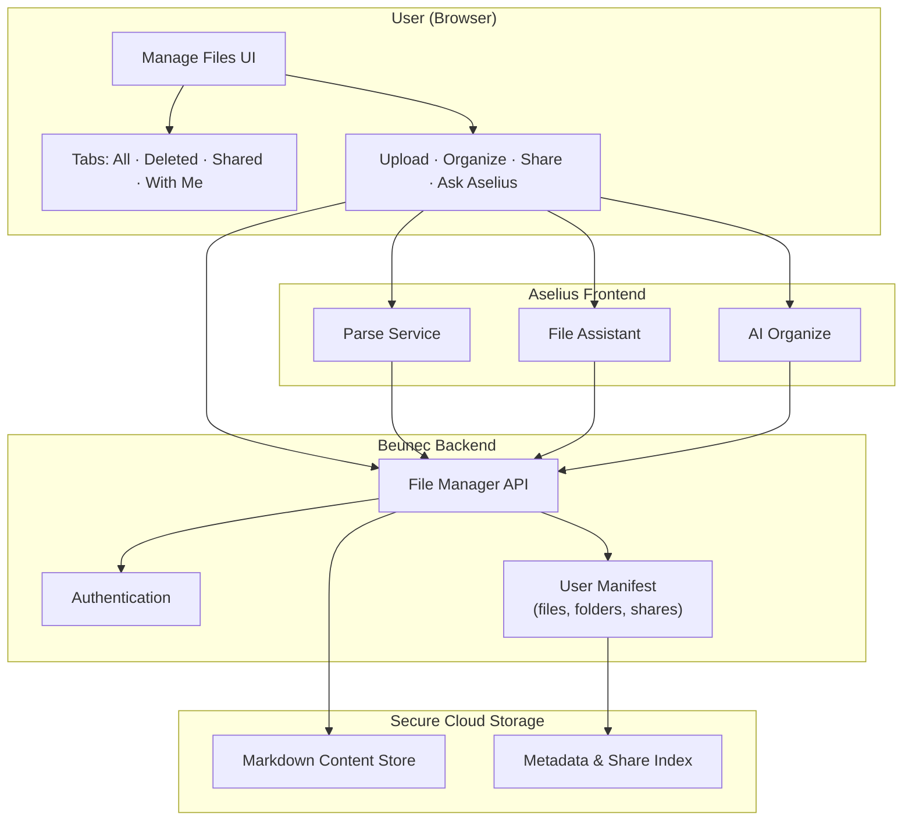
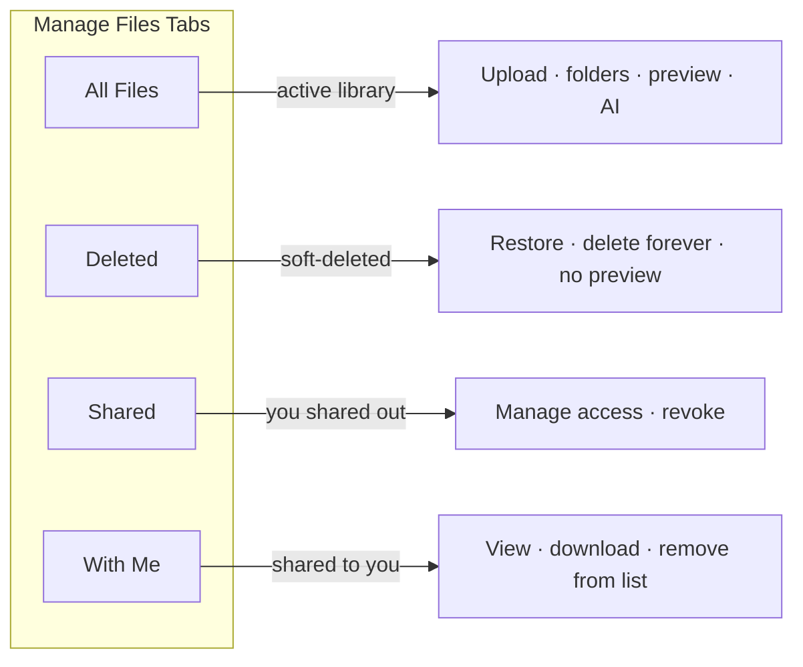
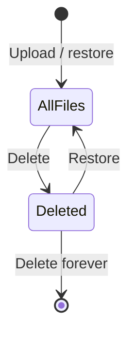
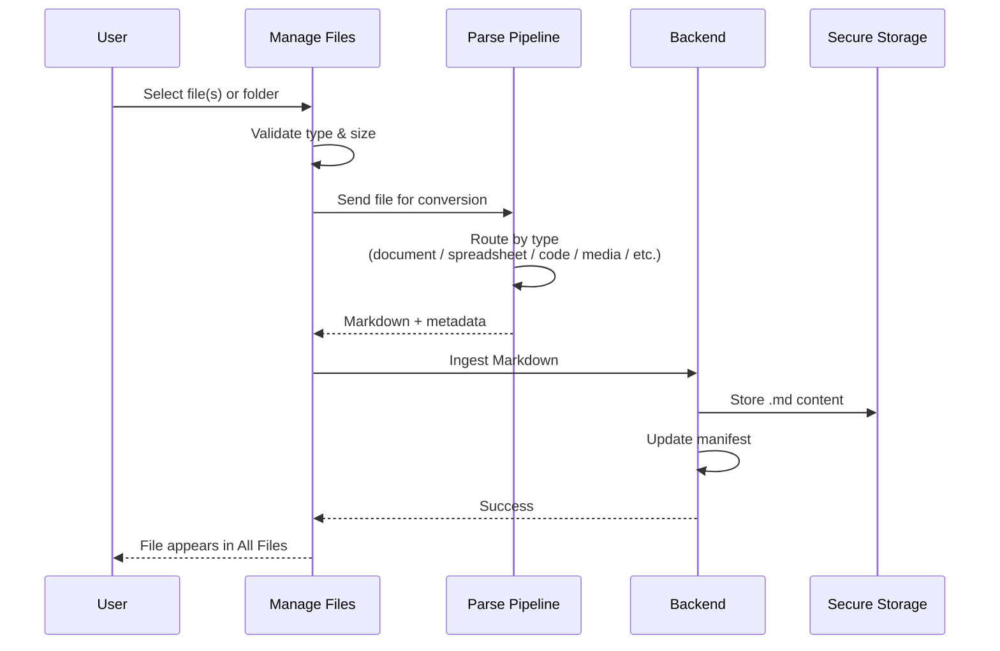
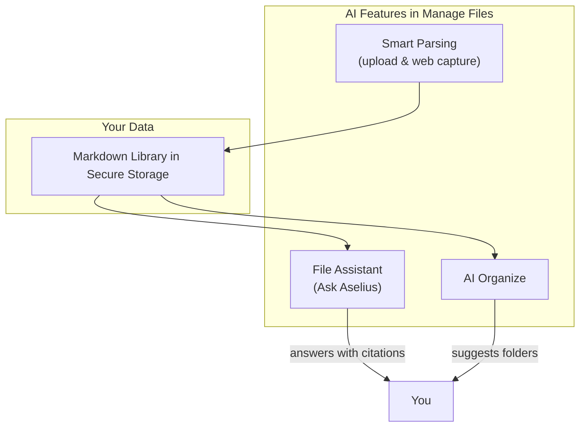
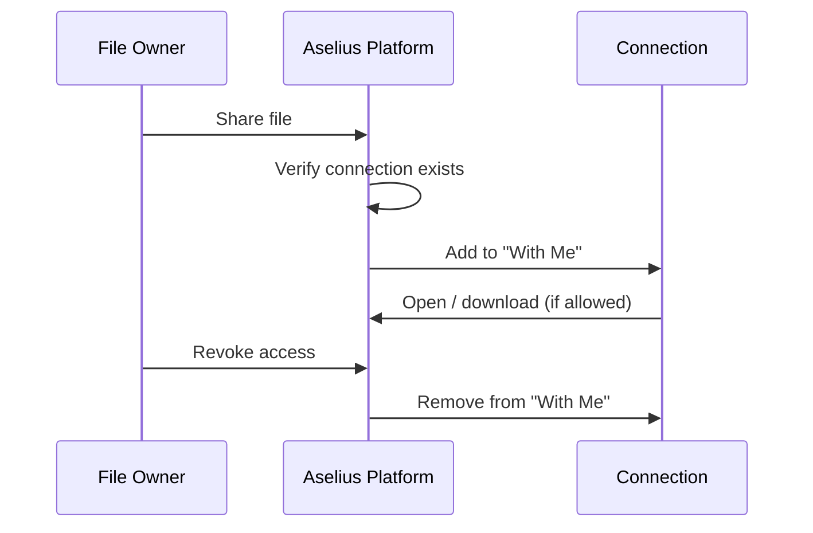
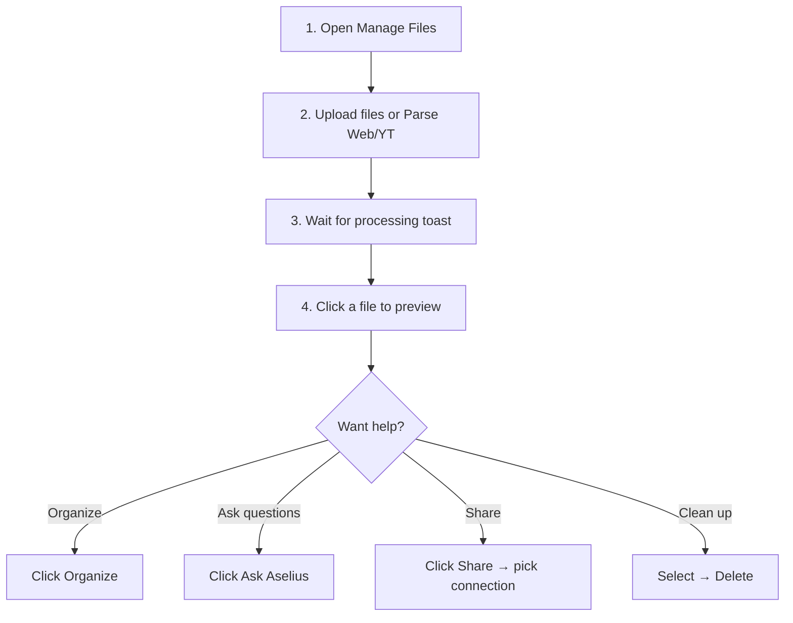

# Manage Files - Aselius Platform Documentation

**Version:** 1.0.0   

**Access:** Sidebar → **Manage Files** (`/file-management`)

**License note:** This documentation is provided for Aselius users. The underlying platform is proprietary to Beunec Technologies Inc.

---

## 1. What Is Manage Files?

Manage Files is the file storage, conversion, organization, and sharing layer inside the **Aselius Platform**. Unlike traditional cloud drives that store files “as uploaded,” Manage Files is built around a **markdown-first** approach: most uploads are converted into clean, readable Markdown and stored securely so they can be previewed, searched, organized, and discussed with AI.

**In one sentence:** Upload almost anything → get a readable, AI-ready knowledge file → organize, share, and ask questions about your library.

---

## 2. How Manage Files Differs From Google Drive, Dropbox, and Similar Tools

| Capability | Typical cloud drive | Aselius Manage Files |
|---|---|---|
| **Primary storage format** | Original binary (PDF, DOCX, etc.) | Converted **Markdown** optimized for reading & AI |
| **Preview** | Native viewers or downloads | Unified **Markdown preview** with tables, code, headings |
| **AI over your files** | Often separate, limited, or add-on | Built-in **File Assistant** grounded in *your* library |
| **Auto-organization** | Manual folders only | **AI Organize** suggests folder groupings |
| **Web & video capture** | Bookmarks or raw links | **Parse Web/YT** saves content as Markdown |
| **Sharing model** | Link or email invites | Share with **network connections** on Aselius, with permissions |
| **Deleted files** | Trash with restore | **Deleted** tab with restore or permanent delete |
| **Security posture** | General file hosting | Blocked executables/archives; validated uploads; authenticated access |

**Why this matters:** Google Drive and Dropbox excel at storing and syncing files. Manage Files is designed for **knowledge work** research, notes, documents, code, and media that you want to read, reference, share, and query intelligently inside Aselius.

> **Transparency note:** Beunec uses a multi-stage conversion pipeline combining specialized parsers and enterprise AI services. Exact model names, routing logic, and internal parsing strategies are proprietary and not disclosed here. What follows explains *what* happens and *why*, not *how to replicate* it.

---

## 3. System Overview (Architecture)

**Plain-language summary:**
1. You upload or capture content in the browser.
2. Content is converted to Markdown through Beunec’s parsing pipeline.
3. Markdown is stored in secure cloud storage; metadata (name, folder, shares, delete state) lives in your personal manifest.
4. The UI reads from that manifest, tabs, search, preview, and AI all use the same source of truth.

---

## 4. The Four Tabs Explained

### 4.1 All Files
Your working library.

| Feature | What it does |
|---|---|
| **Upload** | Add files or entire folders (batch conversion to Markdown) |
| **New Folder** | Create structure manually |
| **Parse Web/YT** | Save a web page or YouTube content as Markdown |
| **Select** | Multi-select for move or delete |
| **Organize** | AI suggests folder groupings for root-level files |
| **Preview** | Opens Markdown in a side panel |
| **Ask Aselius** | Opens File Assistant grounded in your library |
| **Share** | Share with connections; manage existing access |

The action bar stays visible while you scroll.

---

### 4.2 Deleted
Soft-deleted items, recoverable until permanently removed.

| Behavior | Detail |
|---|---|
| **Preview** | **Not available** restore first to view again |
| **Select** | Multi-select supported |
| **Restore** | Returns files to All Files |
| **Delete forever** | Permanent removal (cannot be undone) |

---

### 4.3 Shared
Files **you** have shared with connections.

| Action | Result |
|---|---|
| **Share / Revoke Share** | Open manage-sharing modal |
| **Multi-select → Revoke access** | Bulk remove recipient access |
| **Preview** | View shared Markdown content |

Each row represents a **share record** (who has access), not just a file.

---

### 4.4 With Me
Files **others** shared with you.

| Action | Result |
|---|---|
| **Preview** | Read shared Markdown |
| **Download** | If permitted by owner |
| **Delete for Me** | Removes from your list only (does not delete owner’s file) |

---

## 5. End-to-End Upload & Conversion Flow

### What happens to your file?
- Original filename is preserved in metadata (e.g. `report.pdf` → stored as `report.md`).
- Size shown may reflect **original → Markdown** compression.
- Parser quality is recorded internally; failed conversions produce a safe fallback stub (re-upload may be needed).

---

## 6. Supported Upload Types

### Accepted categories

| Category | Extensions | Converted to |
|---|---|---|
| **Images** | jpg, jpeg, png, gif, bmp, svg, webp | Markdown with descriptions / extracted text |
| **Documents** | pdf, docx, xlsx, pptx, csv, txt, rtf, md | Structured Markdown (tables for spreadsheets & CSV) |
| **Audio** | mp3, wav, m4a, flac, ogg | Markdown transcript / summary |
| **Video** | mp4, mov, avi, mkv, webm | Markdown transcript / summary |
| **Code** | py, js, jsx, ts, tsx, html, css, json, xml, sql, java, go, rust, php, c, cpp, swift, kotlin, yaml, vue, svelte, tex, mdx, and more | Fenced code blocks in Markdown |
| **Web capture** | Any public URL (Parse Web/YT) | Markdown article / transcript |

### Not accepted (security)

| Blocked | Reason |
|---|---|
| **Archives** (.zip, .rar, .7z, etc.) | Upload individual files or a folder instead |
| **Executables** (.exe, .bat, .sh, etc.) | Security risk |
| **Unknown extensions** | Not in the allowed list |

> **Tip:** To upload many files, use **Upload → Folder** rather than a zip archive.

---

## 7. Preview & Reading Experience

All active files open as **Markdown** in the preview panel:

- **Tables** (CSV, Excel-derived) render as formatted tables  
- **Code** uses syntax highlighting  
- **Headings & lists** from documents are preserved  
- **Copy Markdown** copies raw content to clipboard  
- **Download** saves the `.md` file (folders download as `.zip` of Markdown files)

Deleted files cannot be previewed until restored.

---

## 8. AI-Powered Features

### 8.1 File Assistant (“Ask Aselius”)
- Chat panel beside your file list  
- Grounded in **your** uploaded Markdown library (server-side, authenticated)  
- Can cite which files informed an answer  
- **Sessions** are saved so conversations persist  
- Works across your library, not just one open file  

**What it is not:** A general internet search engine. It answers from your library unless platform tools explicitly fetch external data.

---

### 8.2 AI Organize
- Analyzes root-level files in All Files  
- Suggests logical folder groupings  
- You confirm before anything moves  
- Falls back to smart heuristics if AI is unavailable  

**Best for:** Libraries with many unfiled uploads after a bulk import.

---

### 8.3 Smart Parsing (on upload)
Uploads are routed through type-specific conversion:

| Content type | Approach (high level) |
|---|---|
| PDF & Office docs | Document AI extraction → structured Markdown |
| Spreadsheets & CSV | Table-aware conversion → Markdown tables |
| HTML / web pages | HTML-to-Markdown conversion |
| Code files | Preserved in fenced code blocks |
| Images & video | Vision / multimodal AI → descriptive Markdown |
| Plain text & Markdown | Direct or light formatting |

Beunec does not publish which third-party or internal models power each route. The design goal is **accuracy, structure preservation, and AI-readiness**, not storing opaque binaries.

---

### 8.4 Parse Web / YouTube
- Paste a URL and name  
- Page or video content is fetched and converted to Markdown  
- Saved like any other file in All Files  
- Useful for research, meeting notes, articles, and reference material  

---

## 9. Sharing & Permissions

| Permission | Recipient can |
|---|---|
| **View** | Read Markdown preview |
| **Edit** | Extended access (where enabled) |
| **Allow download** | Download the Markdown file |

**Important rules:**
- You can only share with users in your **Aselius network connections**  
- Owners revoke access from All Files (Share modal) or the **Shared** tab  
- Recipients remove items from their view via **With Me** without deleting the owner’s file  

---

## 10. Folders, Selection & Bulk Actions

| Action | Where | How |
|---|---|---|
| Create folder | All Files | **New Folder** |
| Move files | All Files | Select → Move, or drag to folder preview |
| Delete | All Files | Select → Delete (moves to Deleted tab) |
| Restore | Deleted | Select → Restore |
| Permanent delete | Deleted | Select → Delete forever |
| Revoke sharing | Shared | Select → Revoke access |
| Folder upload | All Files / folder preview | Drag & drop or Upload → Folder |
| Folder download | Preview / list | Downloads `.zip` of Markdown files inside |

---

## 11. Storage & Limits

- Storage bar shows **used vs quota** (plan-dependent)  
- Markdown is often smaller than originals (compression ratio shown in file details)  
- Batch uploads may process in chunks for reliability  
- Very large Markdown payloads may be rejected with a clear size limit  

---

## 12. Security & Trust (What We Can Share Publicly)

| Area | User-facing guarantee |
|---|---|
| **Authentication** | Files tied to your Aselius identity; API access requires valid session |
| **Upload validation** | Dangerous file types blocked before storage |
| **Storage isolation** | Your manifest and content are scoped to your account |
| **Sharing** | Only explicit shares with verified connections; revocable anytime |
| **Deleted files** | Soft delete with optional permanent purge |
| **AI data use** | File Assistant reads your library to answer *your* questions within the session; not sold as a public dataset |

**What we don’t disclose:** Internal model vendors, prompt templates, parser routing tables, or infrastructure credentials.

For the full platform security model, encryption, and vulnerability reporting, see the [Security Disclosure](/aselius-platform/docs/security-disclosure).

---

## 13. Quick Start (Non-Technical Users)

**5-minute workflow:**
1. Upload your PDFs, spreadsheets, or notes.  
2. Open one, read the Markdown preview.  
3. Click **Ask Aselius**: “Summarize my Q3 reports.”  
4. Click **Organize** if your root folder is cluttered.  
5. **Share** a file with a colleague on your network.  

---

## 14. Technical Appendix (Developers & Power Users)

### 14.1 Data model 
- **Manifest** per user: files, folders, `sharesSent`, `sharesReceived`, chat session index  
- **Content** stored as Markdown objects keyed by user handle  
- **Ingest API** accepts parsed Markdown + original metadata  
- **Feature flag:** `MARKDOWN_FIRST_ENABLED` gates the R2-backed path  

### 14.2 API surface 
| Area | Purpose |
|---|---|
| `/api/file-manager/files/*` | CRUD, restore, permanent delete |
| `/api/file-manager/shares/*` | Create, update, revoke shares |
| `/api/file-manager/chat/*` | Session persistence + library context |
| `/api/parse-to-markdown` | Client-side upload conversion |
| `/api/file-management/chat` | File Assistant inference |
| `/api/file-management/organize` | AI organize suggestions |

### 14.3 Parser engines (categories only)
Internal enum includes pass-through, code pass-through, CSV table builder, HTML conversion, document AI, spreadsheet conversion, vision/multimodal, and fallback stubs, exact routing is proprietary.

### 14.4 Frontend modules
| Module | Role |
|---|---|
| `page.tsx` | Layout, tabs, sticky headers, preview panel |
| `FileActionHeader` | Tab-specific actions (upload, select, restore, revoke) |
| `FileList` | Table/grid, selection, row actions |
| `CodeViewer` | Markdown + code rendering (`remark-gfm`) |
| `FileAIChatPanel` | Assistant UI + sessions |
| `ShareModal` | Share create / manage / revoke |
| `fileToast` | Mobile-friendly notifications |

---

## 15. FAQ

**Q: Why is my CSV showing as raw text?**  
A: Re-upload the file. New uploads are converted to Markdown tables automatically.

**Q: Can I preview deleted files?**  
A: No. Restore them first from the Deleted tab.

**Q: Why can’t I share with someone?**  
A: They must be in your Aselius network connections.

**Q: Is this the same as Google Drive?**  
A: No. Manage Files converts content to AI-ready Markdown and includes built-in assistant and organize features.

**Q: What AI model do you use?**  
A: Beunec uses enterprise-grade AI services selected for quality and security. Specific models and routing are proprietary.

**Q: Are zip files supported?**  
A: No. Upload a folder or individual files instead.

---

## 16. Document Figures (For Design / PDF Export)

For a polished PDF or help center, Beunec may export these Mermaid diagrams as PNG/SVG figures:

1. **Figure 1**: System Overview (Section 3)  
2. **Figure 2**: Four Tabs map (Section 4)  
3. **Figure 3**: Upload sequence (Section 5)  
4. **Figure 4**: Deleted state machine (Section 4.2)  
5. **Figure 5**: AI features map (Section 8)  
6. **Figure 6**: Sharing sequence (Section 9)  
7. **Figure 7**: Quick start flow (Section 13)  

---

*© Beunec Technologies Inc. · Aselius Platform · Manage Files Documentation*
