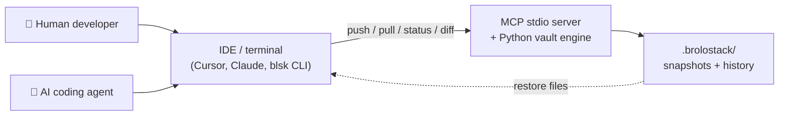

# Brolostack

**A zero-authentication, fully local checkpoint vault built for AI coding agents, and the humans who supervise them.**

`brolostack` (CLI alias: `blsk`) is a Model Context Protocol (MCP) stdio server that gives any coding agent (Cursor, Claude Code, Windsurf, Copilot, OpenCode, Codex, Trae, Kimi Code, Zed) or a human at a terminal a deterministic, file-system-level checkpoint layer. It captures, tracks, and reverts project state without Git credentials, SSH keys, or a network connection of any kind. **Brolostack never opens a socket. No ports, no auth, no cloud, no peers; everything lives under `.brolostack/` in your repo.**

**Creator:** Olu A · **Owner:** Beunec Technologies, Inc. · **License:** MIT

Agents should read [`AGENTS.md`](./AGENTS.md) (full operational protocol) and
[`annotations/brolostack-governance-rules.md`](./annotations/brolostack-governance-rules.md) (short escalation rules).
Terminal command tables: [`BLSKCOMMANDS.md`](./BLSKCOMMANDS.md).

---

## Visual overview (30 seconds)

**Think of Brolostack as a local "save game" for your project**: like hitting save before a boss fight, except it works with AI agents and your real code files.



| You want to… | You run… | What happens |
|--------------|----------|--------------|
| Save current code | `blsk push "message"` | Workspace copied into local vault |
| Undo agent mistakes | `blsk pull` | Whole workspace restored from last save |
| Undo one file only | `blsk pull src/app.py` | Surgical revert of that file (overwrites in place) |
| Undo a whole folder | `blsk pull src/` | Restores every tracked file under `src/` |
| See what changed | `blsk diff src/app.py` | Unified diff: saved vs live |
| Go back to an older save | `blsk log --view`, then `blsk pull --checkpoint <hash>` | Rollback (a truncated hash works) |
| Get machine-readable output | add `--json` to any command | Structured JSON for agents |

**No cloud. No Git login. No network.** Every operation is a local filesystem read/write.

---

## Why Brolostack exists

| Problem | Existing tool | Why it falls short | Brolostack's answer |
| --- | --- | --- | --- |
| Agents cascade errors across many files in one turn | Manual undo | Sequential edits make it easy to lose the "last known good" state | `blsk pull` restores the workspace to the last checkpoint |
| Snapshot live state safely | Python `pickle` | Untrusted deserialization risk | Inert `.blsk` zlib blobs; never executed |
| Local history without setup | Git / GitHub | Auth, network, and merge complexity for a simple save point | Zero Git auth; entirely local; works right after install |

Brolostack is **not** a Git replacement; it is a **supervisory checkpoint layer** for agentic execution.

---

## Checkpoint model

**Live snapshot** = the latest save on your current branch. **History** = up to 50 older saves you can roll back to.

```text
  YOUR LIVE CODE                    BROLOSTACK VAULT (.brolostack/)
  ───────────────                   ────────────────────────────────

  src/app.py  ──push──►             branches/main/src/app.py.blsk  ◄── "latest"
       │                                    │
       │  (you keep editing)                │  history/ archives each push
       ▼                                    ▼
  src/app.py  ◄──pull──             checkpoint #1, #2, #3 … (up to 50)
```

* **One live snapshot per branch:** each `push` updates the latest under `branches/<name>/`.
* **Each `push` also archives** to `history/<branch>/<session_hash>/` (max 50 per branch).
* **`pull`** restores the latest live snapshot; **`pull --checkpoint <hash>`** restores an older one.
* **`log --view`** shows the timeline with session hashes for rollback.
* **Branches** are isolated experiment tracks; there is no merge engine.

---

## Installation

```bash
npm install -g @beunec/brolostack   # postinstall bootstraps a Python venv
blsk --check                        # verify CLI + Python venv
```

### MCP registration

Point your IDE's MCP config at the `brolostack` binary (see [`.mcp.json`](./.mcp.json) for the canonical example):

```json
{
  "mcpServers": {
    "brolostack": {
      "command": "brolostack",
      "args": [],
      "type": "stdio",
      "env": { "BROLOSTACK_WORKSPACE": "${workspaceFolder}" }
    }
  }
}
```

Reload your IDE after changing MCP settings. `which brolostack` should resolve to your npm global bin.

---

## Quick start

```bash
blsk status                              # branch, dirty flag, has_checkpoint
blsk push "before refactor of auth"      # snapshot the workspace
blsk diff src/auth/login.py              # live vs checkpoint (read-only)
blsk pull src/auth/login.py              # surgical revert of one file
blsk log --view                          # checkpoint timeline with hashes
blsk pull --checkpoint <hash>            # roll back to an earlier push
blsk branch create experiment-1          # isolated experiment track
blsk clean                               # remove orphan .blsk blobs

blsk --json status                       # same commands, machine-readable
```

A full `pull` (no file argument) restores the whole workspace and **deletes files added since the checkpoint**. At an interactive terminal it previews the change and asks for confirmation; pass `--yes` to skip the prompt or `--force` to override a dirty workspace.

---

## CLI reference

Full command tables (human vs agent): [`BLSKCOMMANDS.md`](./BLSKCOMMANDS.md).

| Command | Effect |
| --- | --- |
| `blsk status` | Branch, dirty flag, checkpoint presence, history count, encryption |
| `blsk push "message"` | Snapshot tracked files to `.blsk` on the active branch |
| `blsk push --dry-run "msg"` | Preview what would be packed without writing |
| `blsk pull` | Restore the entire workspace to the last push (deletes post-checkpoint files) |
| `blsk pull <file>` | Restore one file only, overwriting local edits in place |
| `blsk pull <dir>/` | Restore every tracked file under a folder |
| `blsk pull --checkpoint <hash> [path]` | Restore from a historical checkpoint (truncated hash accepted) |
| `blsk diff <file>` | Unified diff: checkpoint vs live file |
| `blsk log` / `blsk log --view` | Audit ledger / checkpoint timeline |
| `blsk branch create\|delete <name>` | Manage isolated branches |
| `blsk clean [--branch NAME]` | Remove orphan `.blsk` blobs not in the manifest |

Every command accepts `--json` for machine-readable output, and honors `NO_COLOR` for plain text.

### MCP tools (same engine)

`status` · `push` · `pull` · `diff` · `log` · `log_view` · `branch_create` · `branch_delete` · `clean`

`push`/`pull` accept `dry_run`; `pull` accepts `target_file` (single-file revert) and `session_hash` (historical restore). `push(auto=true)` is CI-only and requires `BROLOSTACK_CI_AUTO_PUSH=1`.

---

## What gets stored

```text
your-project/
├── .blskignore              # glob patterns excluded from tracking (auto-created)
└── .brolostack/
    ├── branches/
    │   └── main/
    │       ├── manifest.json          # path → SHA-256 map (flat dict)
    │       └── src/app.py.blsk        # compressed snapshot blobs
    └── history/
        └── main/
            └── <session_hash>/        # archived push (up to 50)
```

Snapshots use `filename.ext.blsk` naming. `.blsk` files are engine-written only; never edit them by hand.

* **Diff-aware storage for text:** changed UTF-8 files may use compact `BLSKD1` unified-diff blobs when smaller than a full copy; binary files use full `BLSKF1` zlib compression.
* **Optional encryption at rest:** set `BROLOSTACK_ENCRYPTION_KEY` or `BROLOSTACK_ENCRYPTION_PASSPHRASE` before pushing to encrypt `.blsk` payloads.

---

## Security & privacy

See [`SECURITY.md`](./SECURITY.md) for the full model.

- **No network, ever:** no sockets, ports, cloud, or peers; every operation is a local file read/write.
- **No central auth:** no SSH, tokens, or API keys.
- **No code execution on restore:** snapshots are zlib bytes, not pickled objects.
- **Secrets excluded by default:** `.env`, PEM/keys, `.ssh/`, etc. via `.blskignore`.
- **Optional encryption at rest:** AES via `cryptography` when an encryption key/passphrase is set.

---

## Agentic governance

Mutating operations (`push`, full `pull`, `branch_delete`) require human confirmation per
[`annotations/brolostack-governance-rules.md`](./annotations/brolostack-governance-rules.md).
Agents must call `status` before `push` and use `has_checkpoint` + `dirty` to pick the correct prompt. See [`AGENTS.md`](./AGENTS.md) for the full protocol.

---

## Limitations

- **Single-workspace vault** per project: one `.brolostack/` tree under `BROLOSTACK_WORKSPACE`. Nothing syncs or merges across machines.
- **Push skips unchanged files:** only added/changed paths are re-packed; identical `.blsk` blobs are reused.
- **No branch merge:** branches are isolated experiment tracks.
- **Full `pull` replaces, it does not merge:** it restores files to match a checkpoint and deletes files added since. No three-way merge or conflict resolution.

---

## Contributing

See [`CONTRIBUTING.md`](./CONTRIBUTING.md).

## License

Copyright © 2026 Beunec Technologies, Inc. · MIT License
