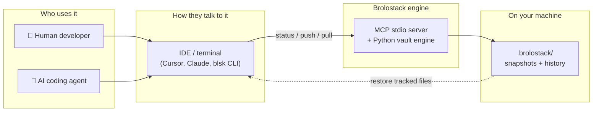
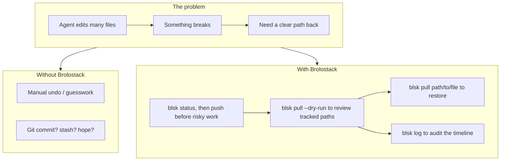
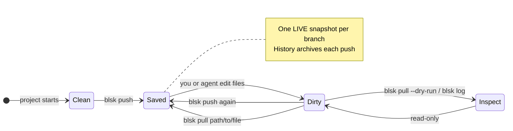
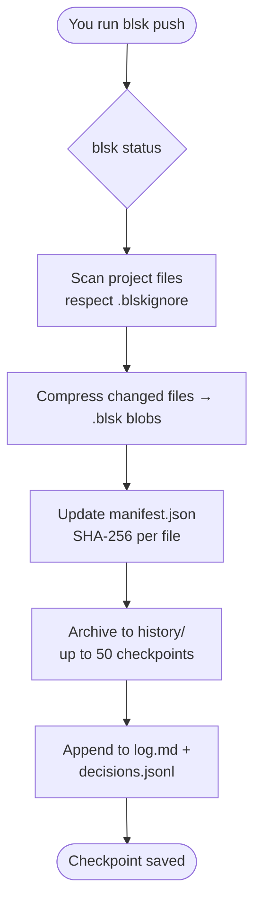
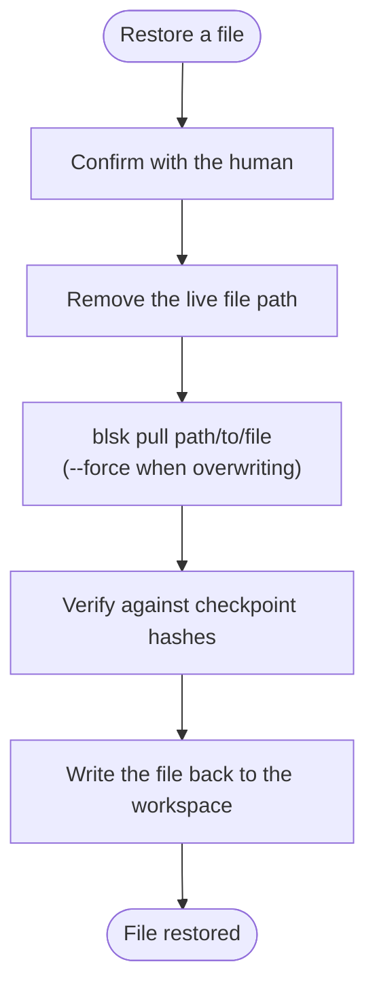
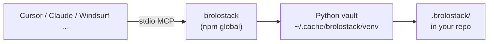

# Brolostack

**A zero-authentication, local-first state vault built for AI coding agents, and the humans who supervise them.**

[`brolostack`](https://github.com/Beunec/brolostack) (CLI alias: `blsk`) is a Model Context Protocol (MCP) stdio server that gives any coding agent, Cursor, Claude Code, Windsurf, Copilot, OpenCode, Codex, Trae, Kimi Code, Zed, or a human at a terminal, a deterministic, file-system-level checkpoint layer. It captures, tracks, and restores project files without Git credentials or SSH keys. **MCP tools never open network connections.**

**Creator:** Olu A

**Owner:** Beunec Technologies, Inc.  

**License:** [MIT](https://github.com/Beunec/brolostack/blob/main/LICENSE)

**Source & docs**

- [Project repository](https://github.com/Beunec/brolostack)
- [AGENTS.md](https://github.com/Beunec/brolostack/blob/main/AGENTS.md): operational protocol for coding agents
- [BLSKCOMMANDS.md](https://github.com/Beunec/brolostack/blob/main/BLSKCOMMANDS.md): command reference
- [SECURITY.md](https://github.com/Beunec/brolostack/blob/main/SECURITY.md): security model
- [CONTRIBUTING.md](https://github.com/Beunec/brolostack/blob/main/CONTRIBUTING.md): how to contribute
- [LICENSE](https://github.com/Beunec/brolostack/blob/main/LICENSE)

---

## Visual overview

**Think of Brolostack as a local “save game” for your project**, like hitting save in a video game before a boss fight, except it works with AI agents and your real code files.



| You want to… | You run… | What happens |
|--------------|----------|--------------|
| Check vault state | `blsk status` | Branch, dirty flag, and checkpoint presence |
| Save current code | `blsk push "message"` | Workspace copied into the local vault |
| Review tracked paths | `blsk pull --dry-run` | Read-only inventory from the current save |
| Restore one file | `blsk pull path/to/file` | That file returned from the latest save |
| Review the timeline | `blsk log` / `blsk log --view` | Inspection and audit of pushes |

**No cloud. No Git login.** MCP agents never initiate network I/O.

---

## Why Brolostack Exists

| Problem | Existing Tool | Why It Falls Short | Brolostack's Answer |
| --- | --- | --- | --- |
| Agents cascade edits across many files in one turn | Manual undo | Sequential, easy to lose "last known good" | Checkpoint first; restore specific files from the last save |
| Snapshot live state safely | Python `pickle` | Untrusted deserialization risk | Inert `.blsk` zlib blobs, never executed |
| Local history without cloud setup | Git / GitHub | Auth, network, merge complexity for a simple save point | Zero Git auth; MCP is local-only after `npm install -g @beunec/brolostack` |

Brolostack is **not** a Git replacement, it is a **supervisory checkpoint layer** for agentic execution.



---

## Checkpoint model

**Live snapshot** = the latest save on your current branch. Each push also archives an entry in local history so the vault keeps a timeline of what was stored.

```text
  YOUR LIVE CODE                    BROLSTACK VAULT (.brolostack/)
  ───────────────                   ────────────────────────────────

  src/app.py  ──push──►             branches/main/src/app.py.blsk  ◄── "latest"
       │                                    │
       │  (you keep editing)                 │  history/ archives each push
       ▼                                    ▼
  src/app.py  ◄──pull <file>──      live snapshot (+ archived pushes)
```



| Concept | Plain English | Command |
|---------|---------------|---------|
| **Live snapshot** | The save `pull <file>` reads from | `blsk push "message"` |
| **Status** | What branch you are on, and whether it is dirty | `blsk status` |
| **Inventory** | Paths held by the current checkpoint | `blsk pull --dry-run` |
| **File restore** | Bring one tracked file back from the save | `blsk pull path/to/file` |
| **Timeline** | What was pushed, and when | `blsk log` / `blsk log --view` |

* **One live snapshot per branch** each `push` updates the latest on `branches/<name>/`.
* **Each `push` also archives** to `history/<branch>/<session_hash>/` (up to 50 per branch).
* **`pull <file>`** restores a specific tracked file from the latest live snapshot.
* **`pull --dry-run`** lists restore paths for inspection only.
* **`log` / `log --view`** support audit without changing the workspace.

---

## Working with coding agents

Coding agents interact with Brolostack through a small, deliberate set of MCP tools. Every mutating step requires human confirmation. Full protocol: [AGENTS.md](https://github.com/Beunec/brolostack/blob/main/AGENTS.md). Command tables: [BLSKCOMMANDS.md](https://github.com/Beunec/brolostack/blob/main/BLSKCOMMANDS.md).

### `blsk status`

Read the current branch, whether a checkpoint exists, and whether the workspace is dirty. This is read-only, start here before any push or restore.

### `blsk push "message"`

Store the entire tracked workspace into the vault. Before an initial push or any subsequent push, the agent asks the human for confirmation and for a commit message. Pass the message as a positional argument:

```bash
blsk push "Your commit message here"
```

### `blsk pull --dry-run`

Review which files and folders the current checkpoint tracks. Parse the `restore:` lines in the output to build an inventory of tracked paths. This command is informational only, it does not write files and is not used for restoration. When a path needs to come back from the vault, use file-path `pull` below, one file at a time.

### `blsk pull path/to/file`

Restore a specific file from the latest checkpoint. Ask the human for confirmation before running.

Restoration works at the **file** level, restore tracked files by path, one at a time. To bring a file back from the vault, remove that file from the live workspace first, then pull it. When the human asks to overwrite local modifications in place (for example, an unpushed deletion), use:

```bash
blsk pull --force path/to/file
```

### `blsk log` / `blsk log --view`

Inspect and audit the push timeline whenever context is needed. These commands are non-mutating, they provide information without changing the codebase.

---

## Installation

```bash
npm install -g @beunec/brolostack   # postinstall bootstraps Python venv + pip install -e .
```

Package: [`@beunec/brolostack`](https://www.npmjs.com/package/@beunec/brolostack) · Source: [github.com/Beunec/brolostack](https://github.com/Beunec/brolostack)

### How push and file restore work





---

## Quick Start

```bash
blsk status                              # branch, dirty, has_checkpoint
blsk push "before refactor of auth"      # snapshot workspace (confirm + message)
blsk pull --dry-run                      # inventory tracked paths (read-only)
blsk pull src/auth/login.py              # restore one file (confirm first)
blsk log --view                          # audit the timeline
```

---

## Command reference

| Command | Effect |
| --- | --- |
| `blsk status` | Branch, dirty state, and checkpoint presence (read-only) |
| `blsk push "message"` | Snapshot tracked files to `.blsk` on the active branch |
| `blsk pull --dry-run` | List tracked restore paths without writing files |
| `blsk pull <file>` | Restore one tracked file from the latest live snapshot |
| `blsk pull --force <file>` | Restore one file, overwriting local modifications |
| `blsk log` / `blsk log --view` | Checkpoint timeline for inspection and audit |

### MCP tools

`status` · `push` · `pull` · `log` · `log_view`

Agents use `status` before every session, `push` with human-approved messages, `pull --dry-run` for inventory, file-path `pull` (and `--force` when the human requests it) for restoration, and `log` / `log_view` for audit.

---

## What Gets Stored

```text
~/.config/brolostack/
├── identity.key             # global private Ed25519 key (chmod 600)
├── identity.pub             # global public key
└── identity.meta.json       # peer ID + username

your-project/
├── .blskignore              # glob patterns excluded from tracking (auto-created)
└── .brolostack/
    ├── branches/
    │   └── main/
    │       ├── manifest.json          # path → SHA-256 map
    │       └── src/app.py.blsk        # compressed snapshot blobs
    └── history/
        └── main/
            └── <session_hash>/        # archived push (up to 50)
```

Snapshots use `filename.ext.blsk` naming. `.blsk` files are engine-written only, never edit them by hand.

---

## Security & Privacy

See [SECURITY.md](https://github.com/Beunec/brolostack/blob/main/SECURITY.md) for the full security model.

- **No central auth**L no SSH, tokens, or API keys to a cloud service
- **MCP is local-only**: agent tools never open sockets or initiate network I/O
- **No code execution on restore**: zlib bytes, not pickle/objects
- **Secrets excluded by default**: `.env`, PEM/keys, `.ssh/`, etc. via `.blskignore` + workspace ignores

```
  ┌─────────────────────────────────────────┐
  │           YOUR MACHINE                  │
  │                                         │
  │   IDE / Agent ──► Brolostack ──► disk  │
  │         │              │                │
  │         │              ▼                │
  │         │       .brolostack/            │
  │         │                               │
  │   MCP: no network                       │
  │   ✗ no cloud                            │
  │   ✗ no pickle/exec                      │
  └─────────────────────────────────────────┘
```

---

## Agentic governance

Mutating operations require human confirmation. Agents call `status` before `push`, supply an explicit human-approved message, and restore by file path. Full protocol: [AGENTS.md](https://github.com/Beunec/brolostack/blob/main/AGENTS.md).

## MCP registration



```json
{
  "mcpServers": {
    "brolostack": {
      "command": "brolostack",
      "args": [],
      "type": "stdio",
      "env": { "BROLOSTACK_WORKSPACE": "${workspaceFolder}" }
    }
  }
}
```

Configuration templates for Cursor, Claude, Windsurf, and related hosts live in the [project repository](https://github.com/Beunec/brolostack).

---

## How the vault is organized

**One vault per workspace**: a single `.brolostack/` tree under `BROLOSTACK_WORKSPACE`. Saves stay on your machine.

**Efficient packing**: `push` re-packs added and changed paths and reuses matching `.blsk` blobs. Each push is archived in history (up to 50 per branch).

**Diff-aware storage for text**: changed UTF-8 files may use compact unified-diff blobs when that is smaller than a full copy; binary files use full compression.

---

## Contributing

See [CONTRIBUTING.md](https://github.com/Beunec/brolostack/blob/main/CONTRIBUTING.md).

---

## License

Copyright © 2026 Beunec Technologies, Inc. · [MIT License](https://github.com/Beunec/brolostack/blob/main/LICENSE)
