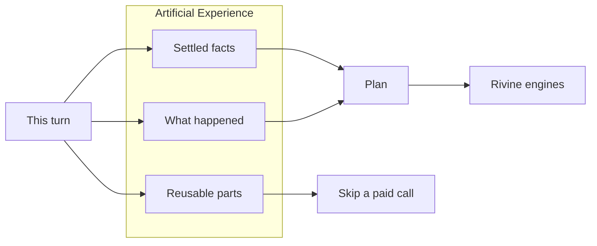
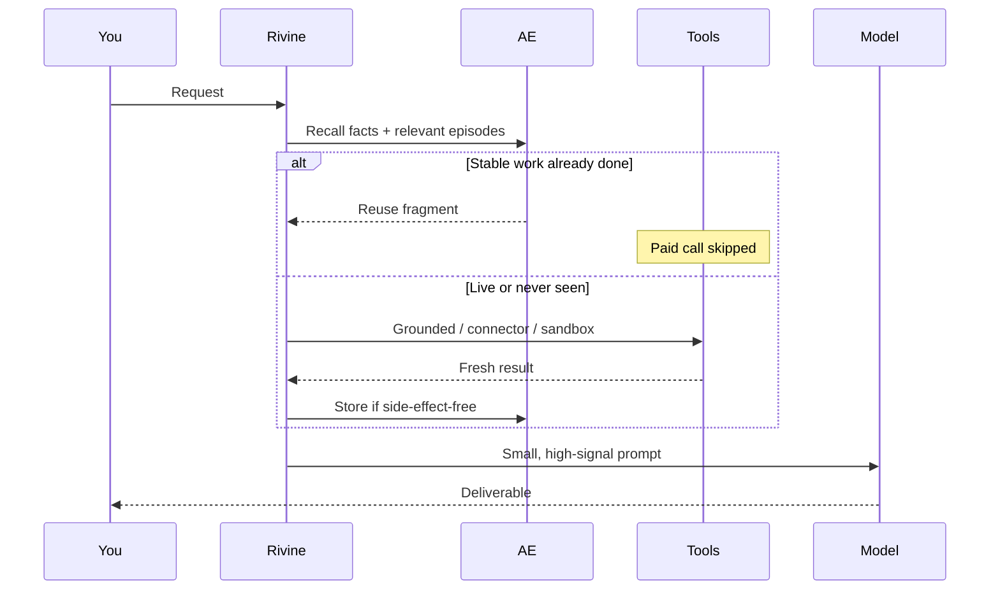

# Artificial Experience

**Aselius Workspace · Rivine engines**

Most AI products treat every request as if it were the first. You pay again for the same research lookup, the same file read, the same failed approach. Artificial Experience (AE) is the layer that makes Rivine **remember what already worked in your workspace**, so Taskforce, Code, Research, and Cicero get faster, cheaper, and more consistent the longer your team uses them.

It is not a bigger prompt. It is not “the model has a long memory.” It is a **software memory of work**: facts, outcomes, and reusable *parts* of prior turns, recalled only when they help the job in front of you.

---

## The problem in one picture

```text
Without AE                         With AE
─────────                         ───────
Ask  →  tools  →  frontier model   Ask  →  “have we done this?”
Ask  →  tools  →  frontier model            │
Ask  →  tools  →  frontier model            ├─ yes, stable data  → reuse
Same bill every time.                       ├─ yes, known failure → don’t repeat
Same mistakes every time.                   └─ no / must be live  → call tools + model
```

Frontier models are intelligent because they were trained on enormous, high-quality data. They are **not** automatically current, and they do **not** know *your* last successful build, *your* grounding sources, or *your* legal constraints unless the product stores and retrieves that work on purpose.

Rivine engines are connected to grounded sources, connectors, and tools. AE’s job is: **if the work was already done well, review and improve it; don’t buy it a second time.**

---

## Three memories, not one blob

AE is easier to trust if you see it as three distinct stores. Mixing them is how products become both expensive *and* wrong.



| Memory | What it holds | What it never holds |
| --- | --- | --- |
| **Facts** | Durable truths the team already established (“this workspace uses X pattern”) | Live prices, weather, the clock |
| **Episodic** | What a turn *did*: successes worth keeping, failures worth not repeating | A full replay of a turn that wrote files or sent messages |
| **Fragments** | Pure lookups: a document already fetched, a digest already written, a file already read | Writes, deploys, emails, “the whole app we generated last week” |

**Whole-turn replay is refused on purpose** when a turn used tools or produced deliverables. Showing yesterday’s answer without repeating yesterday’s effect would look finished and be false. AE reuses **judgment and inputs**, not fake completions.

---

## How it thinks (computational, not mystical)

You do not need the internals. You do need the *shape* of the computation, because that is why it stays safe at enterprise scale.

### 1. Importance, not “save everything”

Every step gets a weight. Failures rank higher than routine success: a dead-end is more valuable to remember than “the test passed.” Sub-agent work ranks higher than a single tool ping. Long, expensive steps rank higher than cheap ones.

```text
keep(step)  if  importance(step)  ≥  bar

importance ≈  outcome
           +  role (lead vs specialist)
           +  cost (time / spend)
           +  substance (was there a reusable detail?)
```

That bar is why AE does not become a second transcript. Storage stays a **signal**, not a dump.

### 2. Freshness, not “cache forever”

```text
volatile   →  never reuse     (markets, weather, “now”, live clocks)
stable     →  reuse until stale  (a filing, a spec, a SHA-pinned file)
durable    →  reuse as pattern   (how this workspace solved auth)
```

If the user says **live / real-time / latest / now**, AE steps aside for that turn’s reads. Intelligence is knowing **when not to remember.**

### 3. Cost the team actually feels

A frontier call is roughly:

```text
spend ≈  (tokens_in + tokens_out)  ×  unit price
```

AE attacks **tokens_in** (don’t re-fetch and re-stuff the same blob) and **avoidable calls** (don’t invoke a tool or a specialist when the fragment already exists). It does not pretend the model got smarter. It pretends less.

---

## Where it sits on a turn



Lead agents and **sub-agents** share this loop. A specialist that cannot see AE will re-buy the same lookup the lead already paid for. That is the opposite of a task force.

---

## How each Rivine engine uses it

Same AE. Different *use*. That is the product.

### Rivine Taskforce: many specialists, one memory

Taskforce is a coordinated crew. Without AE, every specialist rediscovers the brief. With AE:

- The research brief fetched for the lead is **not** fetched again by the writer.
- A failed connector path is **not** retried blindly by the next specialist.
- The crew still **executes** (files, tickets, deploys). AE does not replay a “done” ticket.

**Daily:** “Ship the same weekly ops pack, but this week’s numbers must be live.”  
AE reuses structure and last week’s stable inputs; volatile numbers are fetched again.

### Rivine Code: generate for *this* repo, reuse *how*

Code must not paste last Tuesday’s UI into this Thursday’s product. Workspaces differ.

AE reuses:

- Read-only snapshots (the file already loaded)
- Patterns (“in this workspace, auth is cookie-based”)
- Failures (“that test harness rejects X”)

AE does **not** reuse:

- The generated tree as if it were the answer
- Writes, installs, or sandbox side effects

**Daily:** “Add a settings page like the billing page, but for this design system.”  
AE retrieves the billing *pattern*; Code still writes *this* page.

### Rivine Research: grounded once, cited many times

Research is where duplicate tool spend hurts most: filings, papers, knowledge bases.

- A stable source already pulled becomes a **fragment**. Later questions on the same source enhance the brief instead of re-crawling.
- Live questions (“what did the market do in the last hour?”) bypass reuse.
- Citations stay attached to the stored fragment so the answer remains auditable.

**Daily:** “Update the memo with the same 10-K, plus anything new this quarter.”  
AE reuses the 10-K fragment; only the delta is paid.

### Rivine Cicero: constraints compound; they should not be re-argued

Cicero’s value is consistency under policy, jurisdiction, and prior instruction.

- Settled facts (“this matter is under seal”; “we do not use that clause family”) return as **facts**, not as a new debate.
- Prior failed lines of argument return as **episodic** “don’t repeat.”
- Cicero still reasons on the current facts. AE does not emit a legal conclusion from cache.

**Daily:** “Same counterparty, new SOW, same playbook.”  
AE loads the playbook and the known constraints; Cicero drafts the new instrument.

---

## Simple request vs high-stakes request

| | Simple | High-stakes |
| --- | --- | --- |
| Example | “Summarize yesterday’s notes.” | “Rebuild the dashboard; numbers must be live; keep our chart pattern.” |
| AE | Digest fragment if the notes did not change | Reuse chart *pattern*; refuse stale numbers |
| What you see | Faster, cheaper, same quality | Faster on structure; honest on freshness |
| What you never see | A cached answer to a write | A “complete” app that was not actually rebuilt |

---

## What you can inspect

In workspace observability, AE is visible as **kinds of events**, not as a black box:

- Memory recall (did we find anything?)
- Archive (did we keep a falling-off turn?)
- Exact / semantic / shared reuse of **safe** answers
- Summarize / consolidate (compression of old work)

Empty sections mean that kind has not happened yet; not that the page is hiding it. As engines run, the picture should fill. That is how teams audit whether AE is actually earning its keep.

---

## Guardrails (why enterprises can say yes)

- **Tenant isolation.** Another customer’s work is not your fragment.
- **Reads vs writes.** Only side-effect-free work is reused as data. Actions still run.
- **Human override.** “Live” / “refresh” / “now” wins over memory.
- **No fake completeness.** Tooling and deliverables are not “cached apps.”
- **Bounded recall.** AE injects a small, ranked block, not the entire history, so the model does not drown and meaning does not collapse.

---

## AE vs the Context Extender

Keep these two products straight. They sit next to each other. They are not the same knob.

| | Artificial Experience | Context Extender |
| --- | --- | --- |
| Question | Have we already done this well? | Does this turn even *fit* in the model? |
| When it runs | Whenever there is something worth remembering or reusing | **Only** when the prompt would overflow |
| Superpower | Skip paid work; raise consistency | Operate over a huge corpus with a small prompt |
| Failure if confused | You cache a write and lie | You stuff millions of tokens into one call and pay for mush |

Read [Context Extender](/aselius-platform/docs/context-extender) for the overflow path.

---

*Artificial Experience is how Rivine engines get better at **your** work over time, without pretending a language model magically grew a 5-million-token brain, and without charging you twice for the same grounded fact.*
