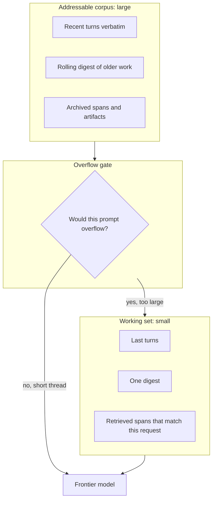
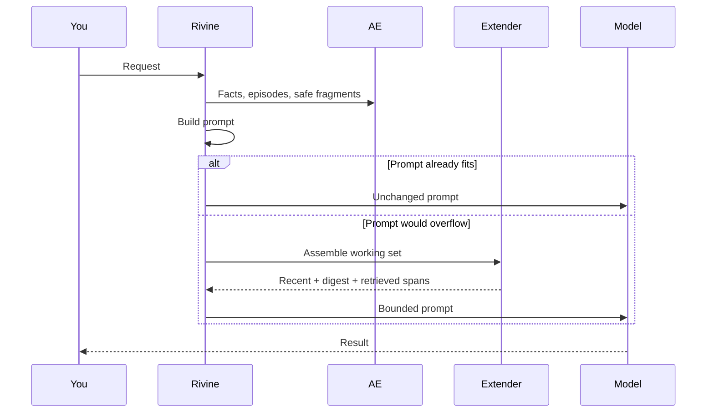

# Context Extender

**Aselius Workspace · Rivine engines**

Language models are smart inside a **window**. Your real work is not. A Taskforce thread, a Codebase, a research corpus, a Cicero matter: these grow past what any frontier model can swallow in one request.

The Context Extender is the software that lets Rivine engines **operate over a very large body of work** (on the order of millions of tokens of history and artifacts) while **never sending millions of tokens to the model**.

It is not Artificial Experience. AE decides *what was worth learning*. The extender decides *what must be in this prompt so the job still fits.*

---

## The honest picture

```text
What people wish                        What actually works
────────────────                        ───────────────────
“Give the model 5,000,000 tokens.”      Keep 5,000,000 tokens in the corpus.
                                        Send a working set that fits.
                                        Retrieve the rest on demand.
```

No serious production path here is “paste the whole matter into one call.” That would be slow, fragile, and ruinously priced, and it **collapses meaning** (the model attends to everything and therefore to nothing).

The extender is **retrieval under a cap**, not concatenation.

---

## Corpus vs working set

Think of two numbers on every turn:

```text
C  =  corpus size     (everything this thread / workspace may address)
W  =  working set     (what this model call is allowed to see)
```

```text
C  can grow  →  10⁵ … 10⁶ … 10⁷  characters of archive
W  is capped →  far below the model window
                 (system + tools + your message + working set must all fit)
```



**Short chats never pay this tax.** If the turn already fits, the extender is a no-op. Prompts stay identical. No extra retrieve, no extra summary call.

---

## When it turns on

```text
engage  if  estimated_prompt_tokens  >  overflow_line
        and estimated_prompt_tokens  >  floor
```

- **Overflow line:** “this would not fit cleanly.”
- **Floor:** “don’t retrieve for a two-line chat even if someone misconfigured the line.”

That is the whole policy in public: **needed, or silent.**

---

## What it assembles (three layers)

Not a search engine bolted on the side. One assembler, same budget math for every Rivine engine and every sub-agent.

```text
working_set  =  recent_verbatim
             +  rolling_digest
             +  retrieved_spans(query)
             ≤  hard_budget
```

| Layer | Role | Why it exists |
| --- | --- | --- |
| **Recent verbatim** | The last stretch of the conversation, word for word | Agents need the live thread, not a paraphrase of “you just said” |
| **Rolling digest** | One compression of what fell off the live window | Continuity without re-paying for every old paragraph |
| **Retrieved spans** | A handful of older pieces that match **this** request | The 2–5M capability: address the corpus without loading it |

Ranking is **lexical and scoped** (this workspace, this thread, this assignment). The public claim is not a magic embedding cluster. The public claim is: **the right few spans, under a hard cap.**

```text
score(span, request)  ↑  when overlap with the current ask is high
budget leftover      ↓  as each accepted span is appended
stop                 when budget is gone
```

Semantic collapse is avoided by **refusing to dump the archive**. More tokens in the prompt is not more intelligence past the window.

---

## Cost and speed (why this is the enterprise move)

Frontier cost is linear in tokens you send:

```text
spend_turn  ≈  (W_in + tokens_out)  ×  price
```

If you naively sent the corpus:

```text
spend_naive  ≈  (C + tokens_out)  ×  price     ← C is huge
latency      ≈  grows with C
```

With the extender:

```text
spend_ext  ≈  (W + tokens_out)  ×  price       ← W is bounded
+ occasional retrieve / digest (only on overflow)
```

```text
C = 2,000,000 tokens of matter
W = a thin working set
ratio  C / W  is the leverage
```

You keep **high-stakes models** for reasoning. You stop using them as a filing cabinet.

---

## How each Rivine engine is empowered

Same extender. Different overflow shape.

### Rivine Taskforce: long-running crews

A task force thread accumulates briefs, specialist reports, and revisions. Without an extender, either the crew **forgets week one** or you **pay to resend week one every time**.

| Without extender | With extender |
| --- | --- |
| Early constraints drop off the window | Digest keeps the mission; retrieve pulls the constraint that matches *this* specialist’s job |
| Sub-agents get a huge paste or nothing | Each specialist gets an **assignment-scoped** working set, not the whole war room |

**Daily:** “Continue the launch program from last month; today’s job is only the pricing page.”  
The extender keeps the program digest; retrieval surfaces pricing decisions, not the entire archive.

### Rivine Code: repos are bigger than windows

A real codebase plus chat plus logs will not fit. Stuffing it produces confident, wrong edits.

| Without extender | With extender |
| --- | --- |
| Model sees a random tail of files | Recent edits stay verbatim; retrieve brings the modules that match the request |
| Sub-agents re-read the same trees | Shared working-set rules; no second dump |

**Daily:** “Fix the billing webhook; don’t touch onboarding.”  
Recent errors stay in the live window; retrieval prefers billing paths; onboarding stays in the corpus, not in the prompt.

### Rivine Research: corpora are the point

Research *is* large context: sources, extracts, prior memos.

| Without extender | With extender |
| --- | --- |
| Old sources vanish or get re-fetched | Stable extracts live in the corpus; overflow retrieve returns the ones that match the new question |
| “Update the memo” forgets the original citations | Digest + retrieved spans keep the spine of the memo addressable |

**Daily:** “Same topic, new angle, don’t lose the primary sources.”  
AE may skip re-fetching a stable source (see [Artificial Experience](./Artificial%20Experience.md)). The extender makes sure that source can still **enter the prompt** when the thread is already huge.

### Rivine Cicero: matters run longer than sessions

A matter has playbooks, prior drafts, and must-not-violate instructions. Losing them mid-thread is an enterprise incident.

| Without extender | With extender |
| --- | --- |
| Early instructions fall out | Digest preserves standing instructions; retrieve pulls the clause family that matches this draft |
| Sub-counsel gets a truncated brief | Assignment-scoped working set: enough to be consistent, not the whole matter dump |

**Daily:** “Fifth revision of the DPA; keep the posture from revision one.”  
Revision one is in the corpus; the extender puts posture + the conflicting paragraph in *W*, not the entire history.

---

## AE and the extender on the same turn



| | Artificial Experience | Context Extender |
| --- | --- | --- |
| **Job** | Don’t redo paid work | Don’t overflow the model |
| **Default** | On, when there is something to remember | **Off**, until overflow |
| **Risk if abused** | Replaying a write | Dumping the archive into one call |
| **User benefit** | Cheaper, more consistent | Still correct on month-long threads |

They stack. They must not merge into one “memory” marketing slide.

---

## Guardrails

- **No-op when small.** Two-message chats are untouched.
- **Hard budget.** The working set cannot crowd out the instructions that make the engine correct.
- **Tenant and thread scope.** Retrieval does not wander into another customer’s corpus.
- **Fail open on the extender, fail closed on the user.** If assembly fails, the turn degrades to ordinary truncation; it does not fail the request.
- **Sub-agents get a slice, not a dump.** Specialists receive what their assignment needs.
- **Live data still live.** The extender does not freeze markets or clocks; freshness policy lives with AE and tools.

---

## What this is not (on purpose)

- Not “unlimited context” as a model feature.
- Not stuffing 2–5 million tokens into Claude, Gemini, or Bedrock in one shot.
- Not a second brain that bypasses Rivine.
- Not a replacement for Artificial Experience.

It is **software that keeps high-stakes engines accurate after the work outgrows the window**, which is when Taskforce, Code, Research, and Cicero become daily infrastructure rather than demos.

---

*The corpus can be vast. The prompt stays small. That is how Rivine stays fast, affordable on frontier models, and coherent on the work that actually matters.*
