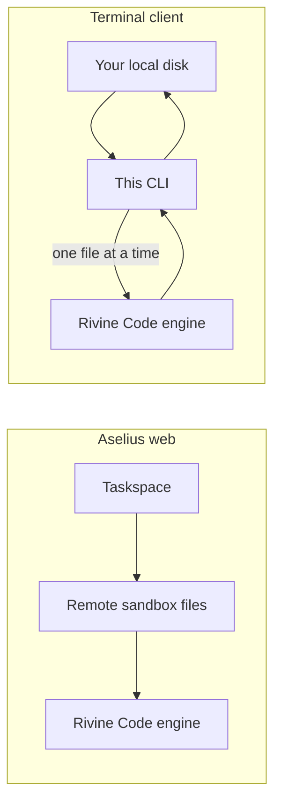
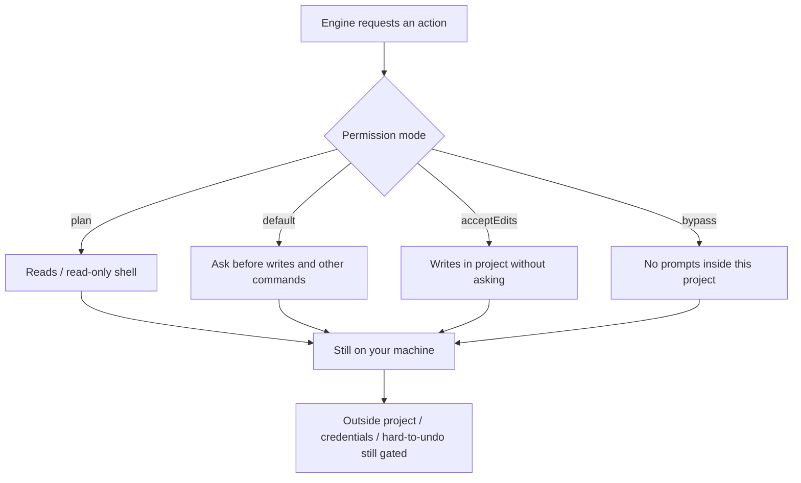

# Rivine Code, in your terminal


Requires Node 20 or newer.

```
npm install -g @beunec/rivine
cd your-project
rivine login
rivine
```

Rivine Code is Beunec's software engineering engine. On the web it works inside
an Aselius Taskspace, on files it holds in a remote sandbox. This client takes
it out of that box: the engine still runs on Beunec's infrastructure, but the
files it reads and writes are **the ones already on your disk**, in the
directory you started it in, open in your editor, tracked by your git.



*Figure: same engine; web works in a sandbox, CLI works on the files already on your machine.*

Nothing is uploaded. There is no "attach your repo" step and no sync. The
engine asks for a file, this client reads it, and the answer goes back: one
file at a time, only the ones it actually opens. A 40,000-file monorepo costs
nothing to start working in, because nothing is copied anywhere.

## What it does

- Reads, writes and edits files in your working directory
- Runs commands: your shell, your PATH, your nvm/pyenv shims
- Runs the same five Modes as the web engine, Frontend Only, Backend Only,
  Full Stack, Plan/Ask Only, and Security Scan/Fix, so a narrow request stays
  scoped to what it actually needs
- Asks you a question when a decision is genuinely yours to make
- Keeps a per-project memory in `.rivine/`, so tomorrow's session knows what
  yesterday's did

## Running commands

Commands run in your own shell, in your working directory, streaming: you see
output as it is produced, not in one block when the command exits. A two-minute
install and a hung one no longer look the same.

Where the platform allows it the command gets a real terminal (a PTY), which
means `isatty` is true and tools behave the way they do when you run them by
hand: colour, progress bars, and the interactive prompts some of them open with.
If a command asks you something, type the answer and press Enter; while a
command is running your input goes to the command, not to the agent. `esc`
stops it; the agent sees the non-zero exit and decides what to do about it.

The terminal comes from `node-pty`, an optional dependency. If it cannot be
installed or a PTY cannot be allocated, commands still run and still stream,
just without a terminal. Nothing fails. `RIVINE_NO_PTY=1` forces the pipe path.

What you see and what the model is sent are deliberately different. Escape codes
are stripped and redrawn lines are collapsed to their final state before the
output leaves your machine, so a progress bar that repainted four hundred times
costs one line rather than four hundred. This is why a real terminal does not
cost more per turn than not having one.

## Permission modes

These are a different thing from `-m`/`--mode` above: that flag picks which
**agent** runs (frontend, backend, and so on); this section is about what the
CLI will do **without asking you first**, regardless of which agent you picked.

The engine runs on our servers. The decision about what happens to your machine
is made **here**, on your machine, before anything runs, never on our servers.

| Mode | Applies without asking | How to choose |
|---|---|---|
| `plan` | Reads, and shell commands that only read | `1`, `/plan`, `--plan`, Shift+Tab |
| `default` | Reads, and read-only commands. Asks before writes and other commands | `2`, Shift+Tab |
| `acceptEdits` | Writes inside the project. Still asks before commands | `3`, `/accept`, `-m acceptEdits`, Shift+Tab |
| `bypass` | No prompts *inside this project*. Still cannot leave the directory | `4`, `/mode`, `--bypass` |

The first interactive session asks how Rivine should work here (`1`-`4`).
Enter keeps **Accept edits**. `--plan`, `-m …`, and `--bypass` skip the
question because you already answered it.



*Figure: the engine runs remotely; permission decisions stay local, before anything runs.*

Shift+Tab cycles plan → default → accept edits. **`bypass` is not in that
cycle**: you cannot land on it by pressing a key once too often. `/mode`
reopens the picker, which is how you reach it mid-session without a flag.

What stays gated:

- **Anything outside the project.** Refused in `bypass` (set
  `RIVINE_ALLOW_OUTSIDE_PROJECT=1` if you mean it). Other modes ask. The jail
  resolves symlinks first, so a link pointing out of the directory is caught
  rather than followed.
- **Credentials**: every mode except `bypass`. `.env`, `*.pem`, `~/.ssh`,
  `~/.aws`, service-account JSON. These ask on *read* too; reading one puts
  a live secret into a model prompt.
- **Commands that are hard to undo**: every mode except `bypass`. `rm -rf`,
  `git push`, `--force`, `git reset --hard`, `sudo`, `npm publish`, any
  deploy, `terraform apply`.
- **Batch writes**: every mode except `bypass`. Judged by their most
  dangerous entry, so a safe first file cannot clear a whole batch.

One exemption: `.rivine/`, the agent's own notebook for this project, seeded at
session start and appended to at the end of each turn. It writes without asking
(except in `plan` mode), for the same reason `.git/` does. It ships with its own
`.gitignore`.

## Commands

```
rivine                          start a session in the current directory
rivine "add tests for auth.ts"  one prompt, then exit
rivine -p "..."                 the same, explicitly
rivine --plan                   start read-only
rivine -C ../other-project      run against a different directory
rivine -m backend               run in a specific Mode: frontend | backend | fullstack | simple | security
rivine --rate bypass            how edits apply: manual (review) | bypass (apply as it works)

rivine login                    sign in (opens your browser)
rivine login --device           sign in on a machine with no browser
rivine logout                   remove stored credentials
rivine status                   who you are, where tokens live, what it points at
rivine credits                  open the credits page

rivine mcp list                 configured MCP servers
rivine mcp login <name>         sign in to a remote MCP server
rivine --output-format json     one JSON object on stdout, for CI
```

In a session: type `/` and press Tab. `/help` `/mode` `/plan` `/accept`
`/status` `/diff` `/pr` `/mcp` `/credits` `/clear` `/exit`. `/mode` opens the
permission picker. Shift+Tab cycles plan / default / accept edits. Ctrl+C
quits cleanly.

`/diff` shows what changed in the working tree. `/pr` prepares a pull request
through your own `gh` CLI. It **never pushes without being asked**: on a
branch that has no upstream it stops and tells you, and `/pr push` is the
form that writes to the remote. It also refuses on `main`, and refuses if
`gh` is missing or signed out.

There is no `/compact` or `/summarize`. Context is compacted on the server as
part of how the engine runs, so there is nothing here to trigger by hand.
Opening `rivine` in a directory you have used before continues that
directory's thread; earlier turns are still in context, and the session says
so on startup.

Answers are single keys, and the keys are always printed: `y` allow, `n` skip,
`a` allow all this session, `esc` cancel. Choices are numbered: press the
number. Nothing here makes you type a word to answer a question.

`a` is offered for ordinary writes only. Credentials, paths outside the project
and destructive commands are never batchable, because those are exactly the
ones where per-operation consent still means something.

### Without a terminal

Piped, redirected, in CI, or driven by another tool, there is no keyboard to
read, so `rivine -p "..."` switches to a plain renderer with no cursor
movement and no repaint, safe to redirect to a log.

Anything that would prompt is **refused**, not auto-approved, and the refusal
names the flag that would have allowed it. Granting write access because nobody
was watching is exactly backwards.

```
rivine -p "run the tests and fix what fails" -m acceptEdits
rivine -p "..." --bypass    # CI, on a machine you accept changes to
```

## Sign-in

Authorization Code with PKCE over a loopback redirect. Your browser opens to
`aselius.beunec.com/cli/authorize`, which recognises your existing session and
asks you to confirm this terminal, then redirects to `127.0.0.1:1455`, a port
only a process on your own machine can listen on.

Device code (`--device`) exists for headless machines and is not the default,
deliberately: typing a code into a browser you opened yourself gives you no way
to tell *which* terminal you are authorizing, which is exactly the shape of a
phishing attack. On a box with no browser it is the lesser risk; anywhere else
loopback is strictly better.

Tokens go in your OS keychain (macOS Keychain, GNOME Secret Service, Windows
Credential Manager). Where no keychain is reachable they fall back to
`~/.rivine/credentials.json` with mode 600, and `rivine status` tells you which
is in use. In CI, set `RIVINE_TOKEN` and neither is touched.

**It is the same Aselius account, not a second one.** Auth0 only answers "who
is this person"; your cloudhandle, your BCID and your wallet live in Beunec's
own systems and are looked up from that answer. The terminal signs in through a
different OAuth client than the website, which is why you approve it separately,
but it resolves to the same identity, the same taskspaces and the same
credits. Sign in as the account you use on aselius.beunec.com and it is
literally the same you.

`rivine status` shows a `Renews:` line. If it says `no`, your session cannot
refresh itself and ends when the token expires: sign in again when it does.
That depends on a tenant setting, not on anything you can change locally.

## MCP servers

Rivine hosts MCP servers **from your machine**, the same way Claude Code and
Codex do, not from our cloud.

```
rivine mcp add playwright npx @playwright/mcp@latest
rivine mcp add sentry --transport http --url https://mcp.sentry.dev/mcp --token-env SENTRY_TOKEN
rivine mcp test          # connect and list what each server offers
rivine mcp list
rivine mcp remove <name>
```

In a session, `/mcp` shows what connected and what didn't.

**Why on your machine.** A stdio server *is* a local process: `npx`, `uvx`, a
docker container, a bridge to your own database. Nothing running in our cloud
can spawn it. And for remote servers, calling from here means your tokens stay
on your machine instead of in our infrastructure, and tool results never transit
it. The engine never speaks MCP: it asks this terminal to make the call, exactly
as it asks it to read a file.

**Config.** Two files, same shape as Cursor and Claude Code, so an existing
`mcpServers` block pastes straight in:

| File | For |
|---|---|
| `<project>/.rivine/mcp.json` | servers this repo needs, committable, so teammates get them |
| `~/.rivine/mcp.json` | servers you use everywhere (`--user`) |

Project wins on a name collision. Secrets are never stored: `env` values written
as `$VAR` or `${VAR}` resolve from your real environment at connect time, and a
remote server's token is referenced by variable name (`--token-env`), never by
value.

**Permissions.** An MCP tool can read a database, drive a browser or post to an
API: closer to running a command than reading a file, so it is gated like one.
Every call asks; `plan` mode refuses them outright, because a tool's schema does
not say whether it writes. "Allow all this session" is scoped to **one server**:
approving Playwright never silently approves a database server that connects
later.

**Failures are contained.** A broken server costs one line of text, not a
startup. The others still connect and their tools are still offered.

**Only the tools a turn needs.** Rivine does not put every connected tool in
front of the model on every turn. Servers are scored against your prompt, and an
unrelated request gets none of them: asking to fix a typo does not hand the
model a browser. Naming a server always includes it (`use playwright to…`), and
a server comes in as a whole set, because a browser you can open but not drive
is worse than no browser. The session line tells you which servers were used and
which were skipped.

That is not only a cost control, though it is one; every tool definition is
tokens you pay for on every turn. It is mostly a quality control: a model
holding a capability tends to find a reason to use it.

### Remote servers that need a sign-in

`--token-env` covers servers with a static API key. For hosted servers that
authenticate per user, there is nothing to paste: the credential does not
exist until you consent:

```bash
rivine mcp add notion --transport http --url https://mcp.example.com/mcp
rivine mcp login notion
rivine mcp logout notion   # forget it again
```

This opens your browser, runs the standard OAuth loopback flow against the
server's **own** authorization server, and stores the token in your OS
keychain, never in `.rivine/mcp.json`, which is a file people commit. If a
server publishes no OAuth metadata the command says so rather than guessing at
endpoints.

## In CI

```bash
rivine --output-format json -m bypass -p "fix the failing type errors"
```

In `json` mode **stdout carries exactly one object** and everything else,
tokens, notices, command output, goes to stderr, so the stream stays safe to
pipe into `jq`:

```json
{ "ok": true, "answer": "…", "error": null, "exit_code": 0, "files_written": ["src/a.ts"] }
```

Exit codes are `0` success, `1` error, `2` out of credits (also if you run
`rivine` with no prompt and no terminal), and `3` nothing could be done:
every operation needed approval and there was no terminal to give it. `3`
exists because that run still costs a turn: without it the step would go
green having changed nothing. The result object carries `refused` alongside
`files_written` so a workflow can tell the two apart.

There is a composite action in `action.yml`:

```yaml
- uses: actions/checkout@v4
- uses: Beunec/rivine-action@v1   # published separately on GitHub
  env:
    RIVINE_TOKEN: ${{ secrets.RIVINE_TOKEN }}
  with:
    prompt: fix the failing type errors
```

`mode` defaults to `bypass` because a workflow has no terminal to approve
anything on, and the headless renderer **refuses** rather than auto-approves,
so any other mode stops at the first write. Run it on a checkout you are
willing to have changed, and review the diff before merging.

One turn has to finish inside the engine's **15-minute ceiling**. Local
commands stream and are not the constraint; a single request that needs longer
than that is. Split the work across steps rather than raising the timeout.

## What the server stores

File operations travel through a mailbox table so the engine and your terminal
can hand work back and forth. Those rows carry real source: a write payload is
the file being written.

Each session generates an **AES-256 key on your machine**. It is sent once per
turn in the request body and held in memory for the length of that turn. It is
never written to disk here and never written to storage there, so no database
we keep, and no backup, replica or restore of one, contains the material needed
to open those rows. Rows are also deleted as soon as the engine has read them.

**This is not end-to-end encryption, and we will not call it that.** The engine
has to read your code to reason about it, so plaintext exists in server memory
while a turn is running. What the session key removes is every path that goes
through storage rather than through a live process: a restored snapshot, a
backup bucket, a replica, a support query. That is the larger and longer-lived
half of the exposure, not all of it.

An older terminal that sends no key falls back to server-side encryption with
the application's own key, which is weaker in exactly the way described above.

There is no third-party security audit or SOC 2 report for this yet. When there
is one, it will be linked here rather than described.

## Credits

The same wallet as the web app, checked by the same gate. Rivine Code needs a
minimum balance to start a turn (usually **$10.00**); below that the CLI says
so and links to the top-up page rather than starting work it cannot finish.
`rivine status` and the status bar show your balance. The bar refreshes after
each turn.

## Configuration

Nothing is required. Two environment variables exist for non-production
deployments:

| Variable | Default |
|---|---|
| `RIVINE_API_URL` | `https://workspace.beunec.com` |
| `RIVINE_SITE_URL` | `https://aselius.beunec.com` |
| `RIVINE_TOKEN` | unset: a pre-issued token for CI |
| `RIVINE_NO_PTY` | unset: set to `1` to run commands without a PTY |
| `RIVINE_ALLOW_OUTSIDE_PROJECT` | unset: set to `1` only if `bypass` should be allowed to leave the project directory |
| `RIVINE_ASCII` | unset: set to `1` for ASCII glyphs (narrow panes, no Unicode) |

Auth0 parameters are fetched from `GET /api/cli/config` at sign-in, so this
package carries no tenant configuration and a client-id change never requires
anyone to reinstall.

## How it works

```
your terminal                    Rivine engine
─────────────                    ─────────────
rivine ──── POST /stream ──────▶ engine starts
                                 rivine_code needs src/app.ts
       ◀─── SSE fs_request ───── (blocks on a mailbox row)
reads ./src/app.ts
       ──── POST fs-result ────▶ row resolved, engine continues
       ◀─── SSE tokens ────────  answer streams back
```

The engine's file operations arrive as distinct verbs: `read`, `write`,
`edit`, `execute`, rather than as shell commands. That is what lets this
client tell a read from a write and apply the right policy, and it is why
nothing here needs Python on your machine.

The request and its answer meet in a durable row rather than in memory,
because the process holding your stream open is not the one that receives your
POST. The same rows are also readable via
`GET /api/cli/sessions/{id}/pending`, which is how a resumed turn works and why
a dropped connection mid-build is survivable rather than fatal.

## In the terminal

Rendering is budgeted rather than best-effort, because a streaming model emits
tokens faster than any terminal can usefully repaint:

- Finished lines are committed once and never redrawn. Only the live region
  below them repaints.
- Tokens flush on a fixed ~24 fps clock, so a 500 token/second stream costs
  about 20 repaints per second instead of 500.
- Nothing is ever wider than your window. Paths truncate in the middle, keeping
  both ends; command output keeps its tail, because that is where the error is.
- Colour degrades: TrueColor, 256, or 16, and `NO_COLOR` is honoured. Colour is
  never the only signal: every line kind has its own glyph, so the transcript
  reads correctly in monochrome and for colour-blind readers. `RIVINE_ASCII=1`
  swaps the glyphs and wordmark for pure ASCII.
- Exits restore the cursor and raw-mode state, including the abnormal ones: a
  kill, or an uncaught error. You should never need to run `reset`.

## Your identity

The status bar shows your **cloudhandle**: the identity you recognise. Your
account key is shown only as `••••••••••••` and the CLI never receives its
value.

That is deliberate: Rivine runs inside a repository that other coding agents
also read. Anything printed here lands in terminal scrollback, and a real
account key there ends up in another agent's context window and, from there, in
some model provider's logs. Masking it at the server means there is nothing to
leak.

## Limits

- One turn holds a server invocation open for up to 15 minutes, including time
  you spend reading an approval prompt. A turn that exceeds it ends; the files
  written up to that point are already on your disk.
- File reads are capped at 2 MB. Larger files are reported rather than
  truncated silently.
- `ls`, `glob` and `grep` skip `node_modules`, `.git`, `dist`, `.next`,
  `target`, `venv` and similar, for cost, not secrecy.
- Command output is capped at 120,000 characters, keeping the tail, because a
  failing build puts its error at the end.

## Development

```
npm install
npm run build
npm test          # jail and permission-policy tests, against real directories
npm run typecheck
```

This package ships compiled JavaScript only; the TypeScript sources are not
redistributed. For maintainers working in the repository, the interesting
code is in `src/protocol/`: `permissions.ts` decides,
`fsExecutor.ts` acts, `runner.ts` coordinates one turn. `src/ui/` only renders;
nothing with a consequence lives there.

---

Rivine Code CLI: licensed and owned by **Beunec Technologies, Inc.**
Proprietary software. Not open source. Use is governed by the licence
agreement accompanying it.
