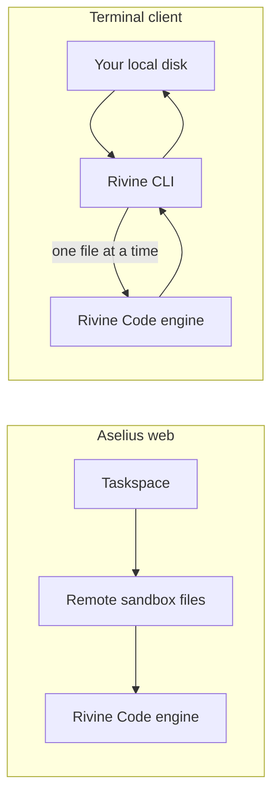
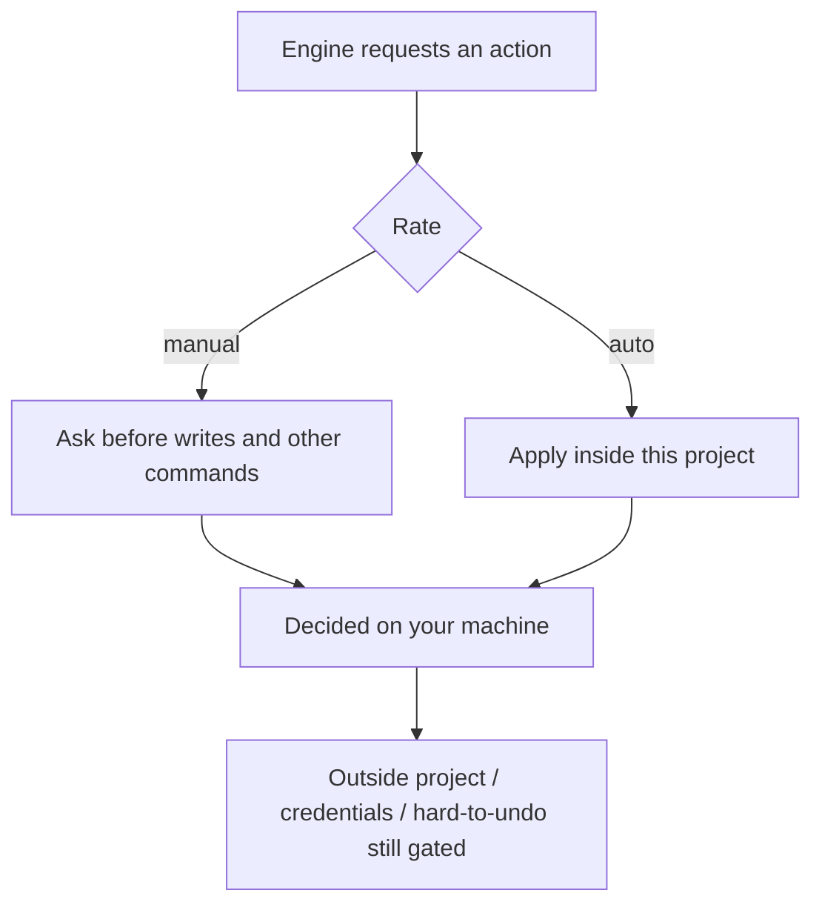

# Rivine Code CLI

The Rivine Code CLI brings Aselius's software engineering engine into your terminal. The engine runs on Beunec's infrastructure, but it reads, writes and runs **the files already on your disk**, in your editor and under your git.


## At a glance

- **What it is:** Rivine Code as a terminal client that works on your local project instead of a web sandbox.
- **Best for:** Developers who want the engine in an existing repo, in their own shell, or in CI.
- **You get:** Real edits on disk, streamed command output, and a per-project memory between sessions.
- **Two settings:** `mode` picks the kind of work (frontend, backend and so on); `rate` picks how changes apply, `manual` or `auto`.
- **Safety:** Every permission decision is made on your machine, before anything runs.
- **Cost:** Same Aselius wallet as the web app. A turn needs a balance of at least $10.
- **Requires:** Node 20 or newer and an Aselius account. Available on every plan.

## Install and start

```
npm install -g @beunec/rivine
cd your-project
rivine login
rivine
```

1. Install the package globally with npm.
2. Change into the project you want to work on.
3. Run `rivine login` and confirm the terminal in your browser.
4. Run `rivine` to start a session in that directory.

## How it differs from the web engine



*Figure: same engine; the web app works in a sandbox, the CLI works on the files already on your machine.*

Nothing is uploaded in bulk. There is no "attach your repo" step and no sync: the engine asks for a file, the CLI reads it and sends back only that file. A 40,000-file monorepo costs nothing to start working in, because nothing is copied ahead of time.

## What it does

- Reads, writes and edits files in your working directory.
- Runs commands in your own shell, with your PATH and your version-manager shims (nvm, pyenv and similar).
- Runs the same five Modes as the web engine, so a narrow request stays scoped to what it needs.
- Asks you a question when a decision is genuinely yours to make.
- Keeps a per-project memory in a `.rivine/` folder, so tomorrow's session knows what yesterday's did.

| Mode | `--mode` value |
|---|---|
| Frontend Only | `frontend` |
| Backend Only | `backend` |
| Full Stack | `fullstack` |
| Plan / Ask Only | `simple` |
| Security Scan / Fix | `security` |

## Commands

```
rivine                          start a session in the current directory
rivine "add tests for auth"     one prompt, then exit
rivine -p "..."                 the same, explicitly
rivine -C ../other-project      run against a different directory
rivine --mode backend           engine Mode: frontend | backend | fullstack | simple | security
rivine --rate manual            permission: manual (asks before changes) | auto (applies as it works)

rivine login                    sign in (opens your browser)
rivine login --device           sign in on a machine with no browser
rivine logout                   remove stored credentials
rivine status                   who you are, where tokens live, your balance
rivine credits                  open the credits page

rivine mcp list                 configured MCP servers
rivine mcp login <name>         sign in to a remote MCP server
rivine --output-format json     one JSON object on stdout, for CI
```

### In a session

| Command or key | What it does |
|---|---|
| `/` then Tab | List the slash commands |
| `/help` | Show help |
| `/mode` | Switch the engine Mode |
| `/rate` | Switch the permission rate: `manual` or `auto` |
| `/status` | Show account, sign-in and balance |
| `/diff` | Show what changed in the working tree |
| `/pr` | Prepare a pull request through your own `gh` CLI |
| `/mcp` | Show which MCP servers connected and which did not |
| `/credits` | Open the credits page |
| `/clear`, `/exit` | Clear the screen, or leave |
| Ctrl+C | Quit cleanly |

- **`/pr` never pushes unless asked.** On a branch with no upstream it stops and tells you; `/pr push` is the form that writes to the remote. It refuses on `main`, and when `gh` is missing or signed out.
- **Sessions continue.** Opening `rivine` in a directory you used before continues that directory's thread, and the session says so on startup.
- **No `/compact` or `/summarize`.** Long sessions are managed automatically on the server.

### Answering prompts

Answers are single keys, and the keys are always printed: `y` allow, `n` skip, `a` allow all this session, `esc` cancel. Choices are numbered: press the number.

> **Note:** `a` is offered for ordinary writes only. Credentials, paths outside the project and destructive commands always ask one at a time.

## Running commands

Commands run in your shell and working directory, and output streams as it is produced. A two-minute install and a hung one no longer look the same.

- **Real terminal where possible.** Tools behave as they do by hand: colour, progress bars and interactive prompts. While a command runs, your typing goes to the command, not to the agent.
- **`esc` stops a command.** The agent sees the non-zero exit and decides what to do next.
- **Fallback.** If a real terminal cannot be opened, commands still run and stream, just without one. Set `RIVINE_NO_PTY=1` to force this.
- **Cheaper output.** Escape codes are stripped and redrawn lines collapse to their final state before output leaves your machine. A progress bar that repainted 400 times costs one line.

## Permission rate

`rate` controls what the CLI does **without asking you first**. It is separate from the Mode, which controls what kind of work runs. For read-only work, choose the `simple` Mode (Plan / Ask Only).

| Rate | Applies without asking | How to choose |
|---|---|---|
| `manual` | Reads, and shell commands that only read. Asks before every write and every other command | `--rate manual`, `/rate` |
| `auto` | Writes and commands *inside this project*. Still cannot leave the directory | `--rate auto`, `/rate` |

1. The first interactive session asks which rate to use in this project.
2. Press Enter to keep **manual**.
3. `--rate` skips the question because you already answered it.



*Figure: the engine runs remotely; permission decisions stay on your machine, before anything runs.*

### What stays gated

| Action | Behaviour |
|---|---|
| **Anything outside the project** | Refused in `auto`; `manual` asks. Symlinks that point out of the directory are caught, not followed. Set `RIVINE_ALLOW_OUTSIDE_PROJECT=1` only if `auto` should be allowed to leave it. |
| **Credentials** (`.env`, `*.pem`, `~/.ssh`, `~/.aws`, service-account key files) | Asks in `manual`; applies without a prompt in `auto`, on *read* too, because reading one puts a live secret into a prompt. |
| **Hard-to-undo commands** (`rm -rf`, `git push`, `--force`, `git reset --hard`, `sudo`, `npm publish`, any deploy, `terraform apply`) | Asks in `manual`; applies without a prompt in `auto`. |
| **Batch writes** | Asks in `manual`; applies without a prompt in `auto`. Judged by the most dangerous entry, so a safe first file cannot clear a whole batch. |

The one exemption is `.rivine/`, the agent's own notebook for the project. It writes without asking (except in the `simple` Mode), the same way `.git/` does, and ships with its own git-ignore rule.

### Without a terminal

Piped, redirected, in CI or driven by another tool, `rivine -p "..."` switches to a plain renderer that is safe to redirect to a log.

> **Note:** Anything that would prompt is **refused**, not auto-approved, and the refusal names the flag that would have allowed it.

```
rivine -p "run the tests and fix what fails" --mode fullstack --rate auto
rivine -p "review this branch" --mode simple    # read-only
```

## Sign-in

1. Run `rivine login`. Your browser opens to aselius.beunec.com, which recognises your existing session.
2. Confirm this terminal. The browser hands the sign-in back to a local address only your own machine can receive.
3. The CLI stores your tokens in your OS keychain (macOS Keychain, GNOME Secret Service, Windows Credential Manager).

- **No keychain?** Tokens fall back to a private file in your home folder readable only by you. `rivine status` tells you which is in use.
- **Headless machines.** `rivine login --device` signs in with a code. It is not the default, because a typed code cannot show *which* terminal you are authorizing. Use it only where there is no browser.
- **Same account.** The CLI resolves to the same Aselius identity, taskspaces and credits as aselius.beunec.com. You approve the terminal separately the first time.
- **Renewal.** `rivine status` shows a `Renews:` line. If it says `no`, the session ends when the token expires: sign in again then.

### Your identity on screen

The status bar shows your **cloudhandle**. Your account key appears only as `••••••••••••`, and the CLI never receives its value. Other coding agents read the same repository and scrollback, so there is nothing there to leak.

## MCP servers

Rivine runs MCP servers **from your machine**, not from Beunec's cloud. Local servers (`npx`, `uvx`, a docker container, a bridge to your own database) can only run there, and remote-server tokens and tool results stay on your machine.

```
rivine mcp add playwright npx @playwright/mcp@latest
rivine mcp add sentry --transport http --url https://mcp.sentry.dev/mcp --token-env SENTRY_TOKEN
rivine mcp test          # connect and list what each server offers
rivine mcp list
rivine mcp remove <name>
```

In a session, `/mcp` shows what connected and what did not.

### Configuration files

The files use the same shape as Cursor and Claude Code, so an existing `mcpServers` block pastes straight in.

| File | For |
|---|---|
| `<project>/.rivine/mcp.json` | Servers this repo needs. Committable, so teammates get them |
| `~/.rivine/mcp.json` | Servers you use everywhere (`--user`) |

- The project file wins on a name collision.
- **Secrets are never stored.** `env` values written as `$VAR` or `${VAR}` resolve from your environment at connect time. A remote server's token is referenced by variable name (`--token-env`), never by value.

### How MCP tools are gated

- **Every call asks.** An MCP tool can read a database, drive a browser or post to an API, so it is treated like a command.
- **The `simple` Mode refuses MCP calls,** because a tool's description does not say whether it writes.
- **"Allow all this session" covers one server.** Approving Playwright never approves a database server that connects later.
- **Failures are contained.** A broken server costs one line of text. The others still connect.
- **Only the tools a turn needs.** An unrelated request gets no MCP tools, so fixing a typo does not hand the engine a browser. Naming a server (`use playwright to…`) always includes it, as a whole set. The session line shows which servers were used and which were skipped. This also saves cost, since every tool offered is tokens you pay for.

### Remote servers that need a sign-in

`--token-env` covers servers with a static API key. For hosted servers that authenticate each user, sign in instead:

```bash
rivine mcp add notion --transport http --url https://mcp.example.com/mcp
rivine mcp login notion
rivine mcp logout notion   # forget it again
```

Your browser opens to the server's **own** sign-in page, and the token goes in your OS keychain, never in the committable config file. If a server publishes no sign-in details, the command says so rather than guessing.

## In CI

```bash
rivine --output-format json --rate auto -p "fix the failing type errors"
```

In `json` mode **stdout carries exactly one object**. Everything else (tokens, notices, command output) goes to stderr, so stdout is safe to pipe into `jq`.

```json
{ "ok": true, "answer": "…", "error": null, "exit_code": 0, "files_written": ["path/to/changed-file"] }
```

| Exit code | Meaning |
|---|---|
| `0` | Success |
| `1` | Error |
| `2` | Out of credits (also when `rivine` runs with no prompt and no terminal) |
| `3` | Nothing could be done: every operation needed approval and there was no terminal |

Code `3` exists because that run still costs a turn; without it, the step would go green having changed nothing. The result object includes `refused` alongside `files_written` so a workflow can tell the two apart.

### GitHub Actions

Store your pre-issued Rivine token as a repository secret named `RIVINE_TOKEN`. When `RIVINE_TOKEN` is set, the CLI uses it and does not touch the keychain or open a browser.

```yaml
- uses: actions/checkout@v4
- uses: Beunec/rivine-action@v1   # published separately on GitHub
  env:
    RIVINE_TOKEN: ${{ secrets.RIVINE_TOKEN }}
  with:
    prompt: fix the failing type errors
```

- `rate` defaults to `auto`, because a workflow has no terminal to approve anything and `manual` stops at the first write.
- Run it on a checkout you are willing to have changed, and review the diff before merging.

> **Note:** One turn must finish within 15 minutes. Split long work across steps rather than raising the step timeout.

## What the server stores

File contents pass through Beunec's servers only while the engine and your terminal hand work back and forth. That includes real source, since a write carries the file being written.

- **Session key on your machine.** Each session creates an AES-256 key locally. It is sent once per turn and held in memory only for that turn.
- **Never at rest.** The key is never written to disk or to storage, so no database, backup or restore holds what is needed to open your file data. The data itself is deleted as soon as the engine has read it.
- **Not end-to-end encryption.** The engine has to read your code to reason about it, so plaintext exists in server memory while a turn runs. The session key removes every path through storage, not that one.
- **Keep the CLI updated.** Older versions that send no key fall back to server-side encryption with Beunec's key, which is weaker.

> **Note:** There is no third-party security audit or SOC 2 report for the CLI yet. When there is one, it will be linked here.

## Credits

- Same wallet as the web app, with the same check.
- A Rivine Code turn needs a balance of at least **$10.00** to start, on every plan. Below that, the CLI says so and links to the top-up page instead of starting work it cannot finish.
- `rivine status` and the status bar show your balance. The bar refreshes after each turn.

See [Plans and pricing](/aselius-platform/docs/plans-pricing) for how credits are billed.

## Optional settings

Nothing is required. These environment variables are for your own setup:

| Variable | Use |
|---|---|
| `RIVINE_TOKEN` | A pre-issued token for CI. When set, no browser sign-in or keychain is used |
| `RIVINE_NO_PTY` | Set to `1` to run commands without a real terminal |
| `RIVINE_ALLOW_OUTSIDE_PROJECT` | Set to `1` only if `auto` should be allowed to leave the project directory |
| `RIVINE_ASCII` | Set to `1` for ASCII glyphs (narrow panes, no Unicode) |
| `NO_COLOR` | Standard: turns colour off |

## Display

- Nothing is wider than your window. Paths truncate in the middle; command output keeps its tail, where errors are.
- Colour adapts to your terminal, and colour is never the only signal: each line kind has its own glyph, so the transcript reads in monochrome and for colour-blind readers.
- Every exit restores your cursor and terminal state, including a kill or a crash. You should never need to run `reset`.

## Limits

| Limit | Value |
|---|---|
| One turn | Up to 15 minutes, including time spent on an approval prompt. Files written before the limit are already on your disk |
| File reads | 2 MB per file. Larger files are reported, not silently truncated |
| Command output | 120,000 characters, keeping the tail |
| Skipped folders | `ls`, `glob` and `grep` skip `node_modules`, `.git`, `dist`, `.next`, `target`, `venv` and similar, for cost, not secrecy |

## Related

- [Rivine Code](/aselius-platform/docs/rivine-code): Modes, Rate and the web engine
- [Aselius Workspace](/aselius-platform/docs/workspace): Taskspaces, Preview and assets
- [Aselius MCP](/aselius-platform/docs/aselius-mcp): use Aselius engines from other AI apps
- [Plans and pricing](/aselius-platform/docs/plans-pricing): credits and start floors
- [Security disclosure](/aselius-platform/docs/security-disclosure): data handling and reporting

---

Rivine Code CLI: licensed and owned by **Beunec Technologies, Inc.**
Proprietary software. Not open source. Use is governed by the licence agreement accompanying it.
