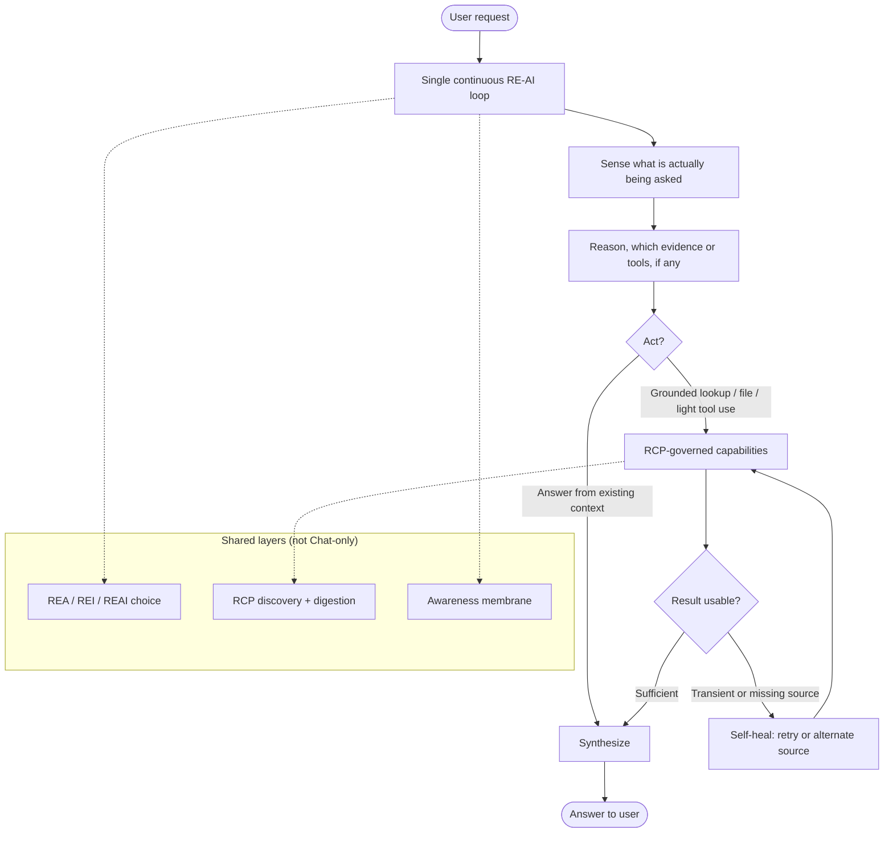

# Rivine Chat  

Rivine Chat is the general-purpose conversational engine, and it is deliberately the least specialized of the five. Its job is to run a full reasoning pass, sense the request, reason about what it actually needs, act (which may mean pulling in grounded data, reading a file, or delegating), and synthesize a final answer, inside a single continuous loop, without the multi-stage delegation machinery the more specialized engines use.




*Figure: Chat shape: one loop, shared RE-AI and RCP underneath. Boxes name stages of work, not internal classes or tools.*

What distinguishes Chat from "a chatbot with tools" is that it inherits the full RE-AI reasoning framework and the full RCP-governed data catalog: it has access to the same breadth of external data sources as the domain engines, and in live testing it demonstrably reaches for the *right combination* of them rather than defaulting to a single generic search path. A representative internal test, a question requiring both a specialized authoritative lookup and a general economic statistic, resulted in the engine chaining a multi-step lookup against the correct grounded source *and* falling back to general search only for the piece of the question that had no specialized source available. That is the self-heal and discovery layers of RCP working as intended, inside the simplest of the five engines.

```text
┌──────────────┐     ┌─────────────────────────────┐     ┌──────────────┐
│ User request │────▶│  Chat continuous loop       │────▶│ Final answer │
└──────────────┘     │  sense → reason → act → out │     └──────────────┘
                     └──────────────┬──────────────┘
                                    │
                     ┌──────────────▼──────────────┐
                     │ RCP catalog  (specialized   │
                     │ sources first; search last) │
                     └─────────────────────────────┘
```