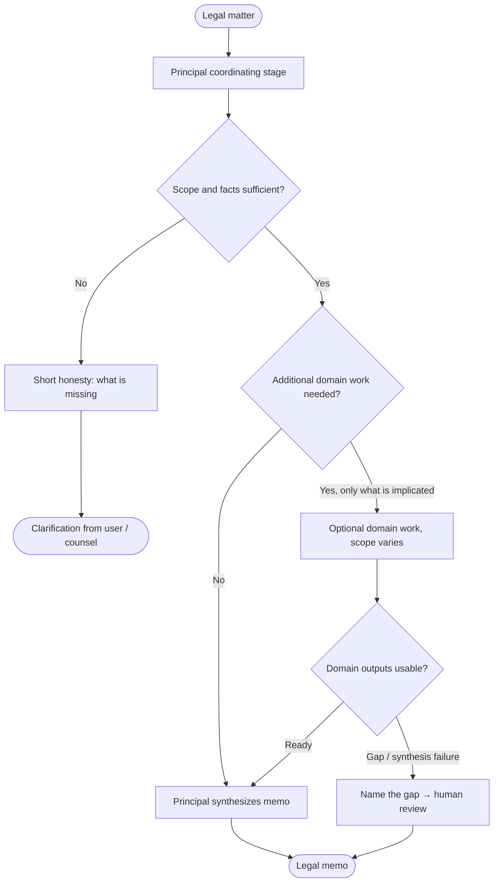

#  Rivine Cicero 

Cicero is Rivine's legal-domain engine, and it is the clearest illustration of conditional delegation in the whole system. A principal coordinating stage, the only stage that produces the final, user-facing memo; deconstructs an incoming legal matter and decides, case by case, *whether* additional domain work is required and *how much*. Only work genuinely implicated by the matter is engaged; the rest of the engine's capacity stays idle. We do not publish the inventory of internal roles, domain slices, or how those roles are composed, that roster is proprietary. What matters architecturally is the rule: **delegation is conditional on the matter, not automatic.**



*Figure: Cicero shape: one memo owner; optional domain work is conditional; gaps escalate instead of being padded over. Internal role names and domain catalog omitted on purpose.*

```text
                 ┌──────────────────────────────┐
                 │ Principal (memo owner only)  │
                 └──────────────┬───────────────┘
                                │
              ┌─────────────────┼─────────────────┐
              ▼                 ▼                 ▼
        Insufficient      Sufficient +       Sufficient +
        facts → ask       no extra work      selective domain
                                              work (unlisted)
                                │                 │
                                └────────┬────────┘
                                         ▼
                              Memo / HITL if gap
```

Two properties of Cicero matter more than the delegation mechanics themselves. First, **output length is calibrated to genuine scope and confidence, not to a fixed target.** A real multi-jurisdiction matter legitimately produces a long, detailed memo, the length real law-firm work of that kind actually requires. But when a matter is underspecified, missing the jurisdiction, missing a key fact the analysis depends on; the correct output is a short, honest statement of what's missing and a request for it, not a long document padded to *look* thorough. In internal testing, we deliberately gave the engine both kinds of matter, and it produced the appropriate shape of output for each without being told which case it was in.

Second, when underlying domain analysis genuinely fails; a real synthesis error, not a low-confidence answer, Cicero does not silently absorb that failure into a memo that looks complete. It is required to say so explicitly and route to human review, naming what could not be completed. A legal memo that hides a gap is worse than one that admits it. 