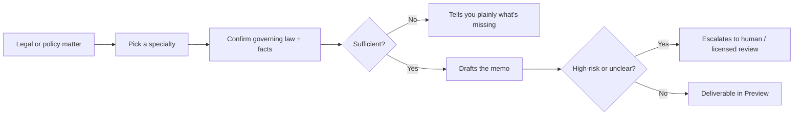
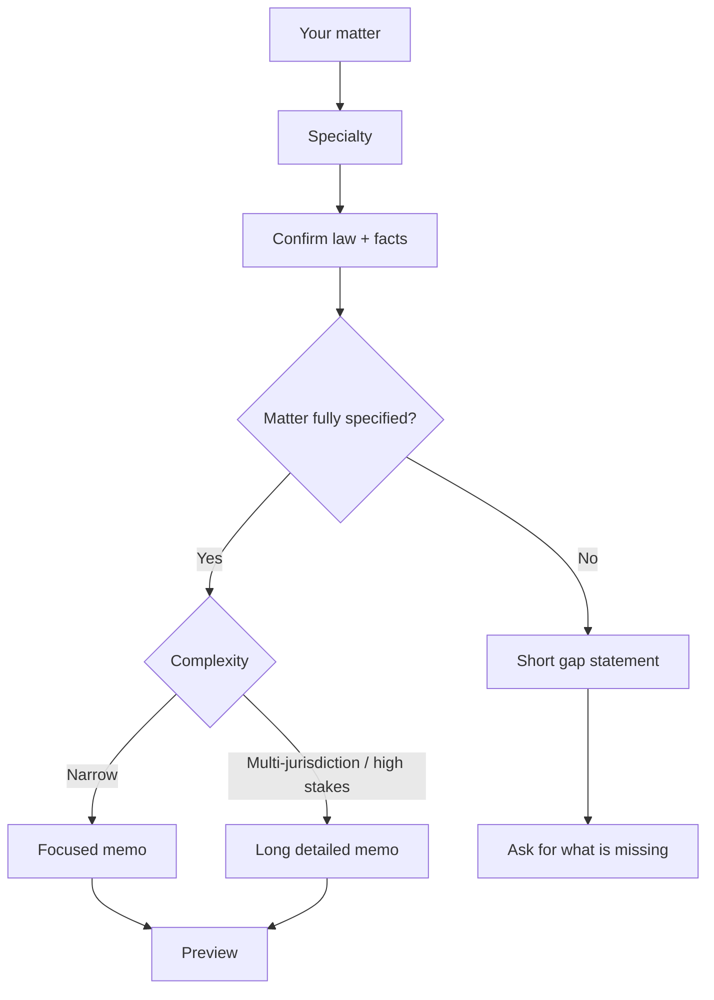

# Rivine Cicero

Rivine Cicero is the legal and policy engine in Aselius for drafting and reviewing contracts, employment terms, immigration questions, corporate documents, patents, M&A diligence and cross-border matters. It confirms governing law and facts first, drafts conservatively, and names gaps or routes high-risk matters to licensed review instead of guessing.

## At a glance

- **What it is:** Research-and-draft support for legal and policy work, under guardrails.
- **Best for:** Founders, consultants, engineering teams, researchers and post-graduates who need careful first drafts and reviews.
- **You get:** A legal memo or draft in Preview, sized to the matter.
- **Cost:** Needs a prepaid balance of at least $3 to start a turn, on every plan. See [Plans and pricing](/aselius-platform/docs/plans-pricing).
- **Limits:** Not a substitute for a licensed attorney or diplomat.

## How it works

1. Choose Rivine Cicero and a specialty in the Taskspace input bar.
2. Describe your matter and attach the documents.
3. Cicero confirms the governing law and the facts the analysis depends on.
4. If something essential is missing, it tells you plainly what is missing and asks for it.
5. If the matter is fully specified, it drafts the memo or document.
6. If the matter is high-risk or unclear, it says so and points you to human or licensed review.
7. The deliverable opens in Preview.

*Figure: Cicero never guesses past a gap; it names it.*

## Specialties

Pick a specialty before you send. One dedicated legal specialist handles the whole matter, start to finish, in a single pass.

| Specialty | Covers |
|---|---|
| **Contract Review** / **Legal Drafting** | Reviewing or drafting contracts, NDAs and commercial agreements |
| **Corporate Law** | Governance, entity formation and compliance |
| **Employment Law** | Offer letters, employment terms and workplace policy |
| **Immigration Law** | Visa, sponsorship and status questions |
| **International Relations** | Cross-border and multi-jurisdiction matters |
| **Patent Compliance** | Patent and prior-art questions |
| **M&A Due Diligence** | Deal-related document review |
| **Policy and Law Drafting** / **General** | Cross-cutting or multi-domain matters that do not fit one specialty |

Not sure which fits? **General** covers the full breadth of practice areas and tells you plainly if your matter needs a narrower specialist.

## Output length follows the matter

| Matter | What you get |
|---|---|
| Narrow and fully specified | A focused memo |
| Multi-jurisdiction or high stakes | A long, detailed memo, the length real law-firm work of that kind requires |
| Underspecified (missing jurisdiction or a key fact) | A short statement of what is missing and a request for it, not a padded document |

*Figure: length follows the matter; underspecified work stays short and honest.*

## Why it matters for high-stakes work

Legal and policy mistakes are expensive and often irreversible. Cicero is built so its failure mode is "tells you it is unsure and routes to a licensed professional", never "confidently wrong". That matters to a founder signing a term sheet, a consultant advising across jurisdictions, or a researcher reading an IP assignment clause.

> **Note:** Cicero produces research and drafts. Have a licensed attorney review anything you sign, file or rely on.

## Who uses it

- **Startup teams:** SAFEs, employment agreements, term sheets and first-hire compliance across jurisdictions.
- **Consulting firms:** NDAs, cross-border data agreements and client-facing policy memos.
- **Software engineering teams:** open-source license review and patent or prior-art disclosure drafting.
- **Research organizations:** multi-institution collaboration and IP-ownership agreements.
- **University post-graduates:** plain-language explanations of IP assignment and research agreement clauses.

## Example prompts

| Persona | Example prompt |
|---|---|
| Startup team | "Review this SAFE agreement draft and flag any terms that deviate from standard YC SAFE language." |
| Consulting firm | "Draft an NDA for a joint due-diligence engagement between our firm and this client, under US governing law." |
| Software engineering team | "Review this open-source dependency's license for compatibility with our proprietary codebase before we ship it." |
| Startup team | "We're hiring our first remote employee in Germany. Draft an employment agreement and flag any mandatory local employment terms we're missing." |
| University post-graduate | "Explain, in plain terms, what this university IP assignment clause means for my thesis research and any patent rights." |
| Consulting firm | "Draft a cross-border data-processing addendum for a client operating in the US, UK and Germany, and flag where GDPR and US state privacy law conflict." |
| Research organization | "Review this multi-institution research collaboration agreement and flag any IP ownership ambiguity across the three participating universities." |
| Startup team | "We're raising a Series A with a foreign lead investor. Draft the term sheet issue list and flag anything requiring immigration or FDI screening review." |
| Software engineering team | "Draft a patent invention disclosure memo for this new caching algorithm and flag any prior art risk from these three uploaded papers." |
| Consulting firm | "A client is expanding into three new international markets. Draft a policy memo identifying the international relations and trade-law touchpoints they need licensed counsel for." |

## Related

- [Workspace](/aselius-platform/docs/workspace)
- [Rivine Research](/aselius-platform/docs/rivine-research)
- [Automations](/aselius-platform/docs/automations)
- [Plans and pricing](/aselius-platform/docs/plans-pricing)
- [Artificial Experience](/aselius-platform/docs/artificial-experience)
