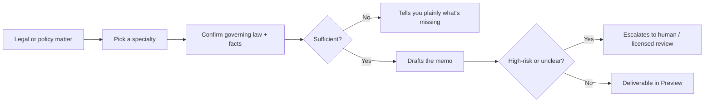
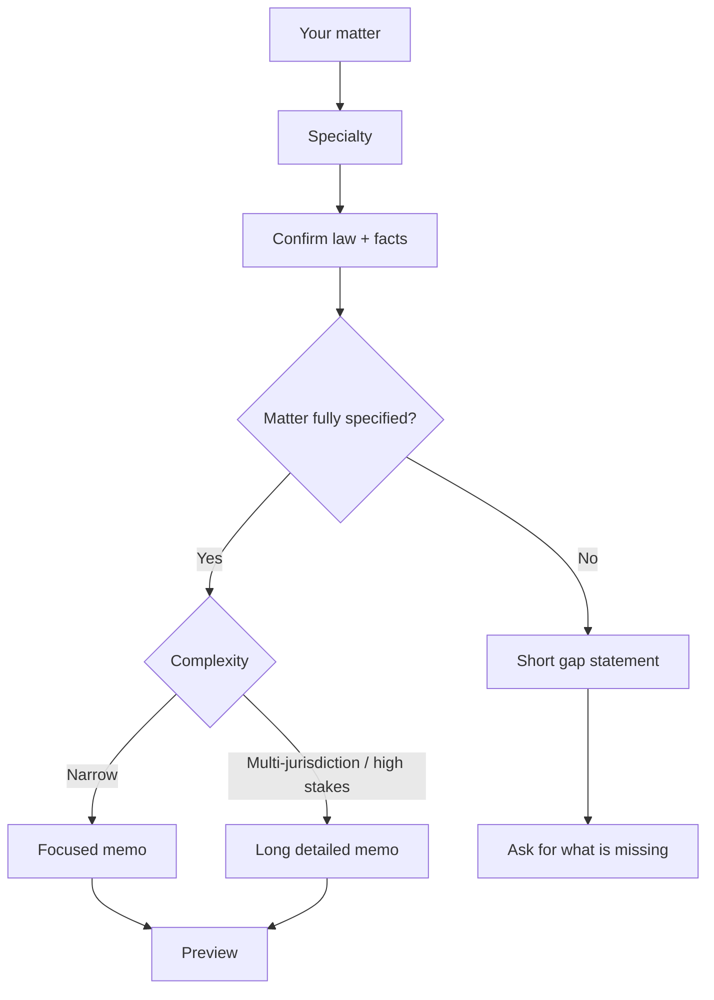

# Rivine Cicero

## What it does (plain language)

Rivine Cicero handles legal and policy drafting and review: contracts, NDAs, employment terms, immigration questions, corporate documents, patents, M&A due diligence, and cross-border/policy matters. It confirms the governing law and the facts first, drafts conservatively, and, when a matter is genuinely high-risk or the facts are missing, says so plainly and routes to human or licensed review instead of guessing. It is research-and-draft support under guardrails, not a substitute for a licensed attorney or diplomat.

*Figure: Cicero never guesses past a gap, it names it.*

## How you work with it

Pick a specialty before you send your matter, and one dedicated legal specialist handles the whole thing, start to finish, in a single pass:

| Specialty | Covers |
|---|---|
| **Contract Review** / **Legal Drafting** | Reviewing or drafting contracts, NDAs, and commercial agreements |
| **Corporate Law** | Governance, entity formation, and compliance |
| **Employment Law** | Offer letters, employment terms, and workplace policy |
| **Immigration Law** | Visa, sponsorship, and status questions |
| **International Relations** | Cross-border and multi-jurisdiction matters |
| **Patent Compliance** | Patent and prior-art questions |
| **M&A Due Diligence** | Deal-related document review |
| **Policy and Law Drafting** / **General** | Cross-cutting or multi-domain matters that don't fit one specialty |

Not sure which one fits? The general specialty handles the full breadth of practice areas and will tell you plainly if your matter needs a narrower specialist.

*Figure: length follows the matter; underspecified work stays short and honest.*

**Output length matches the matter, not a fixed target.** A real multi-jurisdiction question legitimately produces a long, detailed memo, the length real law-firm work of that kind actually requires. But when a matter is underspecified, missing the jurisdiction, missing a fact the analysis depends on, the correct output is a short, honest statement of what's missing and a request for it, not a document padded to look thorough.

## Why this matters for high-stakes work

Legal and policy mistakes are expensive and often irreversible. Cicero is built so the failure mode is "tells you it's unsure and routes to a licensed professional," never "confidently wrong." That is the property that matters most to a founder signing a term sheet, a consultant advising a client across jurisdictions, or a researcher navigating an IP assignment clause.

## Who uses Rivine Cicero

- **Startup teams**: SAFEs, employment agreements, term sheets, and first-hire compliance across jurisdictions.
- **Consulting firms**: NDAs, cross-border data agreements, and client-facing policy memos.
- **Software engineering teams**: open-source license review and patent/prior-art disclosure drafting.
- **Research organizations**: multi-institution collaboration and IP-ownership agreements.
- **University post-graduates**: plain-language explanations of IP assignment and research agreement clauses.

## Real-world prompt examples

| Persona | Example real-world prompt |
|---|---|
| Startup team | "Review this SAFE agreement draft and flag any terms that deviate from standard YC SAFE language." |
| Consulting firm | "Draft an NDA for a joint due-diligence engagement between our firm and this client, under US governing law." |
| Software engineering team | "Review this open-source dependency's license for compatibility with our proprietary codebase before we ship it." |
| Startup team | "We're hiring our first remote employee in Germany, draft an employment agreement and flag any mandatory local employment terms we're missing." |
| University post-graduate | "Explain, in plain terms, what this university IP assignment clause means for my thesis research and any patent rights." |
| Consulting firm | "Draft a cross-border data-processing addendum for a client operating in the US, UK, and Germany, and flag where GDPR and US state privacy law conflict." |
| Research organization | "Review this multi-institution research collaboration agreement and flag any IP ownership ambiguity across the three participating universities." |
| Startup team | "We're raising a Series A with a foreign lead investor, draft the term sheet issue list and flag anything requiring immigration or FDI screening review." |
| Software engineering team | "Draft a patent invention disclosure memo for this new caching algorithm and flag any prior art risk from these three uploaded papers." |
| Consulting firm | "A client is expanding into three new international markets, draft a policy memo identifying the international relations and trade-law touchpoints they need licensed counsel for." |
