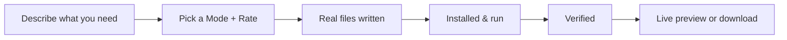
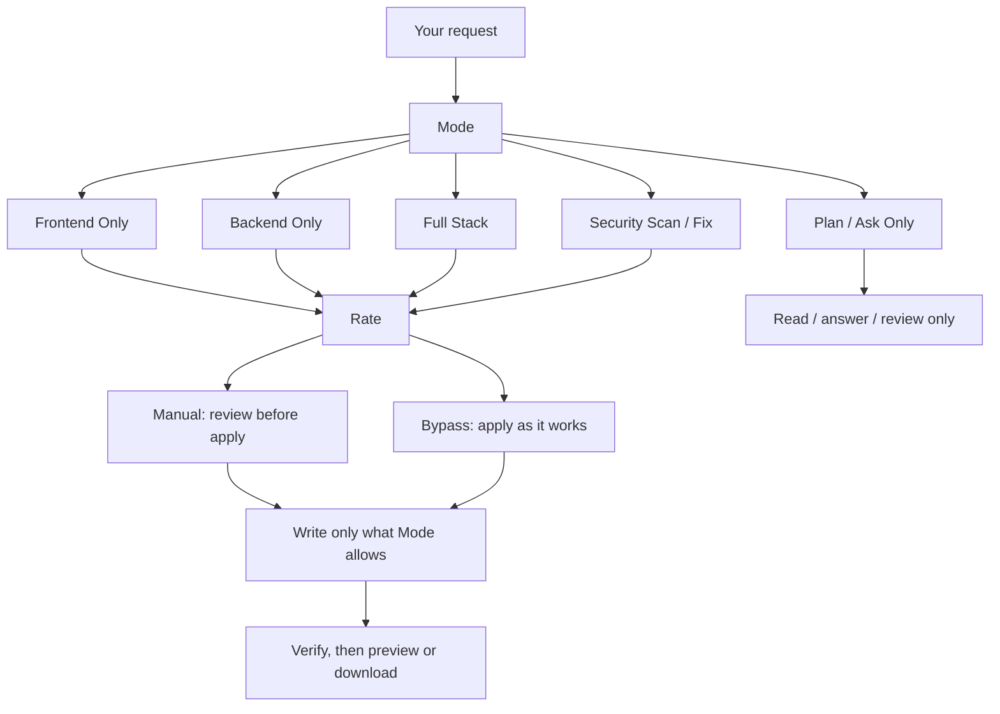

# Rivine Code

## What it does (plain language)

Rivine Code builds real, working software, not a plan or a list of commands. Describe what you need, and it writes the actual files, installs and runs them when possible, checks that the result works, and gives you a live preview in the browser or a downloadable project. Changes stay surgical: fixing one thing doesn't mean regenerating the whole project.

*Figure: what happens between your request and a working result.*

## How you work with it

Every Rivine Code turn starts with two choices, both visible in the toolbar before you send a message.

**Mode** decides what kind of work runs:

| Mode | What it's for |
|---|---|
| **Frontend Only** | UI, styling, client-side logic; leaves your backend and infrastructure alone |
| **Backend Only** | APIs, services, data layer; leaves your UI alone |
| **Full Stack** | A build that genuinely spans both, end to end |
| **Plan / Ask Only** | Read your code and answer, propose an approach, or review, without writing anything |
| **Security Scan / Fix** | Finds and fixes real vulnerabilities in the code you already have |

**Rate** decides how changes get applied:

| Rate | What happens |
|---|---|
| **Manual** | Each meaningful change is shown to you before it lands, so you stay in control of what touches your project |
| **Bypass** | Changes apply as the engine works, for when you want speed over a review step on every edit |

*Figure: Mode scopes what can change; Rate scopes how changes land.*

Picking a narrow Mode isn't a limitation, it's what keeps a "fix the login bug" request from touching your database schema. The engine only has access to what the Mode says the task needs.

## Why this matters for high-stakes work

Software that "looks right" but silently breaks something else is a production incident waiting to happen. Rivine Code verifies its own output, installing dependencies, running the project, checking the result, before it hands anything back to you, whether the "user" is a solo founder shipping an MVP or an engineering team integrating a generated service into an existing production stack.

## Who uses Rivine Code

- **Software engineering teams**: debugging, security review, and multi-service prototypes across any stack.
- **Startup teams**: MVPs and landing pages built and previewed end-to-end before showing investors.
- **Consulting firms**: internal client dashboards built from real data exports.
- **Research organizations**: simulation pipelines and data-processing tools, benchmarked against existing implementations.
- **University post-graduates**: data-analysis scripts and research tooling prototypes.

## Real-world prompt examples

| Persona                   | Example real-world prompt                                                                                                                                      |
| -------------------------- | -------------------------------------------------------------------------------------------------------------------------------------------------------------- |
| Startup team              | "Build a Next.js + Supabase landing page with waitlist signup and email capture, and show me a live preview."                                                  |
| Software engineering team | "Debug this failing FastAPI endpoint using the attached traceback and fix it in place."                                                                        |
| University post-graduate  | "Build a Python script to clean and merge these three CSV datasets for my thesis analysis."                                                                    |
| Consulting firm           | "Prototype a React + Node.js + MongoDB internal dashboard that visualizes this client's operational KPIs from the attached data export."                       |
| Startup team              | "Build a Go backend service that exposes a REST API for our inventory system, with tests, and show me it running."                                             |
| Software engineering team | "Security-review this authentication flow across our Node.js and PostgreSQL services and fix any injection or session vulnerabilities you find."               |
| University post-graduate  | "Build a Flutter mobile app prototype for my research project's participant data-collection tool, with offline support."                                       |
| Startup team              | "Build a Vue + Django + PostgreSQL MVP for our new marketplace idea, end to end, and let me test it in the live preview before I show investors."              |
| Research organization     | "Build a Rust service that runs our simulation pipeline faster than our current Python implementation, and benchmark both."                                    |
| Software engineering team | "Migrate this legacy PHP/Laravel service to a Next.js + FastAPI + PostgreSQL stack, keep the API contract identical, and verify with the existing test suite." |

## Also available: the terminal

Rivine Code runs the same engine as a CLI you can drop into any local project, working on the files already on your disk instead of a workspace sandbox. See the [Rivine Code CLI](/aselius-platform/docs/rivine-code-cli) guide.
