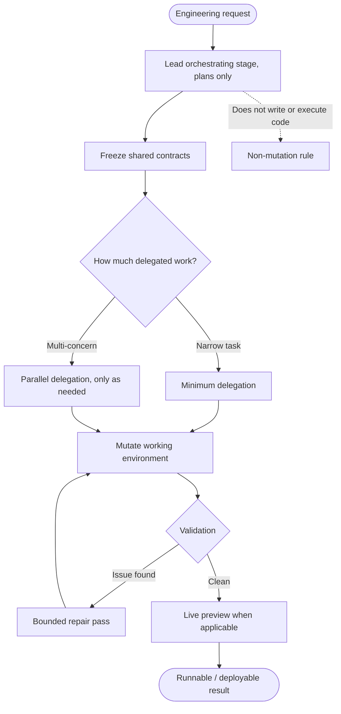
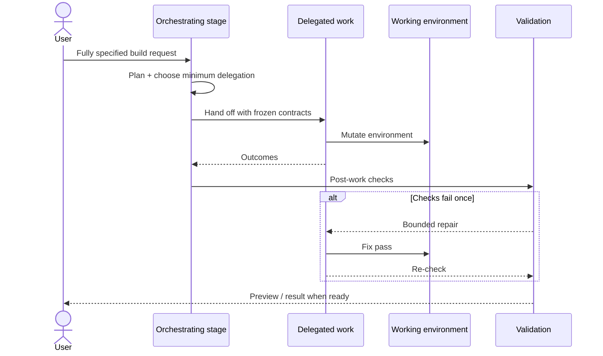

# Rivine Code 

Rivine Code is the most operationally complex of the five engines, because it is the only one that mutates a real, persistent working environment rather than producing a document. A lead orchestrating stage plans and delegates, but deliberately, never writes or executes code itself. All mutation is delegated to concern-scoped work paths, spawned only when a task genuinely requires them. The roster of those paths, and how they are labeled internally, is not published here.



*Figure: Code pipeline shape: plan → freeze contracts → delegated mutation → validate → optional heal → preview. Internal role names omitted on purpose.*



Two disciplines make this safe rather than chaotic. The first is a frozen-contract mechanism: before delegated work runs in parallel, the interfaces that must not be silently redefined; API shapes, type definitions, event contracts are captured and handed to every concurrent path as shared, immutable ground truth, so two paths cannot quietly diverge on what a shared interface looks like. The second is validation that runs after that work finishes and *before* anything reaches deployment, and a bounded self-heal loop that can send work back for one repair pass if validation finds something wrong, rather than either shipping a broken result or failing the whole task outright.

In our own internal benchmark run: a realistic, fully-specified engineering request, the full pipeline, from request to a live, running preview, completed in well under five minutes, with the orchestrating stage correctly choosing minimum delegation rather than over-delegating for a task that didn't need it. On a more complex, multi-concern request in the same test cycle, the same stage correctly increased parallel delegation. That is the "delegate as little as necessary" discipline from §1, observed doing its job under a real, timed test rather than asserted in the abstract.

```text
  Request ──▶ Orchestrating stage (plan) ──▶ Freeze contracts
                         │                         │
                         │                 ┌───────┴───────┐
                         │                 ▼               ▼
                         │          Delegated path   Delegated path …
                         │                 │               │
                         │                 └───────┬───────┘
                         │                         ▼
                         │                  Validation ──▶ heal? ──▶ Preview
                         │
                         └── ✕ no direct code write / exec
```
