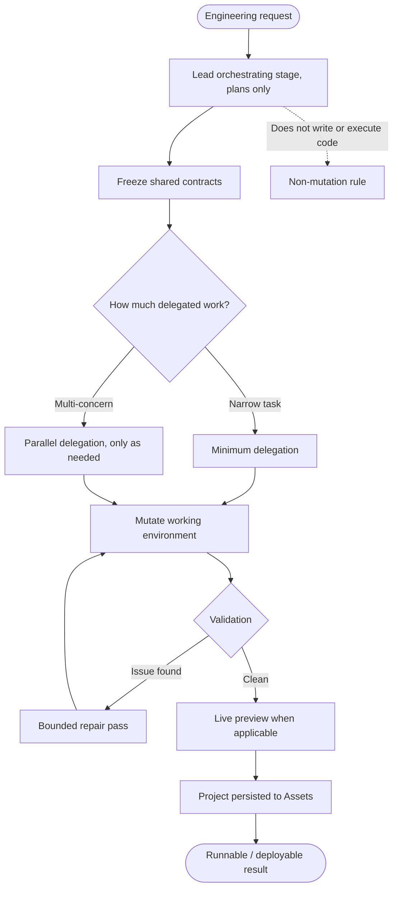
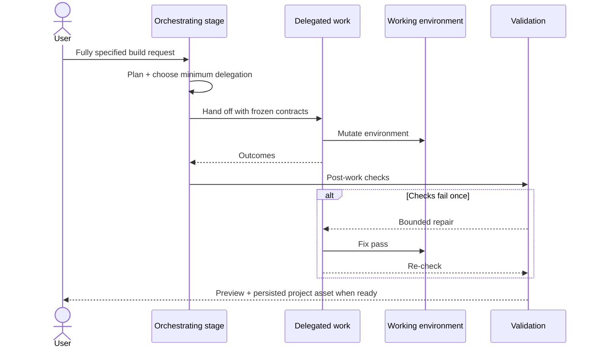

# Rivine Code

## What it does (plain language)

Rivine Code builds real, working software, not a plan or a list of commands. Describe what you need in any stack (Next.js, Python, Vue, HTML, Flutter, Go, and dozens more), and it writes the actual files, installs and runs them when possible, checks that the result works, and gives you a live preview in the browser or a downloadable project. Changes stay surgical: fixing one thing doesn't mean regenerating the whole project.

## How it works (for technical readers)

Rivine Code is the most operationally complex of the Rivine engines, because it's the only one that mutates a real, persistent working environment rather than producing a document. It runs the same **Cocoon Analysis** lifecycle every Rivine engine runs: a lead orchestrating stage owns Formation through Metamorphosis, plans and delegates, but deliberately never writes or executes code itself. Emergence delegates all mutation to concern-scoped work paths, spawned only when the frozen contract genuinely requires them.




*Figure: Code pipeline shape: plan → freeze contracts → delegated mutation → validate → optional heal → preview → persist.*




Two disciplines make this safe rather than chaotic. The first is a frozen-contract mechanism: before delegated work runs in parallel, the interfaces that must not be silently redefined (API shapes, type definitions, event contracts) are captured and handed to every concurrent path as shared, immutable ground truth, so two paths cannot quietly diverge on what a shared interface looks like. The second is validation that runs after that work finishes and before anything reaches you, plus a bounded self-heal loop that can send work back for one repair pass if validation finds something wrong, rather than either shipping a broken result or failing the whole task outright.

The entire working project tree, minus dependency and build folders, is persisted as a code project asset once the turn completes, so it survives past the live session and is available in your Assets library, not only as a snapshot in the conversation.

```text
  Request ──▶ Orchestrating stage (plan) ──▶ Freeze contracts
                         │                         │
                         │                 ┌───────┴───────┐
                         │                 ▼               ▼
                         │          Delegated path   Delegated path …
                         │                 │               │
                         │                 └───────┬───────┘
                         │                         ▼
                         │                  Validation ──▶ heal? ──▶ Preview ──▶ Persist to Assets
                         │
                         └── ✕ no direct code write / exec by the orchestrator
```


## Why this matters for high-stakes work

Software that "looks right" but silently breaks a shared contract is a production incident waiting to happen. Freezing contracts before parallel work runs, and validating before anything ships, is what keeps a fast build from becoming a fragile one, whether the "user" is a solo founder shipping an MVP or an engineering team integrating a generated service into an existing production stack.

## Who uses Rivine Code

- **Software engineering teams**: debugging, security review, and multi-service prototypes across any stack.
- **Startup teams**: MVPs and landing pages built and previewed end-to-end before showing investors.
- **Consulting firms**: internal client dashboards built from real data exports.
- **Research organizations**: simulation pipelines and data-processing tools, benchmarked against existing implementations.
- **University post-graduates**: data-analysis scripts and research tooling prototypes.


## Real-world prompt examples


| Persona                   | Example real-world prompt                                                                                                                                      |
| ------------------------- | -------------------------------------------------------------------------------------------------------------------------------------------------------------- |
| Startup team              | "Build a Next.js + Supabase landing page with waitlist signup and email capture, and show me a live preview."                                                  |
| Software engineering team | "Debug this failing FastAPI endpoint using the attached traceback and fix it in place."                                                                        |
| University post-graduate  | "Build a Python script to clean and merge these three CSV datasets for my thesis analysis."                                                                    |
| Consulting firm           | "Prototype a React + Node.js + MongoDB internal dashboard that visualizes this client's operational KPIs from the attached data export."                       |
| Startup team              | "Build a Go backend service that exposes a REST API for our inventory system, with tests, and show me it running."                                             |
| Software engineering team | "Security-review this authentication flow across our Node.js and PostgreSQL services and fix any injection or session vulnerabilities you find."               |
| University post-graduate  | "Build a Flutter mobile app prototype for my research project's participant data-collection tool, with offline support."                                       |
| Startup team              | "Build a Vue + Django + PostgreSQL MVP for our new marketplace idea, end to end, and let me test it in the live preview before I show investors."              |
| Research organization     | "Build a Rust service that runs our simulation pipeline faster than our current Python implementation, and benchmark both."                                    |
| Software engineering team | "Migrate this legacy PHP/Laravel service to a Next.js + FastAPI + PostgreSQL stack, keep the API contract identical, and verify with the existing test suite." |


