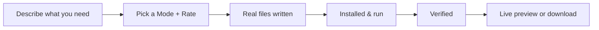
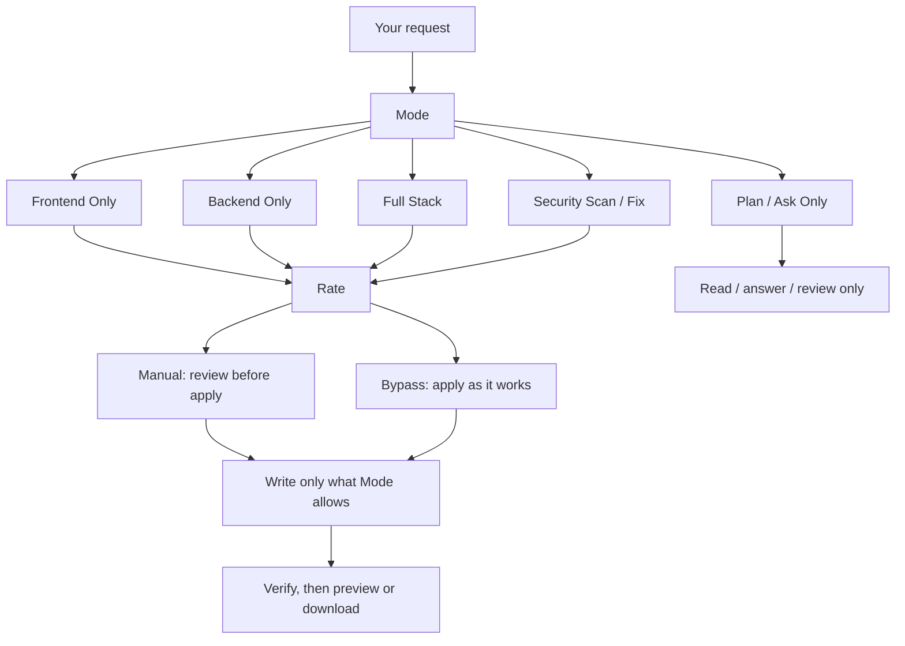

# Rivine Code

Rivine Code is the Aselius engine that builds real, working software, not a plan or a list of commands. Describe what you need and it writes the files, installs and runs them when possible, checks the result and hands you a live preview or a downloadable project.

## At a glance

- **What it is:** The software engineering engine in Aselius Workspace, chosen in the Taskspace input bar.
- **Best for:** New builds, surgical fixes, code review and security fixes in any stack.
- **You get:** Real files, verified by running them, with a live preview or a download.
- **Controls:** A Mode that scopes what can change and a Rate that sets how changes land.
- **Cost:** Needs a prepaid balance of at least $10 to start a turn, on every plan.
- **Where:** In a Taskspace on aselius.beunec.com, or in your terminal with the [Rivine Code CLI](/aselius-platform/docs/rivine-code-cli).

## What happens to a request

*Figure: what happens between your request and a working result.*

Changes stay surgical: fixing one thing does not regenerate the whole project.

## Mode and Rate

Every Rivine Code turn starts with two choices, both visible in the input bar before you send a message.

**Mode** decides what kind of work runs:

| Mode | What it's for |
|---|---|
| **Frontend Only** | UI, styling, client-side logic; leaves your backend and infrastructure alone |
| **Backend Only** | APIs, services, data layer; leaves your UI alone |
| **Full Stack** | A build that genuinely spans both, end to end |
| **Plan / Ask Only** | Read your code and answer, propose an approach, or review, without writing anything |
| **Security Scan / Fix** | Finds and fixes real vulnerabilities in the code you already have |

**Rate** decides how changes get applied:

| Rate | What happens |
|---|---|
| **Manual** | Each meaningful change is shown to you before it lands, so you control what touches your project |
| **Bypass** | Changes apply as the engine works, for speed over a review step on every edit |

*Figure: Mode scopes what can change; Rate scopes how changes land.*

A narrow Mode is a safeguard, not a limitation. It keeps a "fix the login bug" request from touching your database schema, because the engine only gets access to what the Mode says the task needs.

## Verified before it reaches you

Software that "looks right" but silently breaks something else is a production incident waiting to happen. Rivine Code installs dependencies, runs the project and checks the result before handing anything back. That holds whether you are a solo founder shipping an MVP or a team integrating a generated service into a production stack.

## Who uses Rivine Code

| Who | Typical work |
|---|---|
| **Software engineering teams** | Debugging, security review and multi-service prototypes across any stack |
| **Startup teams** | MVPs and landing pages built and previewed end to end before showing investors |
| **Consulting firms** | Internal client dashboards built from real data exports |
| **Research organizations** | Simulation pipelines and data-processing tools, benchmarked against existing implementations |
| **University post-graduates** | Data-analysis scripts and research tooling prototypes |

## Example prompts

| Persona | Example prompt |
| --- | --- |
| Startup team | "Build a Next.js + Supabase landing page with waitlist signup and email capture, and show me a live preview." |
| Software engineering team | "Debug this failing FastAPI endpoint using the attached traceback and fix it in place." |
| University post-graduate | "Build a Python script to clean and merge these three CSV datasets for my thesis analysis." |
| Consulting firm | "Prototype a React + Node.js + MongoDB internal dashboard that visualizes this client's operational KPIs from the attached data export." |
| Startup team | "Build a Go backend service that exposes a REST API for our inventory system, with tests, and show me it running." |
| Software engineering team | "Security-review this authentication flow across our Node.js and PostgreSQL services and fix any injection or session vulnerabilities you find." |
| University post-graduate | "Build a Flutter mobile app prototype for my research project's participant data-collection tool, with offline support." |
| Startup team | "Build a Vue + Django + PostgreSQL MVP for our new marketplace idea, end to end, and let me test it in the live preview before I show investors." |
| Research organization | "Build a Rust service that runs our simulation pipeline faster than our current Python implementation, and benchmark both." |
| Software engineering team | "Migrate this legacy PHP/Laravel service to a Next.js + FastAPI + PostgreSQL stack, keep the API contract identical, and verify with the existing test suite." |

## Limits

- **Not schedulable.** Rivine Code runs interactively; it cannot be set up as an [automation](/aselius-platform/docs/automations).
- **Not exposed through Aselius MCP.** Use it in a Taskspace or through the CLI.
- **Start floor.** A turn needs a balance of at least $10, the same on every plan.

## Also available: the terminal

The Rivine Code CLI runs the same engine in any local project, working on the files already on your disk instead of a workspace sandbox. See the [Rivine Code CLI](/aselius-platform/docs/rivine-code-cli) guide.

## Related

- [Rivine Code CLI](/aselius-platform/docs/rivine-code-cli): the engine in your terminal and in CI
- [Aselius Workspace](/aselius-platform/docs/workspace): Taskspaces, Preview and assets
- [Preview app](/aselius-platform/docs/preview-app): share a live result
- [Plans and pricing](/aselius-platform/docs/plans-pricing): credits and start floors
