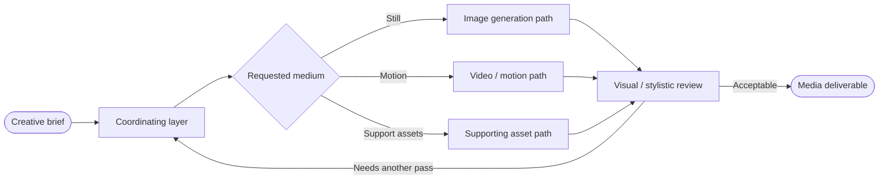
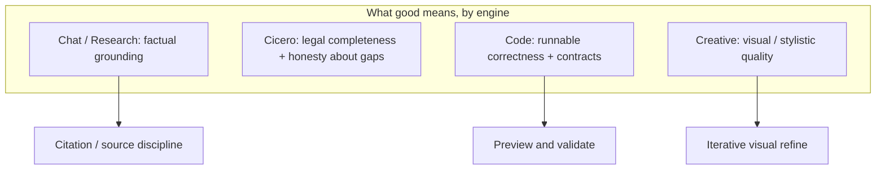

# Rivine Creative  

Rivine Creative generates visual and media deliverables: images, short video, and the supporting assets a marketing or product surface needs. Structurally, it follows the same conditional-composition pattern as the other engines: a coordinating layer routes a creative brief to the right generation capability for the requested medium, rather than treating "generate media" as a single undifferentiated capability. What's specific to Creative is that its outputs are evaluated on a different axis than the other engines - visual and stylistic quality rather than factual grounding, so its validation and refinement loop is built around iterative visual review rather than citation-checking. We are intentionally not detailing the internal generation pipeline, providers, or role roster further in this publication.

*Figure - Creative routes by medium, then reviews on visual criteria. Provider names, model IDs, and prompt text are omitted on purpose.*

 