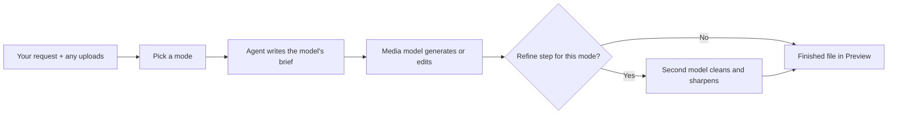
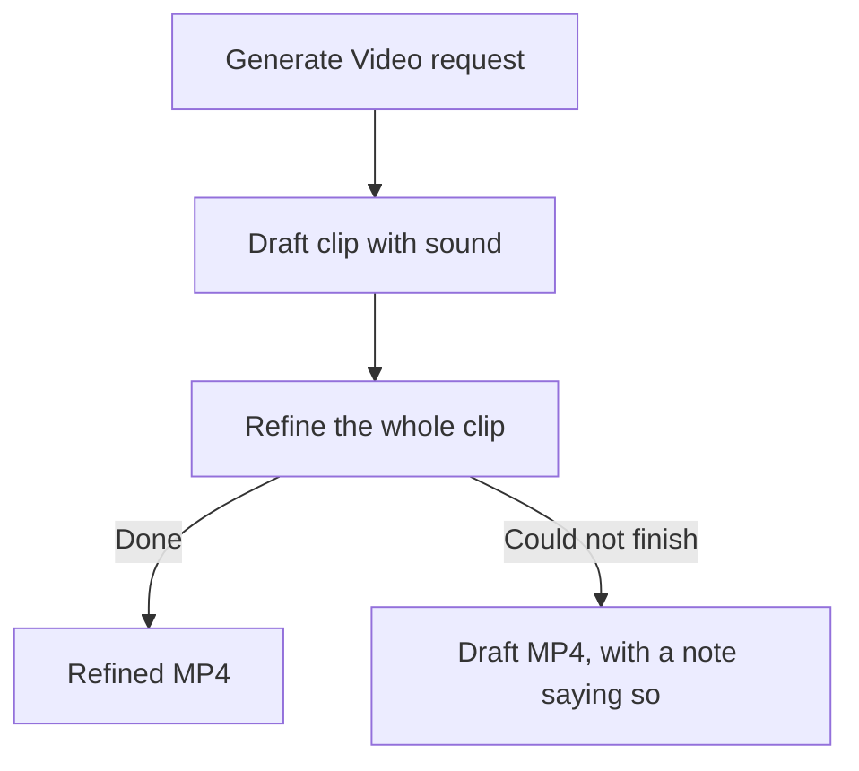

# Rivine Creative

## What it does (plain language)

Rivine Creative makes and edits media: images, short animations and GIFs, video clips, spoken audio, and music or sound effects. You pick one of seven modes, describe what you want in your own words, and attach your pictures or clips when the mode works on them. Each mode is its own agent built around the generation models best suited to that job, and it hands you a finished file you can preview, download, or publish.

*Figure: you choose the mode; nothing guesses it for you.*

## How you work with it

Pick a mode before you send your request:

| Mode | What it does | You get |
|---|---|---|
| **Generate Image** | Creates images from your description, using up to 5 images or a video clip you attach as references, then refines each one for clean text, edges and texture at 2K (4K on request) | 1 to 3 images |
| **Surgical Edit Image** | Changes exactly what you ask in 1 to 5 pictures you attach, or makes a still from a clip (add, remove or replace something, recolour, retouch, fix text, change the background or format) and keeps everything else | 1 to 3 images |
| **Animate / GIF / Motion** | Brings a description, or a picture you attach, to life as a short clip of up to 15 seconds: logo reveals, product spins, loops | 1 MP4, or 1 GIF when you ask for one |
| **Generate Video** | Renders a clip of up to 10 seconds with sound from your description (or from a picture as the first frame), then refines the whole clip while keeping its motion and timing | 1 MP4 |
| **Surgical Edit Video** | Edits a clip you attach (up to 10 seconds): lighting, time of day, weather, style, or an object or outfit, with optional reference pictures, and keeps everything else | 1 MP4 |
| **Generate Audio** | Records a voiceover, narration, announcement or two-person dialogue from your script or a description, in over 130 languages and 30 voices | 1 MP3 |
| **Generate Music / SFX** | Composes background music, jingles, loops, full songs (with your lyrics on request) or sound effects | 1 MP3 |

Every editing and refining step receives your original request word for word, so the change it makes is the one you asked for. Pictures and clips you attach in these modes go to the models as they are, never converted to text first.

*Figure: if a refine step cannot finish, you still get the draft, and you are told.*

## What it will not do

- Imitate a real person's voice, or a named artist's voice or song.
- Edit voices or add new dialogue to a clip where someone is already speaking.
- Get around a provider's content policy. When a model declines a request, Creative tells you plainly instead of rewording it to slip past.

Generated images and audio carry the providers' invisible watermarks (for example, Google's SynthID).

## Who uses Rivine Creative

- **Startup teams**: launch graphics, product imagery, short promo clips and jingles.
- **Consulting firms**: presentation visuals and narrated summaries.
- **Research organizations**: illustrations and narration for public-facing summaries.
- **Software engineering teams**: app icons, marketing visuals and release clips.
- **University post-graduates**: poster illustrations and presentation visuals.

## Example prompts

| Mode | Example real-world prompt |
|---|---|
| Generate Image | "Three options for a square Instagram post announcing that Ember Roast is now open late, a cosy coffee shop at night." |
| Surgical Edit Image | "Remove the background from these three product photos and place each on a soft grey studio backdrop." |
| Animate / GIF / Motion | "Make this logo rotate once and settle, as a looping GIF." |
| Generate Video | "A cinematic 8-second shot of a lighthouse in a storm at night, for a podcast intro." |
| Surgical Edit Video | "Turn the daylight in this clip into a golden sunset. Keep everything else the same." |
| Generate Audio | "A calm 20-second voicemail greeting for our dental clinic." |
| Generate Music / SFX | "Upbeat acoustic background music for a 30-second juice advert, instrumental." |
| Generate Music / SFX | "The sound of a coin dropping into a glass jar." |
