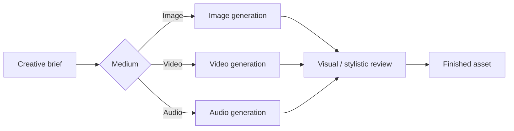
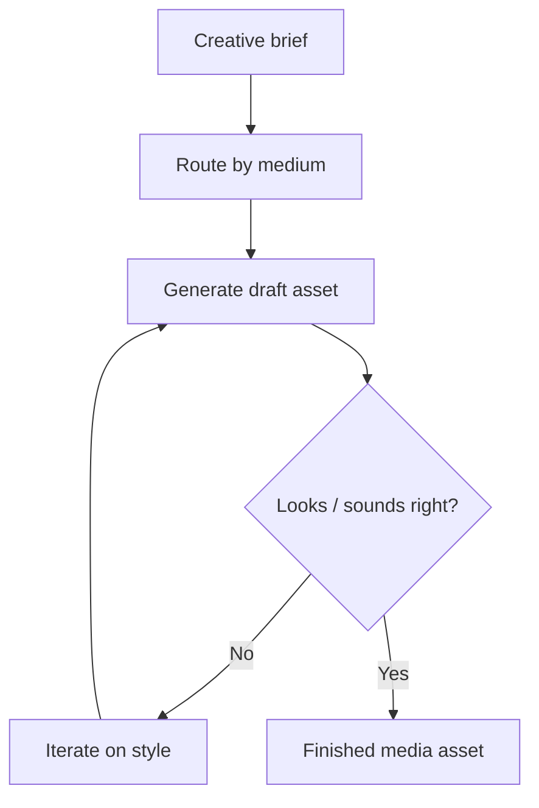

# Rivine Creative

> **Coming soon.** Rivine Creative is not yet available to select in Workspace. The description and examples below describe what it will do at launch; select **Rivine TaskForce** or another engine in the meantime.

## What it does (plain language)

Rivine Creative will generate and edit visual and media deliverables: images, short video, audio, and the supporting assets a marketing, product, or research surface needs. Describe the brief, and it routes to the right generation capability for the medium you asked for, then iterates on visual/stylistic quality before handing you a finished asset.

*Figure: Creative routes by medium, then reviews on how it looks and sounds.*

## How it will work

Unlike TaskForce, Research, and Cicero, Creative's definition of "correct" is visual and stylistic, not factual. What's specific to Creative is that it routes a brief to the right generation path for the requested medium, still image, video, or audio, and iterates on the result against how it looks and sounds, the same discipline the other engines apply to their own domain, just measured on a different axis.

*Figure: Creative measures correctness by visual and audio quality, then iterates until it lands.*

## Why this matters for high-stakes work

Media deliverables live or die on brand consistency and iteration speed, not citations. Creative's review loop is built around getting the visual/audio result right through iteration.

## Who will use Rivine Creative

- **Startup teams**: launch graphics, product imagery, and short explainer videos.
- **Consulting firms**: client-facing explainer videos and presentation visuals.
- **Research organizations**: diagram-style illustrations and narrated summary videos for publication or outreach.
- **Software engineering teams**: app icons, marketing screenshots, and release/demo videos.
- **University post-graduates**: conference posters and presentation-quality illustrations.

## Example prompts (once available)

| Persona | Example real-world prompt |
|---|---|
| Startup team | "Generate a set of product hero images for our landing page in a consistent brand style." |
| Consulting firm | "Create a short explainer video summarizing this client engagement's key findings for a non-technical executive audience." |
| Research organization | "Generate a clean diagram-style illustration of our study's experimental setup for a journal submission." |
| Software engineering team | "Generate app icon and marketing screenshot variants for our next release." |
| University post-graduate | "Generate a poster-quality illustration of my thesis's core concept for a conference presentation." |
| Startup team | "Edit this product photo to remove the background and place it on a branded gradient." |
| Consulting firm | "Generate a short narrated video walkthrough of this quarterly report for client distribution." |
| Research organization | "Generate audio narration for our public-facing research summary video." |
| Software engineering team | "Generate a demo video showing our new feature's UI flow for the release announcement." |
| Startup team | "Generate a full set of social media launch graphics matching our brand guidelines." |
