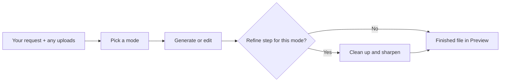
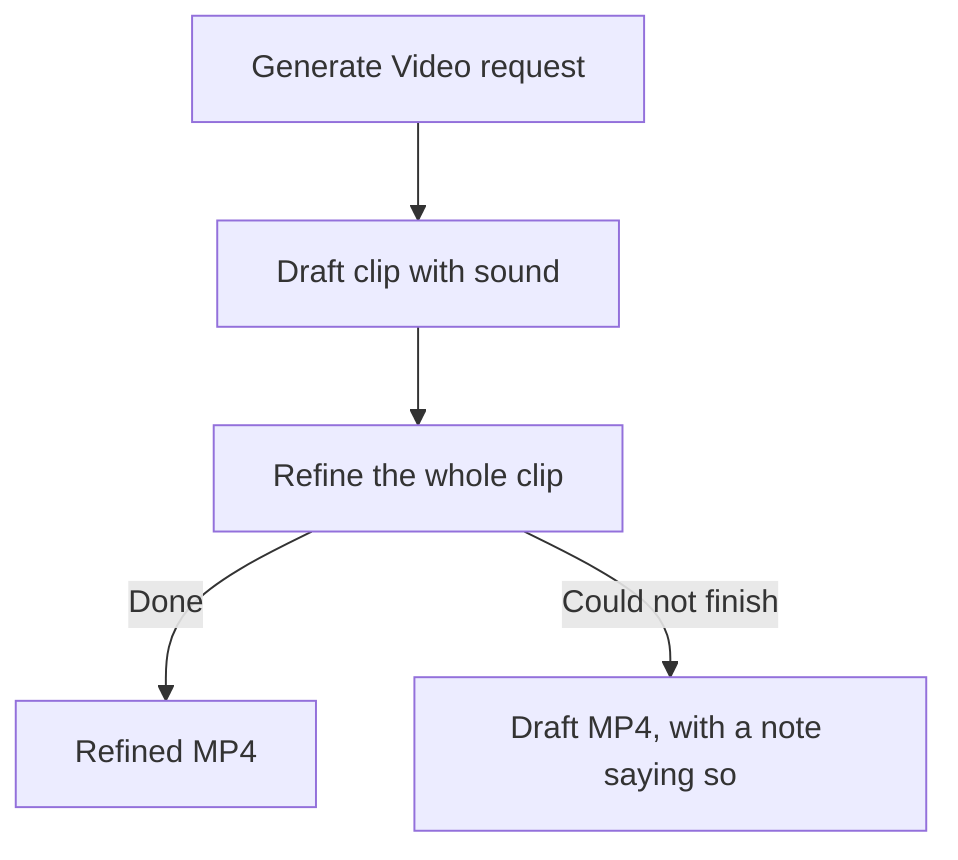

# Rivine Creative

Rivine Creative is the media engine in Aselius for making and editing images, short animations and GIFs, video clips, spoken audio, and music or sound effects. You pick one of seven modes, describe what you want, attach your pictures or clips where the mode uses them, and get a finished file to preview, download or publish.

## At a glance

- **What it is:** Seven media modes, each its own dedicated agent built for that job.
- **You get:** 1 to 3 images, one MP4 or GIF, or one MP3, depending on the mode.
- **Where:** Choose Rivine Creative and a mode in the Taskspace input bar; results open in Preview.
- **Cost:** Needs a prepaid balance of at least $3 to start a turn, on every plan. See [Plans and pricing](/aselius-platform/docs/plans-pricing).
- **Limits:** Videos up to 10 seconds, animations up to 15 seconds. No imitation of real people's or named artists' voices.

## How it works

1. Choose Rivine Creative and one of the seven modes. Nothing guesses the mode for you.
2. Describe what you want in your own words.
3. Attach pictures or clips when the mode works on them.
4. The mode's agent prepares the brief and generates or edits your media.
5. Modes with a refine step then clean up and sharpen the result.
6. The finished file opens in Preview, ready to download or publish.

*Figure: you choose the mode; nothing guesses it for you.*

## The seven modes

| Mode | What it does | You get |
|---|---|---|
| **Generate Image** | Creates images from your description, using up to 5 attached images or a video clip as references, then refines each for clean text, edges and texture at 2K (4K on request) | 1 to 3 images |
| **Surgical Edit Image** | Changes exactly what you ask in 1 to 5 attached pictures, or makes a still from a clip: add, remove or replace something, recolour, retouch, fix text, change the background or format. Everything else stays the same | 1 to 3 images |
| **Animate / GIF / Motion** | Brings a description or an attached picture to life as a short clip of up to 15 seconds: logo reveals, product spins, loops | 1 MP4, or 1 GIF when you ask for one |
| **Generate Video** | Renders a clip of up to 10 seconds with sound from your description (or from a picture as the first frame), then refines the whole clip while keeping its motion and timing | 1 MP4 |
| **Surgical Edit Video** | Edits an attached clip of up to 10 seconds: lighting, time of day, weather, style, or an object or outfit, with optional reference pictures. Everything else stays the same | 1 MP4 |
| **Generate Audio** | Records a voiceover, narration, announcement or two-person dialogue from your script or a description, in over 130 languages and 30 voices | 1 MP3 |
| **Generate Music / SFX** | Composes background music, jingles, loops, full songs (with your lyrics on request) or sound effects | 1 MP3 |

Every editing and refining step works from your original request word for word, so the change it makes is the one you asked for. Pictures and clips you attach are used as they are, never converted to a text description first.

## If a refine step cannot finish

*Figure: if a refine step cannot finish, you still get the draft, and you are told.*

## What it will not do

- Imitate a real person's voice, or a named artist's voice or song.
- Edit voices or add new dialogue to a clip where someone is already speaking.
- Work around a content policy. When a request is declined, Creative tells you plainly instead of rewording it to slip past.

> **Note:** Generated images and audio carry invisible AI watermarks that identify them as machine-generated.

## Who uses it

- **Startup teams:** launch graphics, product imagery, short promo clips and jingles.
- **Consulting firms:** presentation visuals and narrated summaries.
- **Research organizations:** illustrations and narration for public-facing summaries.
- **Software engineering teams:** app icons, marketing visuals and release clips.
- **University post-graduates:** poster illustrations and presentation visuals.

## Example prompts

| Mode | Example prompt |
|---|---|
| Generate Image | "Three options for a square Instagram post announcing that Ember Roast is now open late, a cosy coffee shop at night." |
| Surgical Edit Image | "Remove the background from these three product photos and place each on a soft grey studio backdrop." |
| Animate / GIF / Motion | "Make this logo rotate once and settle, as a looping GIF." |
| Generate Video | "A cinematic 8-second shot of a lighthouse in a storm at night, for a podcast intro." |
| Surgical Edit Video | "Turn the daylight in this clip into a golden sunset. Keep everything else the same." |
| Generate Audio | "A calm 20-second voicemail greeting for our dental clinic." |
| Generate Music / SFX | "Upbeat acoustic background music for a 30-second juice advert, instrumental." |
| Generate Music / SFX | "The sound of a coin dropping into a glass jar." |

## Related

- [Workspace](/aselius-platform/docs/workspace)
- [Preview app](/aselius-platform/docs/preview-app)
- [Plans and pricing](/aselius-platform/docs/plans-pricing)
- [Rivine TaskForce](/aselius-platform/docs/rivine-taskforce)
