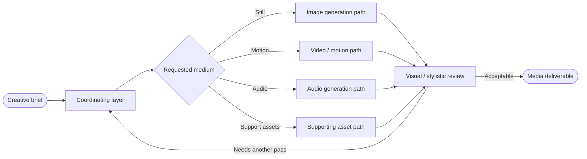
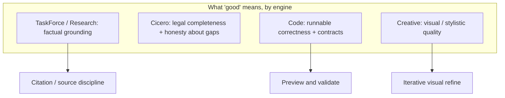

# Rivine Creative

> **Coming soon.** Rivine Creative is not yet available to select in Workspace. The description and examples below describe what it will do at launch; select **Auto** or another engine in the meantime.

## What it does (plain language)

Rivine Creative will generate and edit visual and media deliverables: images, short video, audio, and the supporting assets a marketing, product, or research surface needs. Describe the brief, and it routes to the right generation capability for the medium you asked for, then iterates on visual/stylistic quality before handing you a finished asset.

## How it works (for technical readers)

Structurally, Creative will run the same **Cocoon Analysis** lifecycle every Rivine engine runs: a coordinating layer routes a creative brief to the right generation capability for the requested medium at Metamorphosis, rather than treating "generate media" as one undifferentiated capability. What's specific to Creative is that its validation gate is evaluated on a different axis than the other engines, visual and stylistic quality rather than factual grounding, so its Phase 5 repair loop is built around iterative visual review rather than citation-checking.

*Figure: Creative routes by medium, then reviews on visual/audio criteria rather than citation discipline.*

## Why this matters for high-stakes work

Media deliverables live or die on brand consistency and iteration speed, not citations. Creative's review loop is built around getting the visual/audio result right through iteration, the same discipline the other engines apply to their own domain's definition of "correct."

## Who will use Rivine Creative

- **Startup teams**: launch graphics, product imagery, and short explainer videos.
- **Consulting firms**: client-facing explainer videos and presentation visuals.
- **Research organizations**: diagram-style illustrations and narrated summary videos for publication or outreach.
- **Software engineering teams**: app icons, marketing screenshots, and release/demo videos.
- **University post-graduates**: conference posters and presentation-quality illustrations.

## Example prompts (once available)

| Persona | Example real-world prompt |
|---|---|
| Startup team | "Generate a set of product hero images for our landing page in a consistent brand style." |
| Consulting firm | "Create a short explainer video summarizing this client engagement's key findings for a non-technical executive audience." |
| Research organization | "Generate a clean diagram-style illustration of our study's experimental setup for a journal submission." |
| Software engineering team | "Generate app icon and marketing screenshot variants for our next release." |
| University post-graduate | "Generate a poster-quality illustration of my thesis's core concept for a conference presentation." |
| Startup team | "Edit this product photo to remove the background and place it on a branded gradient." |
| Consulting firm | "Generate a short narrated video walkthrough of this quarterly report for client distribution." |
| Research organization | "Generate audio narration for our public-facing research summary video." |
| Software engineering team | "Generate a demo video showing our new feature's UI flow for the release announcement." |
| Startup team | "Generate a full set of social media launch graphics matching our brand guidelines." |
