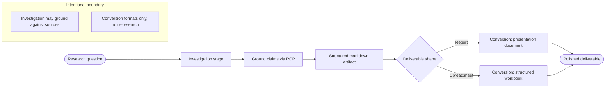
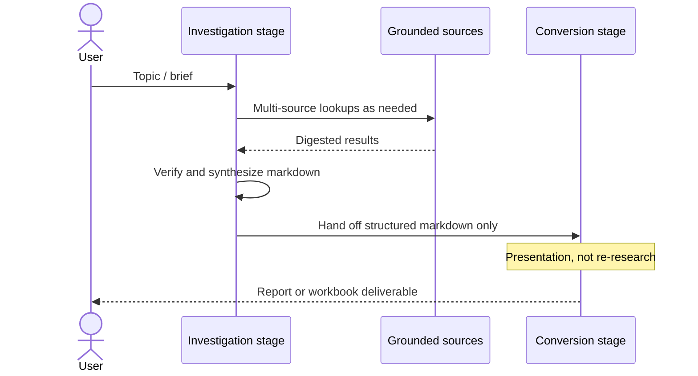

# Rivine Research 

Rivine Research is built around a division of labor that we think is under-used elsewhere: the stage that researches a topic is not the stage that formats the deliverable. A lead investigation stage conducts the actual investigation, grounding claims against real sources, not producing prose from memory, and hands off a structured markdown artifact to a downstream conversion stage, which is responsible only for turning that artifact into a polished, presentation-ready document (a formatted report, a structured spreadsheet, whichever the request calls for). We do not publish how those stages are staffed, named, or composed internally.

*Figure: Research as two jobs: establish what is true, then make it presentable. Downstream stages do not re-open the evidence catalog on their own.*

Separating "find and verify the truth" from "make it look good" turns out to matter a great deal for reliability. A single stage doing both jobs at once tends to let formatting concerns bleed into factual claims, or vice versa. Splitting them means the downstream formatting stage is free to focus entirely on presentation quality without holding independent grounded-data access, and in our own quality assessment of representative outputs, this consistently produced higher-fidelity source citation than a single-stage design did in earlier iterations of this engine.
 