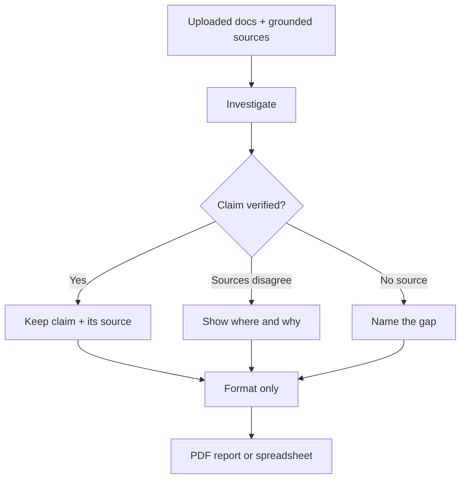

# Rivine Research

Rivine Research is the source-grounded research engine in Aselius. It reads what you give it (documents, spreadsheets, grounded sources) first, verifies claims against those sources, and only then produces a polished PDF report or spreadsheet workbook you can hand to a decision-maker without re-checking every number.

## At a glance

- **What it is:** Research that verifies before it writes, rather than summarizing from memory.
- **You get:** A formatted PDF report or a formula-driven spreadsheet, with every claim traceable to its source.
- **Best for:** Literature reviews, due diligence, competitive and market research, risk research, incident investigations.
- **Cost:** Needs a prepaid balance of at least $5 to start a turn, on every plan. See [Plans and pricing](/aselius-platform/docs/plans-pricing).
- **Can be scheduled:** Yes, through [Automations](/aselius-platform/docs/automations).

## What it promises

- **Sources first.** Every claim is checked against a real source before anything is written.
- **Disagreement shown.** When sources conflict, it tells you where and why instead of silently picking one.
- **Gaps named.** When something cannot be verified, it says so instead of filling the gap.
- **Traceable output.** Every number in the final report or workbook can be traced back to where it came from.

## How it works

1. Choose Rivine Research and a specialty (PDF or Spreadsheet) in the Taskspace input bar.
2. Ask your question and attach documents; enable grounded sources if you need them.
3. Research investigates and verifies each claim against the sources.
4. Formatting then arranges only what was already verified. It never reopens the evidence.
5. Your deliverable opens in Preview.

*Figure: investigation settles the evidence; formatting only arranges what was already verified.*

## Specialties

| Specialty | Produces |
|---|---|
| **PDF** | A formatted, presentation-ready report |
| **Spreadsheet** | A structured, formula-driven workbook |

## Why it matters for high-stakes work

If you are making a funding, clinical, legal or engineering decision from a research output, an unverifiable claim is worse than an admitted gap. Research keeps every claim tied to a source, surfaces disagreement instead of hiding it, and escalates rather than fabricates when a source does not exist.

## Who uses it

- **Research organizations:** literature reviews, meta-analysis cross-checks and grounded findings reports.
- **Consulting firms:** due-diligence workbooks and vendor or competitor comparisons, sourced and citable.
- **Software engineering teams:** CVE and dependency risk research; incident root-cause investigation grounded in logs and public postmortems.
- **Startup teams:** competitive landscape, prospect and market research, and regulatory research before a launch or fundraise.
- **University post-graduates:** literature reviews and benchmark cross-checks against published results.

## Example prompts

| Persona | Example prompt |
|---|---|
| Research organization | "Summarize these 12 uploaded clinical trial PDFs into a single evidence-linked PDF brief, every claim cited to its source page." |
| Consulting firm | "Cross-check these three vendor RFP responses against our uploaded requirements matrix and flag every conflicting claim." |
| Software engineering team | "Research current CVE disclosures for these five open-source dependencies and produce a verified spreadsheet with severity, patch status and citations." |
| Startup team | "Build a verified competitive-landscape workbook comparing our five closest competitors' pricing, sourced only from their published pricing pages." |
| University post-graduate | "Turn my uploaded literature review notes and these 8 papers into a structured PDF literature review with a citation table." |
| Research organization | "Cross-reference these three conflicting meta-analyses on the same intervention and produce an audit table showing exactly where and why they disagree." |
| Consulting firm | "Produce a due-diligence spreadsheet on this target company's public filings, financial statements and news coverage, with every number sourced." |
| Startup team | "Find prospective clients in New York City who'd be a strong fit for our business, and lay it out as a spreadsheet with the source for each one." |
| Software engineering team | "Investigate root-cause candidates for this production incident using our uploaded logs and public postmortems of similar outages, and produce a grounded findings report." |
| University post-graduate | "Build a verified spreadsheet cross-checking my experimental results against the last 5 years of published benchmarks in this subfield." |

## Related

- [Workspace](/aselius-platform/docs/workspace)
- [Automations](/aselius-platform/docs/automations)
- [Rivine Confluence](/aselius-platform/docs/rivine-confluence)
- [Artificial Experience](/aselius-platform/docs/artificial-experience)
- [Plans and pricing](/aselius-platform/docs/plans-pricing)
