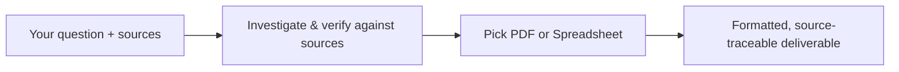
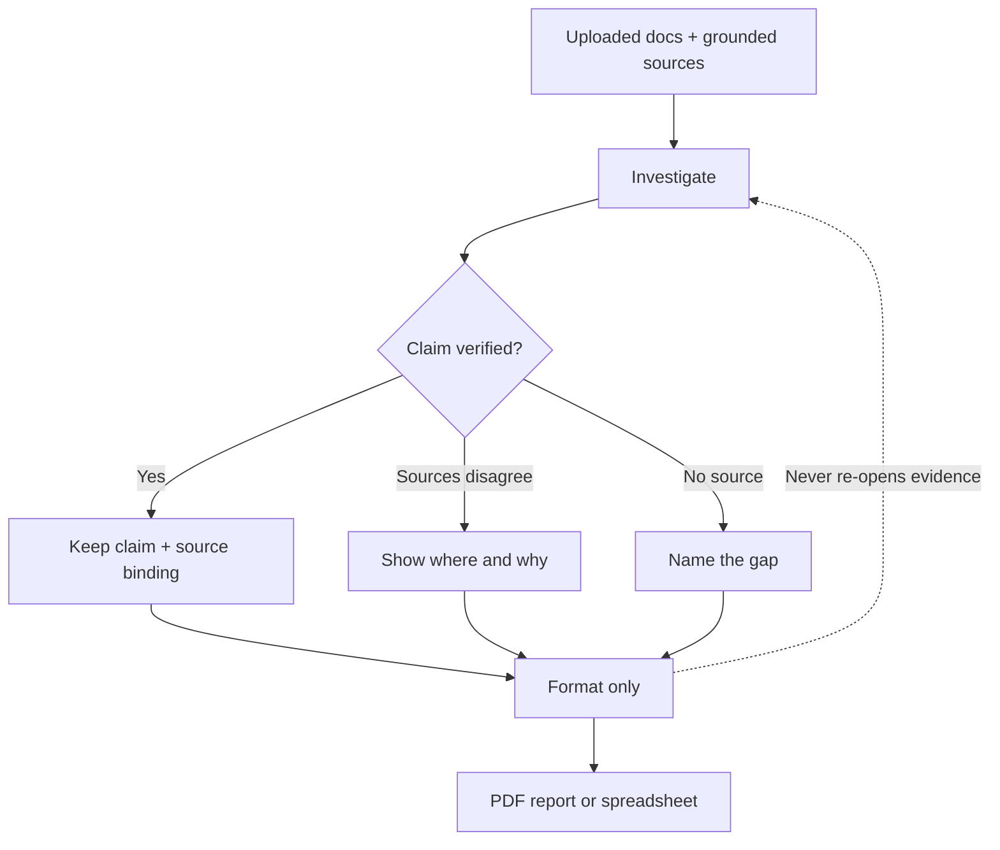

# Rivine Research

## What it does (plain language)

Rivine Research doesn't summarize from memory. It reads what you gave it (documents, spreadsheets, grounded sources) first, verifies claims against those sources, and only then produces a polished report or workbook. If two sources disagree, it tells you where and why instead of picking one silently. If something can't be verified, it says so instead of filling the gap. The result is research you can hand to a decision-maker without re-checking every number yourself.

*Figure: the evidence gets settled before anything gets formatted.*

## How you work with it

Pick a specialty before you send your question, based on the deliverable you need:

| Specialty | Produces |
|---|---|
| **PDF** | A formatted, presentation-ready report |
| **Spreadsheet** | A structured, formula-driven workbook |

*Figure: investigation settles evidence; formatting only arranges what was already verified.*

Research is one investigation and one formatting step, kept deliberately separate. The investigation grounds every claim against a real source before anything gets written; formatting only arranges what was already verified, it never goes back to re-open the evidence question. That split is why a Research deliverable stays traceable: every number in the final report or workbook can be traced back to where it came from.

## Why this matters for high-stakes work

If you're making a funding, clinical, legal, or engineering decision off a research output, an unverifiable claim is worse than an admitted gap. Research is built to keep every claim traceable to a source, surface disagreement between sources instead of silently resolving it, and escalate rather than fabricate when a source doesn't exist. That is the difference between "research" and "a confident-sounding paragraph."

## Who uses Rivine Research

- **Research organizations**: literature reviews, meta-analysis cross-checks, and grounded findings reports.
- **Consulting firms**: due-diligence workbooks and vendor/competitor comparisons, sourced and citable.
- **Software engineering teams**: CVE and dependency risk research, incident root-cause investigation grounded in logs and public postmortems.
- **Startup teams**: competitive landscape, prospect and market research, and regulatory research before a launch or fundraise.
- **University post-graduates**: literature reviews and benchmark cross-checks against published results.

## Real-world prompt examples

| Persona | Example real-world prompt |
|---|---|
| Research organization | "Summarize these 12 uploaded clinical trial PDFs into a single evidence-linked markdown brief, every claim cited to its source page." |
| Consulting firm | "Cross-check these three vendor RFP responses against our uploaded requirements matrix and flag every conflicting claim." |
| Software engineering team | "Research current CVE disclosures for these five open-source dependencies and produce a verified spreadsheet with severity, patch status, and citations." |
| Startup team | "Build a verified competitive-landscape workbook comparing our five closest competitors' pricing, sourced only from their published pricing pages." |
| University post-graduate | "Turn my uploaded literature review notes and these 8 papers into a structured markdown lit review with a citation table." |
| Research organization | "Cross-reference these three conflicting meta-analyses on the same intervention and produce an audit table showing exactly where and why they disagree." |
| Consulting firm | "Produce a due-diligence spreadsheet on this target company's public filings, financial statements, and news coverage, with every number sourced." |
| Startup team | "Find prospective clients in New York City who'd be a strong fit for our business, and lay it out as a spreadsheet with the source for each one." |
| Software engineering team | "Investigate root-cause candidates for this production incident using our uploaded logs and public postmortems of similar outages, and produce a grounded findings report." |
| University post-graduate | "Build a verified spreadsheet cross-checking my experimental results against the last 5 years of published benchmarks in this subfield." |
