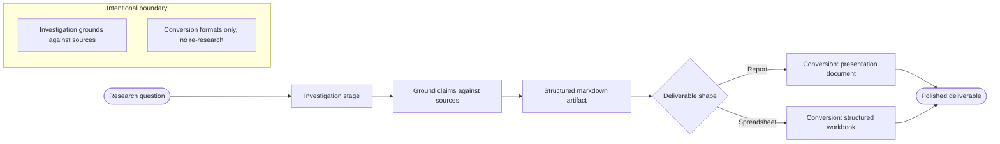
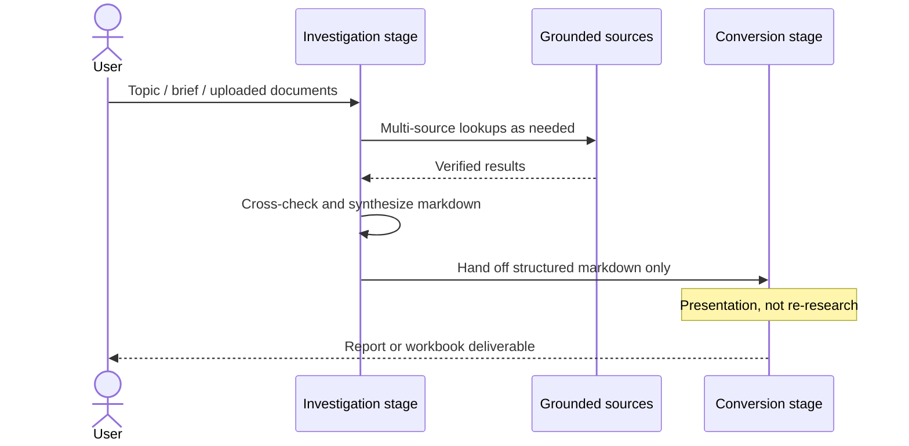

# Rivine Research

## What it does (plain language)

Rivine Research doesn't summarize from memory. It reads what you gave it (documents, spreadsheets, grounded sources) first, verifies claims against those sources, and only then produces a polished report or workbook. If two sources disagree, it tells you where and why instead of picking one silently. If something can't be verified, it says so instead of filling the gap. The result is research you can hand to a decision-maker without re-checking every number yourself.

## How it works (for technical readers)

Rivine Research runs the same **Cocoon Analysis** lifecycle every Rivine engine runs, specialized around a division of labor: the stage that investigates a topic is not the stage that formats the deliverable. Formation and Maturation are owned by a lead investigation stage, which conducts the actual research, grounding claims against real sources rather than producing prose from memory, until the readiness gate is satisfied. Metamorphosis and Emergence hand off a structured markdown artifact to a downstream conversion stage, responsible only for turning that artifact into a polished, presentation-ready document (a formatted report or a structured spreadsheet, whichever the request calls for), never for re-opening the evidence question.

*Figure: Research as two jobs: establish what is true, then make it presentable. Downstream stages don't re-open the evidence catalog on their own.*

Separating "find and verify the truth" from "make it look good" matters for reliability. A single stage doing both jobs at once tends to let formatting concerns bleed into factual claims, or vice versa. Splitting them lets the formatting stage focus entirely on presentation quality without independent access to grounded data, and in our own quality assessment this consistently produced higher-fidelity source citation than a single-stage design did in earlier iterations of this engine.

## Why this matters for high-stakes work

If you're making a funding, clinical, legal, or engineering decision off a research output, an unverifiable claim is worse than an admitted gap. Research is built to keep every claim traceable to a source, surface disagreement between sources instead of silently resolving it, and escalate rather than fabricate when a source doesn't exist. That is the difference between "research" and "a confident-sounding paragraph."

## Who uses Rivine Research

- **Research organizations**: literature reviews, meta-analysis cross-checks, and grounded findings reports.
- **Consulting firms**: due-diligence workbooks and vendor/competitor comparisons, sourced and citable.
- **Software engineering teams**: CVE and dependency risk research, incident root-cause investigation grounded in logs and public postmortems.
- **Startup teams**: competitive landscape and regulatory research before a launch or fundraise.
- **University post-graduates**: literature reviews and benchmark cross-checks against published results.

## Real-world prompt examples

| Persona | Example real-world prompt |
|---|---|
| Research organization | "Summarize these 12 uploaded clinical trial PDFs into a single evidence-linked markdown brief, every claim cited to its source page." |
| Consulting firm | "Cross-check these three vendor RFP responses against our uploaded requirements matrix and flag every conflicting claim." |
| Software engineering team | "Research current CVE disclosures for these five open-source dependencies and produce a verified spreadsheet with severity, patch status, and citations." |
| Startup team | "Build a verified competitive-landscape workbook comparing our five closest competitors' pricing, sourced only from their published pricing pages." |
| University post-graduate | "Turn my uploaded literature review notes and these 8 papers into a structured markdown lit review with a citation table." |
| Research organization | "Cross-reference these three conflicting meta-analyses on the same intervention and produce an audit table showing exactly where and why they disagree." |
| Consulting firm | "Produce a due-diligence spreadsheet on this target company's public filings, financial statements, and news coverage, with every number sourced." |
| Startup team | "Research the regulatory landscape for launching our product in these 6 countries and produce a jurisdiction-by-jurisdiction verified workbook." |
| Software engineering team | "Investigate root-cause candidates for this production incident using our uploaded logs and public postmortems of similar outages, and produce a grounded findings report." |
| University post-graduate | "Build a verified spreadsheet cross-checking my experimental results against the last 5 years of published benchmarks in this subfield." |
