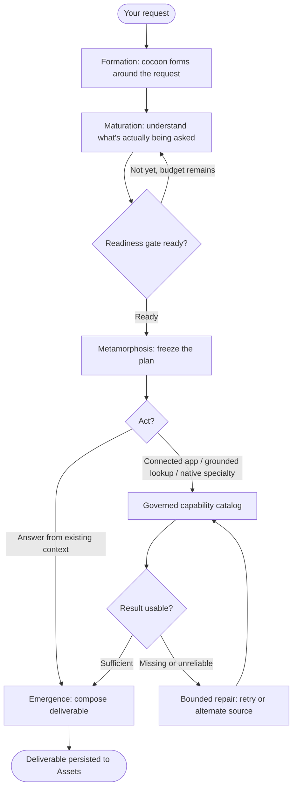

# Rivine TaskForce

## What it does (plain language)

Rivine TaskForce is Aselius's **action-oriented** workspace engine, not a generative chatbot. You describe the outcome you need; it does the work: pulls real data from connected apps, draws the diagram, builds the interactive page, runs the calculation, and returns something you can open, edit, and use immediately. Reach for it when you want a professional deliverable, not a text reply to read.

## How it works (for technical readers)

Rivine TaskForce is the general-purpose engine of the Rivine family, and deliberately the least narrowly specialized. It runs the same **Cocoon Analysis** lifecycle every Rivine engine runs: it forms a cocoon around the request, matures its understanding of what's actually being asked and what evidence or tools (if any) it needs, freezes a plan the moment it is ready, acts, whether that means a grounded lookup, reading an attached file, calling a connected app, or invoking a native specialty, and only then emits a deliverable. It does not skip straight from request to answer, and it is not a bare loop over a single reasoning step.




*Figure: TaskForce shape: one cocoon per request, broad access to governed data sources, connected apps, and native specialties underneath, gated readiness before action.*

What distinguishes TaskForce from "a chatbot with tools" is that it has access to the same breadth of connected apps and grounded data sources as the domain engines, and reaches for the right combination rather than defaulting to one generic search path. A representative internal test asked a question requiring both a specialized authoritative lookup and a general statistic; the engine chained a multi-step lookup against the correct authoritative source and fell back to general search only for the part of the question with no specialized source available.

```text
┌───────────────┐     ┌──────────────────────────────┐     ┌──────────────┐
│ Your request  │────▶│  TaskForce cocoon             │────▶│ Deliverable  │
└───────────────┘     │  form → mature → freeze → act │     └──────────────┘
                       └──────────────┬───────────────┘
                                      │
                       ┌──────────────▼───────────────┐
                       │ Connected apps, native        │
                       │ specialties, grounded sources  │
                       └────────────────────────────────┘
```


## Why this matters for high-stakes work

Because TaskForce acts through governed, auditable connections rather than free-text guesses, every action it takes, an email drafted, a database queried, a diagram generated, traces back to a real, permissioned source. If a specialized data source isn't available or a lookup fails, it says so and retries or falls back, rather than silently inventing an answer. That matters whether you're a founder who needs a board update to be accurate, or an engineering lead who needs an incident diagram to reflect the real system.

## Who uses Rivine TaskForce

- **Software engineering teams**: turn logs, tickets, and connected repos into diagrams, dashboards, and status updates without leaving the workspace.
- **Research organizations**: visualize datasets and cross-lab workflows, and package findings into shareable interactive documents.
- **Consulting firms**: pull live client data through connectors and turn it into client-ready decks, memos, and dashboards.
- **Startup teams**: automate the everyday professional work (emails, board updates, dashboards) that would otherwise eat founder time.
- **University post-graduates**: build teaching aids, thesis diagrams, and interactive explainers grounded in real data.


## Real-world prompt examples


| Persona                   | Example real-world prompt                                                                                                                                                                    |
| ------------------------- | -------------------------------------------------------------------------------------------------------------------------------------------------------------------------------------------- |
| Startup team              | "Pull last week's Stripe transactions and draft a board-ready revenue summary email to send through Gmail."                                                                                  |
| Software engineering team | "Diagram our current microservice request flow in Mermaid, then build an HTML 3D visualization of the queue backlog for the incident review."                                                |
| Research organization     | "Analyze this quantum dataset using advanced mathematical modeling, and create a scientific report using HTML STEM illustrating the entanglement relationships between experimental groups." |
| Consulting firm           | "Connect to the client's MongoDB read-only credentials, pull last quarter's churn data, and build an interactive HTML dashboard of at-risk accounts."                                        |
| University post-graduate  | "Create an Excalidraw diagram explaining the Krebs cycle for my thesis defense slides."                                                                                                      |
| Startup team              | "Use Code Execution to run a Monte Carlo simulation of our cap-table dilution across three funding rounds and chart the outcomes."                                                           |
| Software engineering team | "Generate an HTML STEM interactive simulation comparing our new caching algorithm's latency curve to the old one, using this benchmark CSV."                                                 |
| Consulting firm           | "Draft a governance-compliant client memo summarizing this quarter's connected Salesforce/HubSpot pipeline data with a Mermaid funnel diagram."                                              |
| Research organization     | "Parse this batch of 40 conference talk videos into a structured learning pack with citations back to timestamps."                                                                           |
| University post-graduate  | "Build an HTML 3D model of this protein's folding structure from the attached PDB file, with a computed energy-minimization summary I can defend in committee."                              |


