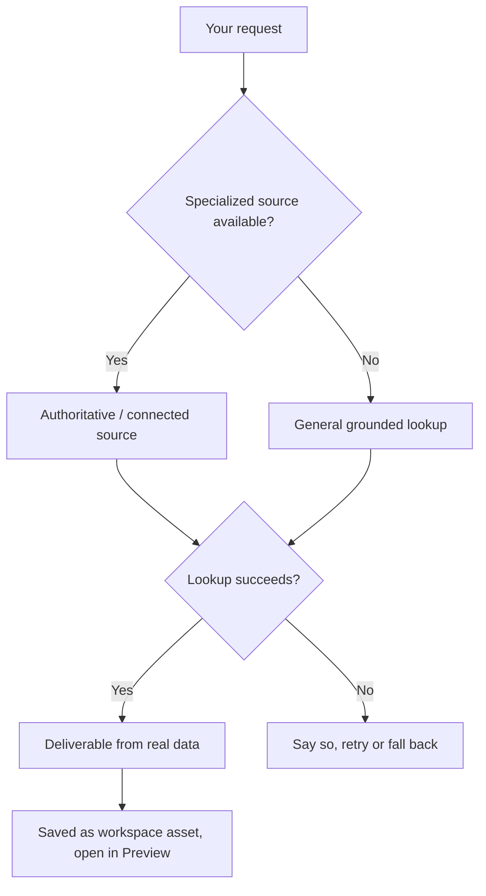

# Rivine TaskForce

Rivine TaskForce is the action-oriented engine in Aselius, the default engine and the most cost-effective one. You describe the outcome you need and it does the work: pulls real data from connected apps, draws the diagram, builds the interactive page, runs the calculation, and returns something you can open, edit and use, not a text reply to read.

## At a glance

- **What it is:** The general-purpose Rivine engine for professional deliverables. It is the default engine when you open a new task, and the most cost-effective Rivine engine.
- **You get:** Documents, diagrams, interactive pages, dashboards, spreadsheets and computed results, saved as workspace assets.
- **Works with:** Connected apps (email, calendars, databases, MCP apps) and grounded data sources.
- **Cost:** Needs a prepaid balance of at least $2 to start a turn, on every plan. See [Plans and pricing](/aselius-platform/docs/plans-pricing).
- **Can be scheduled:** Yes, through [Automations](/aselius-platform/docs/automations).

## How it works

1. Choose Rivine TaskForce and a specialty in the Taskspace input bar.
2. Describe the outcome you need and attach any files.
3. TaskForce picks the right source: a specialized, authoritative or connected source when one exists for the question, a general grounded lookup when it does not.
4. Before it acts in a connected app, it shows you the exact action to Deny or Approve & run.
5. If a source is unavailable or a lookup fails, it tells you, then retries or falls back. It never invents an answer silently.
6. The deliverable is saved as a workspace asset and opens in Preview.

*Figure: TaskForce prefers the right source and names failure instead of fabricating an answer.*

## Specialties

| Specialty | Use it for |
|---|---|
| **Chat** | General professional work through connected apps and grounded sources |
| **Excalidraw** | Hand-drawn style diagrams |
| **Mermaid** | Flowcharts, sequence and process diagrams |
| **HTML STEM** | Interactive scientific and technical documents |
| **HTML 3D** | Interactive 3D visualizations and models |
| **YouTube learning packs** | Learning packs built from YouTube videos |
| **Code Execution** | Verified computation run in a sandbox |

## What makes it different

TaskForce has access to the same breadth of connected apps and grounded sources as the domain engines, and reaches for the right combination rather than one generic search. It is the least narrowly specialized Rivine engine; for deep source-verified research, legal drafting or software builds, choose Research, Cicero or Code.

## Why it matters for high-stakes work

TaskForce acts through governed, auditable connections rather than free-text guesses. Every action it takes (an email drafted, a database queried, a diagram generated) traces back to a real, permissioned source. That matters for a founder whose board update must be accurate, or an engineering lead whose incident diagram must reflect the real system.

## Who uses it

- **Software engineering teams:** turn logs, tickets and connected repos into diagrams, dashboards and status updates without leaving the workspace.
- **Research organizations:** visualize datasets and cross-lab workflows, and package findings into shareable interactive documents.
- **Consulting firms:** pull live client data through connectors and turn it into client-ready decks, memos and dashboards.
- **Startup teams:** handle everyday professional work (emails, board updates, dashboards) that would otherwise eat founder time.
- **University post-graduates:** build teaching aids, thesis diagrams and interactive explainers grounded in real data.

## Example prompts

| Persona | Example prompt |
| --- | --- |
| Startup team | "Pull last week's Stripe transactions and draft a board-ready revenue summary email to send through Gmail." |
| Software engineering team | "Diagram our current microservice request flow in Mermaid, then build an HTML 3D visualization of the queue backlog for the incident review." |
| Research organization | "Analyze this quantum dataset using advanced mathematical modeling, and create a scientific report using HTML STEM illustrating the entanglement relationships between experimental groups." |
| Consulting firm | "Connect to the client's MongoDB read-only credentials, pull last quarter's churn data, and build an interactive HTML dashboard of at-risk accounts." |
| University post-graduate | "Create an Excalidraw diagram explaining the Krebs cycle for my thesis defense slides." |
| Startup team | "Use Code Execution to run a Monte Carlo simulation of our cap-table dilution across three funding rounds and chart the outcomes." |
| Software engineering team | "Generate an HTML STEM interactive simulation comparing our new caching algorithm's latency curve to the old one, using this benchmark CSV." |
| Consulting firm | "Draft a governance-compliant client memo summarizing this quarter's connected Salesforce/HubSpot pipeline data with a Mermaid funnel diagram." |
| Research organization | "Parse this batch of 40 conference talk videos into a structured learning pack with citations back to timestamps." |
| University post-graduate | "Build an HTML 3D model of this protein's folding structure from the attached PDB file, with a computed energy-minimization summary I can defend in committee." |

## Related

- [Workspace](/aselius-platform/docs/workspace)
- [Automations](/aselius-platform/docs/automations)
- [Aselius MCP](/aselius-platform/docs/aselius-mcp)
- [Rivine Research](/aselius-platform/docs/rivine-research)
- [Artificial Experience](/aselius-platform/docs/artificial-experience)
- [Plans and pricing](/aselius-platform/docs/plans-pricing)
